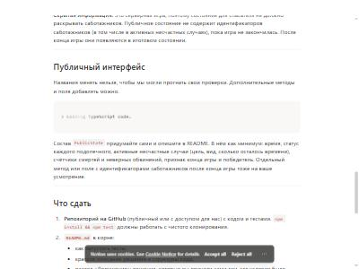
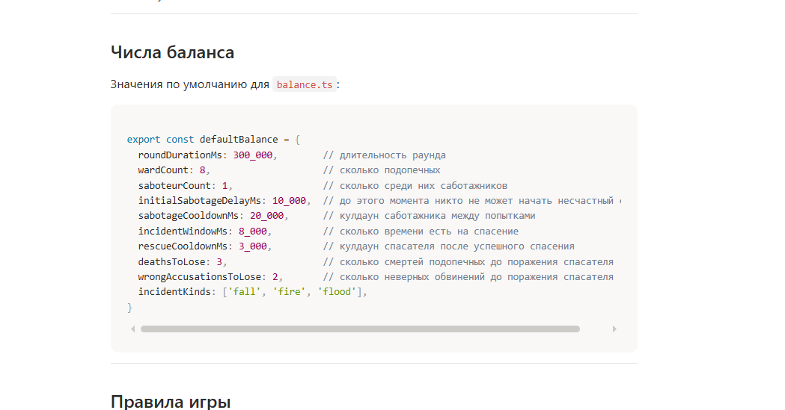

# История работы с агентом

Полная история диалога с Claude Code (приложение Claude для Windows, вкладка Code), модель Claude Opus 5.5.
Файл собран скриптом из журнала сессии (`.jsonl`), в хронологическом порядке, без выборки.

- **Включено:** все сообщения пользователя (включая вставленный текст и скриншот), все ответы агента, все вызовы инструментов и их результаты.
- **Сокращено:** длинные результаты инструментов (до 2500 символов) и содержимое файлов в вызовах Write/Edit (до 600 символов) — итоговые файлы лежат в репозитории.
- **Не включено:** системный промпт и служебные вставки среды (`<system-reminder>`: настройки приложения и правила другого проекта пользователя), а также скрытые внутренние рассуждения модели.
- **Обезличено:** домашняя папка в путях заменена на `~`, имя пользователя — на `<пользователь>`, название другого проекта пользователя — на «другой проект». Время — московское.

Сессия началась в папке другого проекта пользователя: задание пришло туда, а для этой работы агент создал отдельную папку `~/Desktop/rescuer-game`.

---

## 👤 Пользователь · 07.11.2026, 19:34:03

https://fork-mayflower-b1f.notion.site/4003736040848115b809c4995b205400 видишь задание ?

## 🤖 Агент · 07.11.2026, 19:34:10

**🔧 Skill**

```
{
  "skill": "anthropic-skills:built-in-browser"
}
```

<details><summary>Результат</summary>

```
Launching skill: anthropic-skills:built-in-browser
```

</details>

> _Служебное сообщение среды: загружены инструкции навыка (скила) среды_

## 🤖 Агент · 07.11.2026, 19:34:12

**🔧 mcp__Claude_Browser__preview_start**

```
{
  "url": "https://fork-mayflower-b1f.notion.site/4003736040848115b809c4995b205400"
}
```

<details><summary>Результат</summary>

```
{
  "serverId": "preview-local_ce0cfb88-e585-4147-92a6-2fa3d51ab625",
  "tabId": "seed",
  "reused": false,
  "type": "browser",
  "navOk": true
}
Browser pane opened. Use serverId "preview-local_ce0cfb88-e585-4147-92a6-2fa3d51ab625" with read_page / computer / navigate.
```

</details>

**🔧 mcp__Claude_Browser__get_page_text**

```
{}
```

<details><summary>Результат</summary>

```
Title: Notion
URL: https://fork-mayflower-b1f.notion.site/4003736040848115b809c4995b205400
Source element: <body>
---


Tab Context:
- Executed on tabId: seed
- Available tabs:
  • tabId seed: "Notion" ("https://fork-mayflower-b1f.notion.site/4003736040848115b809c4995b205400")
```

</details>

**🔧 mcp__Claude_Browser__computer**

```
{
  "action": "wait",
  "duration": 3
}
```

**🔧 mcp__Claude_Browser__get_page_text**

```
{}
```

<details><summary>Результат</summary>

```
waited 3s


Tab Context:
- Executed on tabId: seed
- Available tabs:
  • tabId seed: "Тестовое задание" ("https://fork-mayflower-b1f.notion.site/4003736040848115b809c4995b205400")
```

</details>

<details><summary>Результат</summary>

```
Title: Тестовое задание
URL: https://fork-mayflower-b1f.notion.site/4003736040848115b809c4995b205400
Source element: <main>
---
Тестовое задание
Задача
Напишите на TypeScript «мозг» простой асимметричной игры: класс Game с чистой игровой логикой. Без сети, без графики, без Colyseus.
Идея игры. Один игрок-спасатель присматривает за подопечными. Среди подопечных прячутся саботажники: они выглядят так же, как остальные, и устраивают несчастные случаи. У спасателя есть несколько секунд, чтобы успеть помочь, и он должен вычислить, кто из подопечных саботажник.
Время: ориентировочно 2 часа. Срок сдачи: 3 дня с момента, когда вам отправили эту ссылку.
Вопросов задавать не нужно. Если что-то в условии кажется неоднозначным, примите решение сами и запишите его в README в разделе «Допущения».
Как делать
TypeScript в строгом режиме (strict: true), Node.js 20+.
Тесты на Vitest. Команда npm test должна запускать все тесты и проходить.
Из зависимостей только typescript, vitest и, если нужно, tsx.
В коде игры нельзя использовать Date.now, Math.random, setTimeout, setInterval. Время приходит снаружи через update(dtMs), случайные числа через генератор, который передают в конструктор.
Все числа баланса лежат в одном файле balance.ts. Никаких магических чисел в логике. Тесты должны уметь подставлять свой баланс.
Использовать AI-агентов (Claude Code и любые другие) можно и нужно. Подробности про сдачу ниже.
Числа баланса
Значения по умолчанию для balance.ts:
> Loading TypeScript code…
​


Tab Context:
- Executed on tabId: seed
- Available tabs:
  • tabId seed: "Тестовое задание" ("https://fork-mayflower-b1f.notion.site/4003736040848115b809c4995b205400")
```

</details>

**🔧 mcp__Claude_Browser__computer**

```
{
  "action": "wait",
  "duration": 4
}
```

**🔧 mcp__Claude_Browser__get_page_text**

```
{}
```

<details><summary>Результат</summary>

```
waited 4s


Tab Context:
- Executed on tabId: seed
- Available tabs:
  • tabId seed: "Тестовое задание" ("https://fork-mayflower-b1f.notion.site/4003736040848115b809c4995b205400")
```

</details>

<details><summary>Результат</summary>

```
Title: Тестовое задание
URL: https://fork-mayflower-b1f.notion.site/4003736040848115b809c4995b205400
Source element: <main>
---
Тестовое задание
Задача
Напишите на TypeScript «мозг» простой асимметричной игры: класс Game с чистой игровой логикой. Без сети, без графики, без Colyseus.
Идея игры. Один игрок-спасатель присматривает за подопечными. Среди подопечных прячутся саботажники: они выглядят так же, как остальные, и устраивают несчастные случаи. У спасателя есть несколько секунд, чтобы успеть помочь, и он должен вычислить, кто из подопечных саботажник.
Время: ориентировочно 2 часа. Срок сдачи: 3 дня с момента, когда вам отправили эту ссылку.
Вопросов задавать не нужно. Если что-то в условии кажется неоднозначным, примите решение сами и запишите его в README в разделе «Допущения».
Как делать
TypeScript в строгом режиме (strict: true), Node.js 20+.
Тесты на Vitest. Команда npm test должна запускать все тесты и проходить.
Из зависимостей только typescript, vitest и, если нужно, tsx.
В коде игры нельзя использовать Date.now, Math.random, setTimeout, setInterval. Время приходит снаружи через update(dtMs), случайные числа через генератор, который передают в конструктор.
Все числа баланса лежат в одном файле balance.ts. Никаких магических чисел в логике. Тесты должны уметь подставлять свой баланс.
Использовать AI-агентов (Claude Code и любые другие) можно и нужно. Подробности про сдачу ниже.
Числа баланса
Значения по умолчанию для balance.ts:
> Loading TypeScript code…
​


Tab Context:
- Executed on tabId: seed
- Available tabs:
  • tabId seed: "Тестовое задание" ("https://fork-mayflower-b1f.notion.site/4003736040848115b809c4995b205400")
```

</details>

**🔧 mcp__Claude_Browser__javascript_tool**

```
{
  "action": "javascript_exec",
  "text": "const sc = document.querySelector('.notion-frame .notion-scroller') || document.scrollingElement; for (let i=0;i<30;i++){ sc.scrollTop += 800; await new Promise(r=>setTimeout(r,300)); } sc.scrollHeight"
}
```

<details><summary>Результат</summary>

```
4295

(captured at origin https://fork-mayflower-b1f.notion.site)


Tab Context:
- Executed on tabId: seed
- Available tabs:
  • tabId seed: "Тестовое задание" ("https://fork-mayflower-b1f.notion.site/4003736040848115b809c4995b205400")
```

</details>

**🔧 mcp__Claude_Browser__get_page_text**

```
{}
```

<details><summary>Результат</summary>

```
Title: Тестовое задание
URL: https://fork-mayflower-b1f.notion.site/4003736040848115b809c4995b205400
Source element: <main>
---
Тестовое задание
Скрытая информация. Это серверная игра, поэтому состояние для спасателя не должно раскрывать саботажников. Публичное состояние не содержит идентификаторов саботажников (в том числе в активных несчастных случаях), пока игра не закончилась. После конца игры они появляются в итоговом состоянии.
Публичный интерфейс
Названия менять нельзя, чтобы мы могли прогнать свои проверки. Дополнительные методы и поля добавлять можно.
​
Состав PublicState придумайте сами и опишите в README. В нём как минимум: время, статус каждого подопечного, активные несчастные случаи (цель, вид, сколько осталось времени), счётчики смертей и неверных обвинений, признак конца игры и победитель. Отдельный метод или поле с идентификаторами саботажников после конца игры тоже на ваше усмотрение.
Что сдать
Репозиторий на GitHub (публичный или с доступом для нас) с кодом и тестами. npm install && npm test должны работать с чистого клонирования.
README.md в корне:
как запустить тесты;
краткое описание решения и структуры кода;
раздел «Допущения»: решения, которые вы приняли сами там, где условие было неоднозначным;
раздел «Работа с агентом»: какой агент и модель использовались, что вы поручали агенту, что проверяли и правили сами, где агент ошибся.
PROMPTS.md (или папка prompts/) с историей промптов: экспорт диалога, лог сессии или скриншоты, на ваш выбор. Нужна полная история, не выборка.
Как отправить результат. Пришлите ссылку на репозиторий в личные сообщения HR, с которым вы созванивались. Срок: 3 дня с момента, когда вам отправили ссылку на это задание.
На что мы смотрим
Тесты: проверяют ли они поведение игры, а не просто «что-то вернулось», есть ли проверки границ времени и порядка событий.
Детерминизм: игру можно прогнать с одним и тем же генератором и получить один и тот же результат.
Аккуратная архитектура: логика отделена от всего остального, числа баланса лежат в одном месте.
Скрытая информация: публичное состояние не выдаёт саботажников.
Честность и осознанность: README с допущениями и история работы с агентом показывают, что вы понимаете, что сделал агент, и проверили результат.


Tab Context:
- Executed on tabId: seed
- Available tabs:
  • tabId seed: "Тестовое задание" ("https://fork-mayflower-b1f.notion.site/4003736040848115b809c4995b205400")
```

</details>

**🔧 mcp__Claude_Browser__javascript_tool**

```
{
  "action": "javascript_exec",
  "text": "const sc = document.querySelector('.notion-frame .notion-scroller') || document.scrollingElement; sc.scrollTop = 0; await new Promise(r=>setTimeout(r,1500)); const seen = new Map(); for (let i=0;i<40;i++){ document.querySelectorAll('[data-block-id]').forEach(el=>{ if(!el.querySelector('[data-block-id]')){ const t=el.innerText; if(t && t.trim() && !t.includes('Loading TypeScript')) seen.set(el.getAttribute('data-block-id'), t);} }); sc.scrollTop += 300; await new Promise(r=>setTimeout(r,500)); } const order=[...document.querySelectorAll('[data-block-id]')].map(e=>e.getAttribute('data-block-id')); [...seen.entries()].sort((a,b)=>order.indexOf(a[0])-order.indexOf(b[0])).map(e=>e[1]).join('\\n---\\n')"
}
```

<details><summary>Результат</summary>

```
"Задача\n---\nНапишите на TypeScript «мозг» простой асимметричной игры: класс Game с чистой игровой логикой. Без сети, без графики, без Colyseus.\n---\nИдея игры. Один игрок-спасатель присматривает за подопечными. Среди подопечных прячутся саботажники: они выглядят так же, как остальные, и устраивают несчастные случаи. У спасателя есть несколько секунд, чтобы успеть помочь, и он должен вычислить, кто из подопечных саботажник.\n---\nВремя: ориентировочно 2 часа. Срок сдачи: 3 дня с момента, когда вам отправили эту ссылку.\n---\nВопросов задавать не нужно. Если что-то в условии кажется неоднозначным, примите решение сами и запишите его в README в разделе «Допущения».\n---\nКак делать\n---\nTypeScript в строгом режиме (strict: true), Node.js 20+.\n---\nТесты на Vitest. Команда npm test должна запускать все тесты и проходить.\n---\nИз зависимостей только typescript, vitest и, если нужно, tsx.\n---\nВ коде игры нельзя использовать Date.now, Math.random, setTimeout, setInterval. Время приходит снаружи через update(dtMs), случайные числа через генератор, который передают в конструктор.\n---\nВсе числа баланса лежат в одном файле balance.ts. Никаких магических чисел в логике. Тесты должны уметь подставлять свой баланс.\n---\nИспользовать AI-агентов (Claude Code и любые другие) можно и нужно. Подробности про сдачу ниже.\n---\nЧисла баланса\n---\nЗначения по умолчанию для balance.ts:\n---\n​\n---\nПравила игры\n---\nУчастники. Подопечные имеют идентификаторы w1, w2, … wN. Часть из них (saboteurCount) саботажники. При создании игры они выбираются случайно через переданный генератор. Саботажник такой же подопечный: у него тоже есть идентификатор вида wN.\n---\nСтатусы подопечного: alive (жив), dead (погиб), caught (разоблачён как саботажник).\n---\nВремя. Игра живёт в миллисекундах. game.time равно сумме всех переданных в update значений dtMs. Раунд начинается в момент 0.\n---\nНесчастный случай (startIncident(saboteurId, wardId)):\n---\nЕго начинает саботажник против подопечного, который не является саботажником.\n---\nДо initialSabotageDelayMs начинать нельзя.\n---\nПосле начала у этого саботажника кулдаун sabotageCooldownMs, он считается от момента начала.\n---\nЦель должна быть alive, и на ней не должно быть другого активного несчастного случая.\n---\nВид несчастного случая выбирается случайно из incidentKinds через генератор.\n---\nУ цели есть incidentWindowMs на спасение. Если спасение не случилось, цель погибает ровно в момент начало + incidentWindowMs.\n---\nС
… [обрезано: ещё 4019 символов]
```

</details>

**🔧 mcp__Claude_Browser__javascript_tool**

```
{
  "action": "javascript_exec",
  "text": "const blocks=[...document.querySelectorAll('.notion-code-block')]; const out=[]; for (const b of blocks){ b.scrollIntoView({block:'center'}); await new Promise(r=>setTimeout(r,2500)); out.push(b.innerText); } JSON.stringify({n:blocks.length, out})"
}
```

<details><summary>Результат</summary>

```
"{\"n\":1,\"out\":[\"​\"]}"

(captured at origin https://fork-mayflower-b1f.notion.site)


Tab Context:
- Executed on tabId: seed
- Available tabs:
  • tabId seed: "Тестовое задание" ("https://fork-mayflower-b1f.notion.site/4003736040848115b809c4995b205400")
```

</details>

**🔧 mcp__Claude_Browser__javascript_tool**

```
{
  "action": "javascript_exec",
  "text": "const b=document.querySelector('.notion-code-block'); b.scrollIntoView({block:'center'}); await new Promise(r=>setTimeout(r,3000)); const all=[...document.querySelectorAll('.notion-code-block, [class*=\"code\"]')].slice(0,10).map(e=>({cls:e.className, txt:e.innerText.slice(0,200), html:e.outerHTML.slice(0,400)})); JSON.stringify(all)"
}
```

<details><summary>Результат</summary>

```
"[{\"cls\":\"notion-inline-code-container\",\"txt\":\"accuse(wardId)\",\"html\":\"<div class=\\\"notion-inline-code-container\\\" style=\\\"display:inline\\\"><span style=\\\"font-family:&quot;SFMono-Regular&quot;, Menlo, Consolas, &quot;PT Mono&quot;, &quot;Liberation Mono&quot;, Courier, monospace;line-height:normal;background:var(--ca-bacIntTra);color:var(--c-redTexSec);border-radius:4px;font-size:85%;padding:0.2em 0.4em;position:relative;bottom:0.065em\\\" data-token-index=\\\"2\\\" spellcheck=\\\"fa\"},{\"cls\":\"notion-inline-code-container\",\"txt\":\"alive\",\"html\":\"<div class=\\\"notion-inline-code-container\\\" style=\\\"display:inline\\\"><span style=\\\"font-family:&quot;SFMono-Regular&quot;, Menlo, Consolas, &quot;PT Mono&quot;, &quot;Liberation Mono&quot;, Courier, monospace;line-height:normal;background:var(--ca-bacIntTra);color:var(--c-redTexSec);border-radius:4px;font-size:85%;padding:0.2em 0.4em;position:relative;bottom:0.065em\\\" data-token-index=\\\"1\\\" spellcheck=\\\"fa\"},{\"cls\":\"notion-inline-code-container\",\"txt\":\"caught\",\"html\":\"<div class=\\\"notion-inline-code-container\\\" style=\\\"display:inline\\\"><span style=\\\"font-family:&quot;SFMono-Regular&quot;, Menlo, Consolas, &quot;PT Mono&quot;, &quot;Liberation Mono&quot;, Courier, monospace;line-height:normal;background:var(--ca-bacIntTra);color:var(--c-redTexSec);border-radius:4px;font-size:85%;padding:0.2em 0.4em;position:relative;bottom:0.065em\\\" data-token-index=\\\"1\\\" spellcheck=\\\"fa\"},{\"cls\":\"notion-inline-code-container\",\"txt\":\"wrongAccusationsToLose\",\"html\":\"<div class=\\\"notion-inline-code-container\\\" style=\\\"display:inline\\\"><span style=\\\"font-family:&quot;SFMono-Regular&quot;, Menlo, Consolas, &quot;PT Mono&quot;, &quot;Liberation Mono&quot;, Courier, monospace;line-height:normal;background:var(--ca-bacIntTra);color:var(--c-redTexSec);border-radius:4px;font-size:85%;padding:0.2em 0.4em;position:relative;bottom:0.065em\\\" data-token-index=\\\"1\\\" spellcheck=\\\"fa\"},{\"cls\":\"notion-inline-code-container\",\"txt\":\"deathsToLose\",\"html\":\"<div class=\\\"notion-inline-code-container\\\" style=\\\"display:inline\\\"><span style=\\\"font-family:&quot;SFMono-Regular&quot;, Menlo, Consolas, &quot;PT Mono&quot;, &quot;Liberation Mono&quot;, Courier, monospace;line-height:normal;background:var(--ca-bacIntTra);color:var(--c-redTexSec);border-radius:4px;font-size:85%;padding:0.2em 0.4em;position:relative;bottom:0.065em\\\" da
… [обрезано: ещё 2829 символов]
```

</details>

Блоки кода на странице не отрисовываются — возьму их текст напрямую из данных страницы Notion.

**🔧 mcp__Claude_Browser__javascript_tool**

```
{
  "action": "javascript_exec",
  "text": "const id='40037360-4084-8115-b809-c4995b205400'; const r=await fetch('/api/v3/loadCachedPageChunkV2',{method:'POST',headers:{'content-type':'application/json'},body:JSON.stringify({page:{id},limit:200,cursor:{stack:[]},verticalColumns:false})}).catch(e=>null); let j = r && r.ok ? await r.json() : null; if(!j){ const r2=await fetch('/api/v3/loadPageChunk',{method:'POST',headers:{'content-type':'application/json'},body:JSON.stringify({pageId:id,limit:200,cursor:{stack:[]},chunkNumber:0,verticalColumns:false})}); j=await r2.json(); } const blocks=j.recordMap.block; const codes=Object.values(blocks).map(b=>b.value && (b.value.value||b.value)).filter(v=>v && v.type==='code').map(v=>({lang:v.properties.language, text:v.properties.title.map(x=>x[0]).join('')})); JSON.stringify(codes)"
}
```

<details><summary>Результат (ошибка)</summary>

```
javascript_tool failed: SyntaxError: Unexpected token '<', "<!DOCTYPE "... is not valid JSON
```

</details>

**🔧 mcp__Claude_Browser__javascript_tool**

```
{
  "action": "javascript_exec",
  "text": "const id='40037360-4084-8115-b809-c4995b205400'; const res={}; for (const [path,body] of [['/api/v3/loadPageChunk',{pageId:id,limit:200,cursor:{stack:[]},chunkNumber:0,verticalColumns:false}],['/api/v3/loadCachedPageChunk',{pageId:id,limit:200,cursor:{stack:[]},chunkNumber:0,verticalColumns:false}],['/api/v3/syncRecordValues',{requests:[{pointer:{table:'block',id},version:-1}]}]]){ try{ const r=await fetch(path,{method:'POST',headers:{'content-type':'application/json'},body:JSON.stringify(body)}); const t=await r.text(); res[path]=r.status+' '+t.slice(0,150);}catch(e){res[path]='ERR '+e} } JSON.stringify(res)"
}
```

<details><summary>Результат</summary>

```
"{\"/api/v3/loadPageChunk\":\"429 <!DOCTYPE html>\\n<html>\\n\\t<head>\\n\\t\\t<meta charset=\\\"utf-8\\\" />\\n\\t\\t<title>Notion</title>\\n\\t\\t<style type=\\\"text/css\\\">*{box-sizing:border-box}html{margin:0;paddi\",\"/api/v3/loadCachedPageChunk\":\"429 <!DOCTYPE html>\\n<html>\\n\\t<head>\\n\\t\\t<meta charset=\\\"utf-8\\\" />\\n\\t\\t<title>Notion</title>\\n\\t\\t<style type=\\\"text/css\\\">*{box-sizing:border-box}html{margin:0;paddi\",\"/api/v3/syncRecordValues\":\"403 <!DOCTYPE html>\\n<!--[if lt IE 7]> <html class=\\\"no-js ie6 oldie\\\" lang=\\\"en-US\\\"> <![endif]-->\\n<!--[if IE 7]>    <html class=\\\"no-js ie7 oldie\\\" lang=\\\"en-US\"}"

(captured at origin https://fork-mayflower-b1f.notion.site)


Tab Context:
- Executed on tabId: seed
- Available tabs:
  • tabId seed: "Тестовое задание" ("https://fork-mayflower-b1f.notion.site/4003736040848115b809c4995b205400")
```

</details>

**🔧 mcp__Claude_Browser__read_network_requests**

```
{
  "urlPattern": "api/v3",
  "limit": 30
}
```

<details><summary>Результат</summary>

```
[16144.1199] POST https://fork-mayflower-b1f.notion.site/api/v3/ping → 200 
[16144.1305] POST https://fork-mayflower-b1f.notion.site/api/v3/ping → 200 
[16144.1335] POST https://fork-mayflower-b1f.notion.site/api/v3/ping → 200 
[16144.1411] POST https://fork-mayflower-b1f.notion.site/api/v3/ping → 200 
[16144.1412] POST https://fork-mayflower-b1f.notion.site/api/v3/ping → 200 
[16144.1413] POST https://fork-mayflower-b1f.notion.site/api/v3/ping → 200 
[16144.1518] POST https://fork-mayflower-b1f.notion.site/api/v3/ping → 200 
[16144.1519] POST https://fork-mayflower-b1f.notion.site/api/v3/ping → 429 
[16144.1520] POST https://fork-mayflower-b1f.notion.site/api/v3/getAssetsJsonV2 → 200 
[16144.1521] POST https://fork-mayflower-b1f.notion.site/api/v3/ping → 200 
[16144.1522] POST https://fork-mayflower-b1f.notion.site/api/v3/getPublicPageData → 200 
[16144.1525] POST https://fork-mayflower-b1f.notion.site/api/v3/ping → 200 
[16144.1528] POST https://fork-mayflower-b1f.notion.site/api/v3/loadCachedPageChunkV2 → 429 
[16144.1529] POST https://fork-mayflower-b1f.notion.site/api/v3/loadPageChunk → 429 
[16144.1530] POST https://fork-mayflower-b1f.notion.site/api/v3/ping → 200 
[16144.1532] POST https://fork-mayflower-b1f.notion.site/api/v3/ping → 200 
[16144.1533] POST https://fork-mayflower-b1f.notion.site/api/v3/loadPageChunk → 429 
[16144.1534] POST https://fork-mayflower-b1f.notion.site/api/v3/loadCachedPageChunk → 429 
[16144.1541] POST https://fork-mayflower-b1f.notion.site/api/v3/syncRecordValues → 403 

(1092 earlier requests were dropped unread before this call — the tab only buffers the most recent ones.)


Tab Context:
- Executed on tabId: seed
- Available tabs:
  • tabId seed: "Тестовое задание" ("https://fork-mayflower-b1f.notion.site/4003736040848115b809c4995b205400")
```

</details>

**🔧 mcp__Claude_Browser__javascript_tool**

```
{
  "action": "javascript_exec",
  "text": "const b=document.querySelector('.notion-code-block'); b ? b.outerHTML.length + ' ' + b.outerHTML.slice(0,3000) : 'none'"
}
```

<details><summary>Результат</summary>

```
"650 <div data-block-id=\"54117ae8-af8b-446b-b0e8-d15019bece61\" dir=\"auto\" class=\"notion-selectable notion-code-block\" style=\"width: 100%; max-width: 817px; padding-top: 8px; padding-bottom: 8px; padding-inline: 8px;\"><div style=\"display: flex;\"><div contenteditable=\"false\" data-content-editable-void=\"true\" role=\"figure\" aria-labelledby=\":r3o:\" style=\"flex-grow: 1; text-align: start; position: relative; min-width: 0px; width: 100%; border-radius: 10px;\"><div style=\"background: var(--ca-graBacPriTra); border-radius: 10px;\"><div style=\"padding: 24px 22px;\"></div></div></div>​<div style=\"position: relative; inset-inline-start: 0px;\"></div></div></div>"

(captured at origin https://fork-mayflower-b1f.notion.site)


Tab Context:
- Executed on tabId: seed
- Available tabs:
  • tabId seed: "Тестовое задание" ("https://fork-mayflower-b1f.notion.site/4003736040848115b809c4995b205400")
```

</details>

**🔧 mcp__Claude_Browser__navigate**

```
{
  "url": "https://fork-mayflower-b1f.notion.site/4003736040848115b809c4995b205400"
}
```

**🔧 mcp__Claude_Browser__computer**

```
{
  "action": "wait",
  "duration": 6
}
```

<details><summary>Результат</summary>

```
navigated to https://fork-mayflower-b1f.notion.site/4003736040848115b809c4995b205400


Tab Context:
- Executed on tabId: seed
- Available tabs:
  • tabId seed: "Notion" ("https://fork-mayflower-b1f.notion.site/4003736040848115b809c4995b205400")
```

</details>

<details><summary>Результат</summary>

```
waited 6s


Tab Context:
- Executed on tabId: seed
- Available tabs:
  • tabId seed: "Notion" ("https://fork-mayflower-b1f.notion.site/4003736040848115b809c4995b205400")
```

</details>

**🔧 mcp__Claude_Browser__javascript_tool**

```
{
  "action": "javascript_exec",
  "text": "await new Promise(r=>setTimeout(r,3000)); const bs=[...document.querySelectorAll('.notion-code-block')]; const out=[]; for(const b of bs){ b.scrollIntoView({block:'center'}); await new Promise(r=>setTimeout(r,4000)); out.push(b.innerText); } JSON.stringify({title:document.title, n:bs.length, out})"
}
```

<details><summary>Результат</summary>

```
"{\"title\":\"Notion\",\"n\":0,\"out\":[]}"

(captured at origin https://fork-mayflower-b1f.notion.site)


Tab Context:
- Executed on tabId: seed
- Available tabs:
  • tabId seed: "Notion" ("https://fork-mayflower-b1f.notion.site/4003736040848115b809c4995b205400")
```

</details>

**🔧 mcp__Claude_Browser__computer**

```
{
  "action": "screenshot",
  "scale": 0.5
}
```

<details><summary>Результат</summary>

```
[Image: source: ~\.claude\projects\<папка-проекта>\1de2b26a-5050-473c-a269-223ff69d546d\tool-results\mcp-Claude_Browser-blob-1794069371962-a3whiw.jpg]
Screenshot size: 400x300 0.5-scale view; coordinate frame: 800x600.


Tab Context:
- Executed on tabId: seed
- Available tabs:
  • tabId seed: "Тестовое задание" ("https://fork-mayflower-b1f.notion.site/4003736040848115b809c4995b205400")
```

</details>


**🔧 mcp__Claude_Browser__computer**

```
{
  "action": "wait",
  "duration": 10
}
```

**🔧 mcp__Claude_Browser__javascript_tool**

```
{
  "action": "javascript_exec",
  "text": "JSON.stringify([...document.querySelectorAll('.notion-code-block')].map(b=>b.innerText))"
}
```

<details><summary>Результат</summary>

```
waited 10s


Tab Context:
- Executed on tabId: seed
- Available tabs:
  • tabId seed: "Тестовое задание" ("https://fork-mayflower-b1f.notion.site/4003736040848115b809c4995b205400")
```

</details>

<details><summary>Результат</summary>

```
"[\"​\"]"

(captured at origin https://fork-mayflower-b1f.notion.site)


Tab Context:
- Executed on tabId: seed
- Available tabs:
  • tabId seed: "Тестовое задание" ("https://fork-mayflower-b1f.notion.site/4003736040848115b809c4995b205400")
```

</details>

**🔧 mcp__Claude_Browser__read_console_messages**

```
{
  "onlyErrors": true,
  "limit": 15
}
```

<details><summary>Результат</summary>

```
[error] Failed to load resource: the server responded with a status of 429 ()
[error] Refused to execute script from 'https://fork-mayflower-b1f.notion.site/_assets/85553-309a6f940ca640e4.js' because its MIME type ('text/html') is not executable, and strict MIME type checking is enabled.
[error] Resource Sentinel noted a failed resource load of type script https://fork-mayflower-b1f.notion.site/_assets/85553-309a6f940ca640e4.js
[error] Failed to load resource: the server responded with a status of 429 ()
[error] Refused to execute script from 'https://fork-mayflower-b1f.notion.site/_assets/publicTopbarShareButton-d172e042df3c8a53.js' because its MIME type ('text/html') is not executable, and strict MIME type checking is enabled.
[error] Resource Sentinel noted a failed resource load of type script https://fork-mayflower-b1f.notion.site/_assets/publicTopbarShareButton-d172e042df3c8a53.js
[error] Failed to load resource: the server responded with a status of 429 ()
[error] Refused to execute script from 'https://fork-mayflower-b1f.notion.site/_assets/28778-ed1293cbd973327e.js' because its MIME type ('text/html') is not executable, and strict MIME type checking is enabled.
[error] Resource Sentinel noted a failed resource load of type script https://fork-mayflower-b1f.notion.site/_assets/28778-ed1293cbd973327e.js
[error] Connecting to 'https://exp.notion.com/v1/rgstr?k=REDACTED&st=javascript-client&sv=3.17.1&t=1794069381553&sid=REDACTED&ec=77&gz=1' violates the following Content Security Policy directive: "connect-src 'self' data: blob: https://img.notionusercontent.com https://artifact.notionusercontent.com https://*.artifact.notionusercontent.com https://notion.so/eap https://cdn.amplitude.com https://api.amplitude.com https://www.notion.so https://app.notion.com notion://app.notion.com https://app.prod.notion.com https://app.canary.notion.com https://api.embed.ly https://dev-embed.notion.co https://embed.notion.co https://ekr.zdassets.com https://ekr.zendesk.com	 https://makenotion.zendesk.com	 https://api.smooch.io	 wss://api.smooch.io	 https://http-inputs-notion.splunkcloud.com https://*.sentry.io https://checkout.stripe.com https://js.stripe.com https://m.stripe.com https://library.notion.com https://d8ejoa1fys2rk.cloudfront.net https://cdn.contentful.com https://preview.contentful.com https://images.ctfassets.net https://tracking.chilipiper.com https://api.chilipiper.com https://api.unsplash.com https://api.giphy.com/ https://giphy-analytics.giphy.com/
… [обрезано: ещё 6034 символов]
```

</details>

**🔧 mcp__Claude_Browser__javascript_tool**

```
{
  "action": "javascript_exec",
  "text": "const found=[]; const seen=new WeakSet(); function scan(o,depth){ if(!o||typeof o!=='object'||depth>6||seen.has(o)) return; seen.add(o); if(o.type==='code' && o.properties && o.properties.title){ found.push({lang:o.properties.language, text:o.properties.title.map(x=>x[0]).join('')}); return;} for(const k of Object.keys(o)){ if(k==='_owner'||k==='return'||k==='child'||k==='sibling') continue; try{ scan(o[k],depth+1);}catch(e){} } } for(const el of document.querySelectorAll('.notion-code-block')){ let fk=Object.keys(el).find(k=>k.startsWith('__reactFiber')); let f=el[fk]; for(let i=0;f&&i<40;i++,f=f.return){ scan(f.memoizedProps,0); scan(f.memoizedState,0); } } JSON.stringify(found.slice(0,5))"
}
```

<details><summary>Результат</summary>

```
"[]"

(captured at origin https://fork-mayflower-b1f.notion.site)


Tab Context:
- Executed on tabId: seed
- Available tabs:
  • tabId seed: "Тестовое задание" ("https://fork-mayflower-b1f.notion.site/4003736040848115b809c4995b205400")
```

</details>

**🔧 mcp__Claude_Browser__javascript_tool**

```
{
  "action": "javascript_exec",
  "text": "const dbs = indexedDB.databases ? await indexedDB.databases() : []; const res=[]; for (const d of dbs){ const db = await new Promise((ok,err)=>{const r=indexedDB.open(d.name); r.onsuccess=()=>ok(r.result); r.onerror=()=>err(r.error);}); for (const s of db.objectStoreNames){ const tx=db.transaction(s,'readonly'); const all=await new Promise(ok=>{const r=tx.objectStore(s).getAll(); r.onsuccess=()=>ok(r.result); r.onerror=()=>ok([]);}); for(const v of all){ const str=JSON.stringify(v); if(str && str.includes('saboteurCount')) res.push({db:d.name,store:s,snip:str.slice(0,200)}); } } } JSON.stringify({dbs:dbs.map(d=>d.name), res:res.slice(0,5)})"
}
```

<details><summary>Результат</summary>

```
"{\"dbs\":[\"TransactionStore\",\"statsigStore\"],\"res\":[]}"

(captured at origin https://fork-mayflower-b1f.notion.site)


Tab Context:
- Executed on tabId: seed
- Available tabs:
  • tabId seed: "Тестовое задание" ("https://fork-mayflower-b1f.notion.site/4003736040848115b809c4995b205400")
```

</details>

**🔧 mcp__Claude_Browser__browser_batch**

```
{
  "actions": [
    {
      "name": "computer",
      "input": {
        "action": "wait",
        "duration": 10
      }
    },
    {
      "name": "computer",
      "input": {
        "action": "wait",
        "duration": 10
      }
    },
    {
      "name": "computer",
      "input": {
        "action": "wait",
        "duration": 10
      }
    },
    {
      "name": "computer",
      "input": {
        "action": "wait",
        "duration": 10
      }
    },
    {
      "name": "navigate",
      "input": {
        "url": "https://fork-mayflower-b1f.notion.site/4003736040848115b809c4995b205400"
      }
    },
    {
      "name": "computer",
      "input": {
        "action": "wait",
        "duration": 8
      }
    }
  ]
}
```

<details><summary>Результат</summary>

```
MCP tool "Claude Browser/browser_batch" was moved to the background as task kaxeu8gg6 so that a message that arrived while it was running can reach you; it was not interrupted and keeps running; you'll receive a notification with the result when it completes. You can keep working in the meantime. To stop it, use TaskStop with task_id "kaxeu8gg6". Note: it does not survive exiting this session.
```

</details>

## 👤 Пользователь · 07.11.2026, 19:37:33 _(отправлено, пока агент работал)_


type Rng = () => number; // возвращает число в диапазоне [0, 1)

type FailReason =
  | 'game_over'
  | 'unknown_ward'
  | 'not_saboteur'
  | 'too_early'
  | 'sabotage_cooldown'
  | 'ward_not_alive'
  | 'incident_already_active'
  | 'no_active_incident'
  | 'rescue_cooldown'
  | 'already_accused';

type Result = { ok: true } | { ok: false; reason: FailReason };

type GameEvent =
  | { type: 'incident_started'; t: number; wardId: string; kind: string }
  | { type: 'incident_rescued'; t: number; wardId: string }
  | { type: 'incident_cancelled'; t: number; wardId: string }
  | { type: 'ward_died'; t: number; wardId: string }
  | { type: 'saboteur_caught'; t: number; wardId: string }
  | { type: 'wrong_accusation'; t: number; wardId: string }
  | {
      type: 'game_over';
      t: number;
      winner: 'rescuer' | 'saboteurs';
      reason: 'saboteur_caught' | 'too_many_deaths' | 'too_many_wrong_accusations' | 'time_up';
    };

class Game {
  constructor(opts: { balance?: Partial<Balance>; rng: Rng });

  readonly time: number;

  update(dtMs: number): void;

  startIncident(saboteurId: string, wardId: string): Result;
  rescue(wardId: string): Result;
  accuse(wardId: string): Result;

  getPublicState(): PublicState;   // без саботажников, пока игра идёт
  drainEvents(): GameEvent[];     // отдаёт накопленные события и очищает список
}

## 🤖 Агент · 07.11.2026, 19:37:59

**🔧 PowerShell**

_Check Node, npm and GitHub CLI versions_

```
node -v; npm -v; try { gh --version | Select-Object -First 1 } catch { "gh: нет" }
```

<details><summary>Результат</summary>

```
node : The term 'node' is not recognized as the name of a cmdlet, function, script file, or operable program. Check the
 spelling of the name, or if a path was included, verify that the path is correct and try again.
At line:1 char:302
+ ... { $PSStyle.OutputRendering = 'PlainText' } catch {} } }; node -v; npm ...
+                                                              ~~~~
    + CategoryInfo          : ObjectNotFound: (node:String) [], CommandNotFoundException
    + FullyQualifiedErrorId : CommandNotFoundException
 
npm : The term 'npm' is not recognized as the name of a cmdlet, function, script file, or operable program. Check the s
pelling of the name, or if a path was included, verify that the path is correct and try again.
At line:1 char:311
+ ... le.OutputRendering = 'PlainText' } catch {} } }; node -v; npm -v; try ...
+                                                               ~~~
    + CategoryInfo          : ObjectNotFound: (npm:String) [], CommandNotFoundException
    + FullyQualifiedErrorId : CommandNotFoundException
 
gh: нет
```

</details>

> _Служебное сообщение среды: <task-notification>_

## 🤖 Агент · 07.11.2026, 19:38:03

**🔧 PowerShell**

_Look for a Node install outside PATH and for winget_

```
Test-Path "C:\Program Files\nodejs\node.exe"; Test-Path "$env:APPDATA\nvm"; (Get-Command winget -ErrorAction SilentlyContinue) -ne $null
```

<details><summary>Результат</summary>

```
False
False
True
```

</details>

**🔧 mcp__ccd_turn__wrap_up**

```
{
  "recap": "Задание прочитано целиком: два блока, которые Notion не загрузил, взяты из вашей вставки. Node.js на этом компьютере не установлен, GitHub CLI тоже нет. Ничего не создавал и не менял.",
  "ask": "Ставлю Node.js и начинаю задание в отдельной папке?",
  "actions": [
    {
      "label": "Да, начинай"
    },
    {
      "label": "Сначала обсудим"
    }
  ]
}
```

<details><summary>Результат</summary>

```
Shown in the next-step box. Your closing message is your answer to the user: write it now, in full, as the last thing you say this turn. The box asks your question, so do not ask it again.
```

</details>

Да, вижу, теперь целиком. Два блока кода (числа баланса и интерфейс `Game`) Notion у меня не загрузил из-за ограничения запросов (ошибка 429), их я взял из вашей вставки.

**Задание:** тестовое на TypeScript. Нужен класс `Game` с чистой логикой игры, где спасатель присматривает за подопечными и ищет саботажника. Без сети и графики.

- **Технологии:** строгий TypeScript, Node 20+, тесты на Vitest. Из зависимостей только `typescript`, `vitest` и, если нужно, `tsx`.
- **Время и случайность приходят снаружи.** В коде нельзя использовать `Date.now`, `Math.random` и таймеры. Время идёт через `update(dtMs)`, случайные числа — через генератор, который передают в конструктор.
- **Баланс в одном файле `balance.ts`.** Тесты должны уметь подставлять свои значения.
- **Самое сложное — большой шаг времени.** `update(60_000)` должен давать тот же итог, что 60 вызовов `update(1000)`. Значит, внутри одного шага события обрабатываются по порядку, каждое в свой точный момент. Если события совпали по времени, сначала смерти, потом конец раунда.
- **Скрытая информация.** Пока игра идёт, в публичном состоянии нет идентификаторов саботажников.
- **Что сдать:** репозиторий на GitHub, README с разделами «Допущения» и «Работа с агентом», и `PROMPTS.md` с полной историей промптов. Срок — 3 дня с момента, когда вам прислали ссылку.

**Что я уже вижу для раздела «Допущения»** (условие это не решает, решу сам и запишу):
- Можно ли начать несчастный случай ровно в момент окончания кулдауна или задержки. Я бы разрешил.
- Какой код отказа вернуть, если целью несчастного случая выбран другой саботажник: подходящего кода в списке нет.
- Что делать с отрицательным или нецелым `dtMs`.

**Прежде чем начинать:**
1. **На этом компьютере нет Node.js**, поэтому сейчас тесты не запустятся. Могу поставить его через `winget`, но только с вашего разрешения.
2. **Нужна отдельная папка**, а не репозиторий другого проекта. Иначе сдача смешается с другим проектом.
3. **История промптов.** Нужна полная, поэтому этот разговор тоже в неё войдёт. Его можно выгрузить, когда будем готовить `PROMPTS.md`.
4. **GitHub CLI (`gh`) тоже нет.** Репозиторий на GitHub проще создать вам через сайт, а я отправлю туда код.

## 👤 Пользователь · 07.11.2026, 19:39:35

Да, начинай

## 🤖 Агент · 07.11.2026, 19:39:46

**🔧 mcp__ccd_turn__update_plan**

```
{
  "items": [
    {
      "content": "Установить Node.js",
      "status": "in_progress"
    },
    {
      "content": "Создать отдельную папку проекта",
      "status": "pending"
    },
    {
      "content": "Написать balance.ts и логику Game",
      "status": "pending"
    },
    {
      "content": "Написать тесты на Vitest",
      "status": "pending"
    },
    {
      "content": "Прогнать тесты и проверить детерминизм",
      "status": "pending"
    },
    {
      "content": "Написать README и PROMPTS.md",
      "status": "pending"
    },
    {
      "content": "Сделать коммит в локальный git",
      "status": "pending"
    }
  ],
  "scope": "continuation"
}
```

<details><summary>Результат</summary>

```
Plan shown (7 steps).
```

</details>

**🔧 ToolSearch**

```
{
  "query": "select:mcp__ccd_directory__request_directory,mcp__ccd_directory__change_directory",
  "max_results": 2
}
```

<details><summary>Результат</summary>

```
(пусто)
```

</details>

Ставлю Node.js LTS через winget. Windows может показать окно «Разрешить изменения?», его нужно подтвердить.

**🔧 PowerShell**

_Install Node.js LTS via winget_

```
winget install --id OpenJS.NodeJS.LTS -e --accept-source-agreements --accept-package-agreements --silent
```

**🔧 PowerShell**

_Create the separate project folder on the Desktop_

```
New-Item -ItemType Directory -Force "~\Desktop\rescuer-game" | Select-Object -ExpandProperty FullName
```

<details><summary>Результат</summary>

```
Command running in background with ID: butbvbkvt. Output is being written to: ~\AppData\Local\Temp\claude\53e72e92ad00b898\1de2b26a-5050-473c-a269-223ff69d546d\tasks\butbvbkvt.output. You will be notified when it completes — do not poll that file or sleep while waiting. Read the file only if the user asks for progress, or if you need a line it prints before you can go on, such as a server's ready line or port.
```

</details>

<details><summary>Результат</summary>

```
~\Desktop\rescuer-game
```

</details>

**🔧 mcp__ccd_directory__request_directory**

```
{
  "path": "~\\Desktop\\rescuer-game"
}
```

<details><summary>Результат</summary>

```
Folder access granted: ~\Desktop\rescuer-game

Use this exact path with Read/Write/Edit/Grep/Glob.
```

</details>

Папка `Desktop\rescuer-game` готова, Node.js ставится в фоне. Пока он ставится, пишу баланс и логику игры.

**🔧 mcp__ccd_turn__update_plan**

```
{
  "done": [
    2
  ],
  "start": 3
}
```

<details><summary>Результат</summary>

```
Plan updated: steps 1, 3 of 7 are in progress; keep one and send {"done": [n]} for any you finished.
```

</details>

**🔧 Write**

```
{
  "file_path": "~\\Desktop\\rescuer-game\\src\\balance.ts",
  "content": "/**\n * Все числа баланса игры. Логика в game.ts берёт значения только отсюда.\n * Тесты и сервер подставляют свой баланс через `new Game({ balance: { ... } })`.\n */\nexport interface Balance {\n  /** Длительность раунда, мс. */\n  readonly roundDurationMs: number;\n  /** Сколько подопечных. */\n  readonly wardCount: number;\n  /** Сколько среди них саботажников. */\n  readonly saboteurCount: number;\n  /** До этого момента никто не может начать несчастный случай, мс. */\n  readonly initialSabotageDelayMs: number;\n  /** Кулдаун саботажника между попытками, считается от начала несчастного случая, мс. */\n … [обрезано, полный текст — в файле репозитория]"
}
```

<details><summary>Результат</summary>

```
File created successfully at: ~\Desktop\rescuer-game\src\balance.ts (file state is current in your context — no need to Read it back)
```

</details>

**🔧 Write**

```
{
  "file_path": "~\\Desktop\\rescuer-game\\src\\types.ts",
  "content": "/** Генератор случайных чисел: каждый вызов возвращает число в диапазоне [0, 1). */\nexport type Rng = () => number;\n\nexport type FailReason =\n  | 'game_over'\n  | 'unknown_ward'\n  | 'not_saboteur'\n  | 'too_early'\n  | 'sabotage_cooldown'\n  | 'ward_not_alive'\n  | 'incident_already_active'\n  | 'no_active_incident'\n  | 'rescue_cooldown'\n  | 'already_accused'\n  /** Добавлено сверх условия: цель несчастного случая — саботажник (в том числе он сам). */\n  | 'target_is_saboteur';\n\nexport type Result = { ok: true } | { ok: false; reason: FailReason };\n\nexport type Winner = 'rescuer' | 'saboteurs';\n\nexpor… [обрезано, полный текст — в файле репозитория]"
}
```

<details><summary>Результат</summary>

```
File created successfully at: ~\Desktop\rescuer-game\src\types.ts (file state is current in your context — no need to Read it back)
```

</details>

**🔧 Write**

```
{
  "file_path": "~\\Desktop\\rescuer-game\\src\\game.ts",
  "content": "import { resolveBalance, type Balance } from './balance';\nimport type {\n  FailReason,\n  GameEvent,\n  GameOverReason,\n  PublicState,\n  Result,\n  Rng,\n  WardStatus,\n  Winner,\n} from './types';\n\ninterface Ward {\n  readonly id: string;\n  readonly isSaboteur: boolean;\n  status: WardStatus;\n  accused: boolean;\n}\n\ninterface Incident {\n  readonly target: Ward;\n  readonly saboteur: Ward;\n  readonly kind: string;\n  readonly startedAt: number;\n  /** Момент, когда цель погибнет, если её не спасут. */\n  readonly deadline: number;\n}\n\ninterface Outcome {\n  readonly winner: Winner;\n  readonly reason: GameOver… [обрезано, полный текст — в файле репозитория]"
}
```

<details><summary>Результат</summary>

```
File created successfully at: ~\Desktop\rescuer-game\src\game.ts (file state is current in your context — no need to Read it back)
```

</details>

**🔧 Write**

```
{
  "file_path": "~\\Desktop\\rescuer-game\\src\\rng.ts",
  "content": "import type { Rng } from './types';\n\n/**\n * Детерминированный генератор mulberry32: один и тот же seed даёт одну и ту же последовательность.\n * Это не часть игровой логики, а удобный генератор для тестов и сервера.\n * Константы ниже — параметры алгоритма, а не числа баланса.\n */\nexport function createSeededRng(seed: number): Rng {\n  let state = seed >>> 0;\n  return () => {\n    state = (state + 0x6d2b79f5) >>> 0;\n    let t = state;\n    t = Math.imul(t ^ (t >>> 15), t | 1);\n    t ^= t + Math.imul(t ^ (t >>> 7), t | 61);\n    return ((t ^ (t >>> 14)) >>> 0) / 4294967296;\n  };\n}\n"
}
```

**🔧 Write**

```
{
  "file_path": "~\\Desktop\\rescuer-game\\src\\index.ts",
  "content": "export { Game } from './game';\nexport { defaultBalance, resolveBalance, validateBalance, type Balance } from './balance';\nexport { createSeededRng } from './rng';\nexport type {\n  FailReason,\n  GameEvent,\n  GameOverReason,\n  PublicIncident,\n  PublicState,\n  PublicWard,\n  Result,\n  Rng,\n  WardStatus,\n  Winner,\n} from './types';\n"
}
```

**🔧 Write**

```
{
  "file_path": "~\\Desktop\\rescuer-game\\package.json",
  "content": "{\n  \"name\": \"rescuer-game\",\n  \"version\": \"1.0.0\",\n  \"private\": true,\n  \"description\": \"Логика асимметричной игры «спасатель против саботажников»: класс Game без сети и графики\",\n  \"type\": \"module\",\n  \"engines\": {\n    \"node\": \">=20\"\n  },\n  \"scripts\": {\n    \"test\": \"vitest run\",\n    \"test:watch\": \"vitest\",\n    \"typecheck\": \"tsc --noEmit\"\n  }\n}\n"
}
```

**🔧 Write**

```
{
  "file_path": "~\\Desktop\\rescuer-game\\tsconfig.json",
  "content": "{\n  \"compilerOptions\": {\n    \"target\": \"ES2022\",\n    \"lib\": [\"ES2022\"],\n    \"module\": \"ESNext\",\n    \"moduleResolution\": \"Bundler\",\n    \"strict\": true,\n    \"noUncheckedIndexedAccess\": true,\n    \"noImplicitOverride\": true,\n    \"noImplicitReturns\": true,\n    \"noFallthroughCasesInSwitch\": true,\n    \"noUnusedLocals\": true,\n    \"noUnusedParameters\": true,\n    \"isolatedModules\": true,\n    \"verbatimModuleSyntax\": true,\n    \"noEmit\": true,\n    \"skipLibCheck\": true,\n    \"types\": []\n  },\n  \"include\": [\"src\", \"tests\"]\n}\n"
}
```

**🔧 Write**

```
{
  "file_path": "~\\Desktop\\rescuer-game\\.gitignore",
  "content": "node_modules/\ncoverage/\n*.log\n"
}
```

<details><summary>Результат</summary>

```
File created successfully at: ~\Desktop\rescuer-game\src\rng.ts (file state is current in your context — no need to Read it back)
```

</details>

<details><summary>Результат</summary>

```
File created successfully at: ~\Desktop\rescuer-game\src\index.ts (file state is current in your context — no need to Read it back)
```

</details>

<details><summary>Результат</summary>

```
File created successfully at: ~\Desktop\rescuer-game\package.json (file state is current in your context — no need to Read it back)
```

</details>

<details><summary>Результат</summary>

```
File created successfully at: ~\Desktop\rescuer-game\tsconfig.json (file state is current in your context — no need to Read it back)
```

</details>

<details><summary>Результат</summary>

```
File created successfully at: ~\Desktop\rescuer-game\.gitignore (file state is current in your context — no need to Read it back)
```

</details>

Логика готова. Пишу тесты: время, порядок событий, скрытая информация, детерминизм.

**🔧 mcp__ccd_turn__update_plan**

```
{
  "done": [
    3
  ],
  "start": 4
}
```

<details><summary>Результат</summary>

```
Plan updated: steps 1, 4 of 7 are in progress; keep one and send {"done": [n]} for any you finished.
```

</details>

**🔧 Write**

```
{
  "file_path": "~\\Desktop\\rescuer-game\\tests\\helpers.ts",
  "content": "import { resolveBalance, type Balance } from '../src/balance';\nimport { Game } from '../src/game';\nimport { createSeededRng } from '../src/rng';\nimport type { GameEvent, PublicState, Result, Rng } from '../src/types';\n\n/** Значение генератора, при котором из size вариантов выберется вариант с номером index. */\nexport function pick(index: number, size: number): number {\n  return (index + 0.5) / size;\n}\n\n/**\n * Генератор с заранее заданными значениями. Когда они кончаются, отдаёт fallback,\n * а без fallback падает — так тест ловит лишние вызовы генератора.\n */\nexport function scriptedRng(values:… [обрезано, полный текст — в файле репозитория]"
}
```

<details><summary>Результат</summary>

```
File created successfully at: ~\Desktop\rescuer-game\tests\helpers.ts (file state is current in your context — no need to Read it back)
```

</details>

**🔧 Write**

```
{
  "file_path": "~\\Desktop\\rescuer-game\\tests\\setup.test.ts",
  "content": "import { describe, expect, it } from 'vitest';\nimport { defaultBalance, resolveBalance, type Balance } from '../src/balance';\nimport { Game } from '../src/game';\nimport { createSeededRng } from '../src/rng';\nimport { advanceTo, revealSaboteurs, setupGame } from './helpers';\n\nconst ALL_WARDS = ['w1', 'w2', 'w3', 'w4', 'w5', 'w6', 'w7', 'w8'];\n\ndescribe('создание игры', () => {\n  it('создаёт подопечных w1..wN: все живы, время 0, никаких событий', () => {\n    const game = new Game({ rng: createSeededRng(1) });\n    const state = game.getPublicState();\n\n    expect(game.time).toBe(0);\n    expect(sta… [обрезано, полный текст — в файле репозитория]"
}
```

<details><summary>Результат</summary>

```
File created successfully at: ~\Desktop\rescuer-game\tests\setup.test.ts (file state is current in your context — no need to Read it back)
```

</details>

**🔧 Write**

```
{
  "file_path": "~\\Desktop\\rescuer-game\\tests\\incident.test.ts",
  "content": "import { describe, expect, it } from 'vitest';\nimport { advanceTo, setupGame, wardStatus } from './helpers';\n\nconst fail = (reason: string) => ({ ok: false, reason });\nconst OK = { ok: true };\n\ndescribe('startIncident: когда можно начать', () => {\n  it('раньше initialSabotageDelayMs нельзя, ровно в этот момент — можно', () => {\n    const game = setupGame({ saboteurs: ['w1'] });\n\n    expect(game.startIncident('w1', 'w2')).toEqual(fail('too_early'));\n    advanceTo(game, 9_999);\n    expect(game.startIncident('w1', 'w2')).toEqual(fail('too_early'));\n    advanceTo(game, 10_000);\n    expect(game.sta… [обрезано, полный текст — в файле репозитория]"
}
```

<details><summary>Результат</summary>

```
File created successfully at: ~\Desktop\rescuer-game\tests\incident.test.ts (file state is current in your context — no need to Read it back)
```

</details>

**🔧 Write**

```
{
  "file_path": "~\\Desktop\\rescuer-game\\tests\\rescue.test.ts",
  "content": "import { describe, expect, it } from 'vitest';\nimport { advanceTo, setupGame, wardStatus } from './helpers';\n\nconst fail = (reason: string) => ({ ok: false, reason });\nconst OK = { ok: true };\n\ndescribe('rescue', () => {\n  it('спасение в последнюю миллисекунду окна работает, подопечный остаётся жив', () => {\n    const game = setupGame({ saboteurs: ['w1'] });\n    advanceTo(game, 10_000);\n    game.startIncident('w1', 'w2');\n    game.drainEvents();\n\n    advanceTo(game, 17_999);\n    expect(game.rescue('w2')).toEqual(OK);\n    expect(game.drainEvents()).toEqual([{ type: 'incident_rescued', t: 17_999… [обрезано, полный текст — в файле репозитория]"
}
```

**🔧 Write**

```
{
  "file_path": "~\\Desktop\\rescuer-game\\tests\\accuse.test.ts",
  "content": "import { describe, expect, it } from 'vitest';\nimport { advanceTo, setupGame, wardStatus } from './helpers';\n\nconst fail = (reason: string) => ({ ok: false, reason });\nconst OK = { ok: true };\n\ndescribe('accuse: верное обвинение', () => {\n  it('саботажник разоблачён, его случай отменён, цель жива, спасатель победил', () => {\n    const game = setupGame({ saboteurs: ['w1'] });\n    advanceTo(game, 10_000);\n    game.startIncident('w1', 'w2');\n    advanceTo(game, 12_000);\n    game.drainEvents();\n\n    expect(game.accuse('w1')).toEqual(OK);\n    expect(game.drainEvents()).toEqual([\n      { type: 'sabo… [обрезано, полный текст — в файле репозитория]"
}
```

<details><summary>Результат</summary>

```
File created successfully at: ~\Desktop\rescuer-game\tests\rescue.test.ts (file state is current in your context — no need to Read it back)
```

</details>

<details><summary>Результат</summary>

```
File created successfully at: ~\Desktop\rescuer-game\tests\accuse.test.ts (file state is current in your context — no need to Read it back)
```

</details>

**🔧 Write**

```
{
  "file_path": "~\\Desktop\\rescuer-game\\tests\\timeline.test.ts",
  "content": "import { describe, expect, it } from 'vitest';\nimport type { Balance } from '../src/balance';\nimport { Game } from '../src/game';\nimport { createSeededRng } from '../src/rng';\nimport type { GameEvent } from '../src/types';\nimport {\n  advanceTo,\n  fixedSteps,\n  oneStep,\n  randomScript,\n  randomSteps,\n  runScript,\n  setupGame,\n  wardStatus,\n} from './helpers';\n\ndescribe('время', () => {\n  it('game.time равно сумме всех dtMs', () => {\n    const game = new Game({ rng: createSeededRng(1) });\n    game.update(1);\n    game.update(2.5);\n    game.update(0);\n    game.update(1_000);\n    expect(game.time).… [обрезано, полный текст — в файле репозитория]"
}
```

<details><summary>Результат</summary>

```
File created successfully at: ~\Desktop\rescuer-game\tests\timeline.test.ts (file state is current in your context — no need to Read it back)
```

</details>

**🔧 Edit**

```
{
  "replace_all": false,
  "file_path": "~\\Desktop\\rescuer-game\\tests\\timeline.test.ts",
  "old_string": "    advanceTo(game, 10_500 + 1_000);",
  "new_string": "    advanceTo(game, 11_500);"
}
```

**🔧 Edit**

```
{
  "replace_all": false,
  "file_path": "~\\Desktop\\rescuer-game\\tests\\timeline.test.ts",
  "old_string": "      expect(runScript(seed, script, fixedSteps(1), balance)).toEqual(reference);\n      expect(runScript(seed, script, randomSteps(seed, 700), balance)).toEqual(reference);",
  "new_string": "      expect(runScript(seed, script, randomSteps(seed, 700), balance)).toEqual(reference);\n      if (seed <= 10) {\n        // Шаг в 1 мс — самый медленный вариант, поэтому только на части сценариев.\n        expect(runScript(seed, script, fixedSteps(1), balance)).toEqual(reference);\n      }"
}
```

**🔧 Write**

```
{
  "file_path": "~\\Desktop\\rescuer-game\\tests\\hidden-info.test.ts",
  "content": "import { describe, expect, it } from 'vitest';\nimport type { Game } from '../src/game';\nimport { advanceTo, setupGame } from './helpers';\n\n/** Одна и та же партия, но саботажник — разный подопечный. Возвращает всё, что видит спасатель. */\nfunction playAs(saboteur: string) {\n  const game = setupGame({ saboteurs: [saboteur], kinds: ['fire', 'flood'] });\n  const seen: unknown[] = [];\n  const record = (g: Game) => seen.push({ state: g.getPublicState(), events: g.drainEvents() });\n\n  record(game);\n  advanceTo(game, 10_000);\n  game.startIncident(saboteur, 'w3');\n  record(game);\n  advanceTo(game, 12_… [обрезано, полный текст — в файле репозитория]"
}
```

<details><summary>Результат</summary>

```
The file ~\Desktop\rescuer-game\tests\timeline.test.ts has been updated successfully. (file state is current in your context — no need to Read it back)
```

</details>

<details><summary>Результат</summary>

```
The file ~\Desktop\rescuer-game\tests\timeline.test.ts has been updated successfully. (file state is current in your context — no need to Read it back)
```

</details>

<details><summary>Результат</summary>

```
File created successfully at: ~\Desktop\rescuer-game\tests\hidden-info.test.ts (file state is current in your context — no need to Read it back)
```

</details>

**🔧 Edit**

```
{
  "replace_all": false,
  "file_path": "~\\Desktop\\rescuer-game\\tests\\hidden-info.test.ts",
  "old_string": "    expect(JSON.stringify(state)).not.toContain('w7\"');\n    expect(JSON.stringify(state.wards)).toBe(JSON.stringify(state.wards).replace('w7', 'w7'));",
  "new_string": "    // Саботажник выглядит как обычный подопечный.\n    expect(state.wards[6]).toEqual({ id: 'w7', status: 'alive', accused: false });"
}
```

**🔧 Write**

```
{
  "file_path": "~\\Desktop\\rescuer-game\\tests\\determinism.test.ts",
  "content": "import { afterEach, describe, expect, it, vi } from 'vitest';\nimport { Game } from '../src/game';\nimport { createSeededRng } from '../src/rng';\nimport { oneStep, randomScript, runScript } from './helpers';\n\nafterEach(() => {\n  vi.restoreAllMocks();\n});\n\ndescribe('детерминизм', () => {\n  it('один и тот же генератор и те же действия дают ту же партию', () => {\n    for (let seed = 1; seed <= 30; seed++) {\n      const script = randomScript(seed);\n      expect(runScript(seed, script, oneStep)).toEqual(runScript(seed, script, oneStep));\n    }\n  });\n\n  it('с разными генераторами партии различаются', … [обрезано, полный текст — в файле репозитория]"
}
```

**🔧 Write**

```
{
  "file_path": "~\\Desktop\\rescuer-game\\tests\\source-rules.test.ts",
  "content": "/// <reference types=\"vite/client\" />\nimport { describe, expect, it } from 'vitest';\n\n// Исходники игры как текст: проверяем правила задания статически, по коду, а не только по поведению.\nconst sources = import.meta.glob('../src/**/*.ts', {\n  query: '?raw',\n  import: 'default',\n  eager: true,\n}) as Record<string, string>;\n\nfunction stripComments(code: string): string {\n  return code.replace(/\\/\\*[\\s\\S]*?\\*\\//g, '').replace(/\\/\\/.*$/gm, '');\n}\n\ndescribe('правила для исходного кода', () => {\n  it('исходники найдены', () => {\n    expect(Object.keys(sources)).toEqual(\n      expect.arrayContaining(… [обрезано, полный текст — в файле репозитория]"
}
```

<details><summary>Результат</summary>

```
The file ~\Desktop\rescuer-game\tests\hidden-info.test.ts has been updated successfully. (file state is current in your context — no need to Read it back)
```

</details>

<details><summary>Результат</summary>

```
File created successfully at: ~\Desktop\rescuer-game\tests\determinism.test.ts (file state is current in your context — no need to Read it back)
```

</details>

<details><summary>Результат</summary>

```
File created successfully at: ~\Desktop\rescuer-game\tests\source-rules.test.ts (file state is current in your context — no need to Read it back)
```

</details>

Тесты написаны. Проверяю, поставился ли Node.js.

**🔧 PowerShell**

_Show Node.js install progress_

```
Get-Content "~\AppData\Local\Temp\claude\53e72e92ad00b898\1de2b26a-5050-473c-a269-223ff69d546d\tasks\butbvbkvt.output" -Tail 15; Test-Path "C:\Program Files\nodejs\node.exe"
```

<details><summary>Результат</summary>

```
Перед использованием источника "msstore" необходимо просмотреть следующие соглашения.
Terms of Transaction: https://aka.ms/microsoft-store-terms-of-transaction
Для правильной работы источника требуется отправить во внутреннюю службу двухбуквенный код текущего региона компьютера (например, "RU").

Найдено Node.js (LTS) [OpenJS.NodeJS.LTS] Версия 26.13.0
Лицензия на это приложение предоставлена вам владельцем.
Корпорация Майкрософт не несет ответственность за сторонние пакеты и не предоставляет для них никакие лицензии.
Скачивание https://nodejs.org/dist/v26.13.0/node-v26.13.0-x64.msi
Хэш установщика успешно проверен
Запуск установки пакета...
Установщик запросит запуск от имени администратора. Ожидайте запроса.
False
```

</details>

**🔧 mcp__ccd_turn__update_plan**

```
{
  "done": [
    4
  ],
  "start": 6
}
```

<details><summary>Результат</summary>

```
Plan updated: steps 1, 6 of 7 are in progress; keep one and send {"done": [n]} for any you finished.
```

</details>

**🔧 Write**

````
{
  "file_path": "~\\Desktop\\rescuer-game\\README.md",
  "content": "# Спасатель против саботажников — логика игры\n\n«Мозг» асимметричной игры на TypeScript: класс `Game` с чистой игровой логикой, без сети, графики и таймеров.\nСпасатель присматривает за подопечными `w1…wN`. Среди них прячутся саботажники, которые устраивают несчастные случаи.\nУ спасателя есть несколько секунд, чтобы помочь, и он должен вычислить, кто саботажник.\n\n## Как запустить\n\nНужен Node.js 20 или новее.\n\n```bash\nnpm install\nnpm test\n```\n\nДополнительно:\n\n```bash\nnpm run typecheck   # проверка типов в строгом режиме (tsc --noEmit)\nnpm run test:watch  # тесты в режиме наблюдения\n```\n\n## Как ус… [обрезано, полный текст — в файле репозитория]"
}
````

<details><summary>Результат</summary>

```
File created successfully at: ~\Desktop\rescuer-game\README.md (file state is current in your context — no need to Read it back)
```

</details>

**🔧 PowerShell**

_Check whether Node.js finished installing_

```
Get-Content "~\AppData\Local\Temp\claude\53e72e92ad00b898\1de2b26a-5050-473c-a269-223ff69d546d\tasks\butbvbkvt.output" -Tail 3; Test-Path "C:\Program Files\nodejs\node.exe"
```

<details><summary>Результат</summary>

```
Хэш установщика успешно проверен
Запуск установки пакета...
Установщик запросит запуск от имени администратора. Ожидайте запроса.
False
```

</details>

**🔧 PowerShell**

_Inspect the session transcript file structure_

```
$f = "~\.claude\projects\<папка-проекта>\1de2b26a-5050-473c-a269-223ff69d546d.jsonl"; if (Test-Path $f) { (Get-Item $f).Length; (Get-Content $f -Encoding UTF8 | Measure-Object -Line).Lines; Get-Content $f -Encoding UTF8 -TotalCount 40 | ForEach-Object { $o = $_ | ConvertFrom-Json; "$($o.type) | $($o.message.role) | " + (($o.message.content | ForEach-Object { if ($_ -is [string]) { 'text' } else { $_.type } }) -join ',') } } else { "нет файла" }
```

<details><summary>Результат</summary>

```
2031500
454
queue-operation |  | 
queue-operation |  | 
user | user | text
attachment |  | 
attachment |  | 
attachment |  | 
attachment |  | 
attachment |  | 
attachment |  | 
attachment |  | 
last-prompt |  | 
relocated |  | 
file-history-snapshot |  | 
atis-latch |  | 
attachment |  | 
attachment |  | 
attachment |  | 
attachment |  | 
attachment |  | 
attachment |  | 
last-prompt |  | 
relocated |  | 
atis-latch |  | 
api-request-shape |  | 
api-request-blob | user | text,text,text,text
api-request-blob | system | text
api-request |  | 
last-prompt |  | 
relocated |  | 
atis-latch |  | 
custom-title |  | 
agent-name |  | 
custom-title |  | 
tools-used |  | 
assistant | assistant | thinking
assistant | assistant | tool_use
user | user | tool_result
user | user | text
attachment |  | 
attachment |  |
```

</details>

**🔧 ToolSearch**

```
{
  "query": "select:mcp__ccd_session_mgmt__export_transcript",
  "max_results": 1
}
```

<details><summary>Результат</summary>

```
(пусто)
```

</details>

**🔧 PowerShell**

_Check Node.js install and running installer_

```
Test-Path "C:\Program Files\nodejs\node.exe"; Get-Process msiexec -ErrorAction SilentlyContinue | Select-Object Id, StartTime
```

<details><summary>Результат</summary>

```
False

   Id StartTime
   -- ---------
10128
```

</details>

**🔧 mcp__ccd_turn__wrap_up**

```
{
  "recap": "В папке Desktop\\rescuer-game готовы код игры, 8 файлов тестов и черновик README. Тесты ещё ни разу не запускались: установка Node.js ждёт, пока вы подтвердите права администратора в окне Windows.",
  "ask": "Подтвердили установку Node.js в окне Windows?",
  "actions": [
    {
      "label": "Нажал «Да»"
    },
    {
      "label": "Окна нет"
    }
  ],
  "blocked": true
}
```

<details><summary>Результат</summary>

```
Shown in the next-step box. Your closing message is your answer to the user: write it now, in full, as the last thing you say this turn. The box asks your question, so do not ask it again.
```

</details>

Код и тесты написаны, но запустить их пока не могу: установка Node.js ждёт ваших прав администратора.

**Что нужно от вас:** найти окно Windows «Разрешить этому приложению вносить изменения на устройстве?» от установщика Node.js и нажать «Да». Если окна не видно, оно, скорее всего, свёрнуто: ищите мигающий значок щита на панели задач. Как только установка закончится, я продолжу сам: поставлю зависимости, прогоню тесты и исправлю то, что упадёт.

**Что уже готово** в папке `~\Desktop\rescuer-game`:
- `src/balance.ts` — все числа баланса по умолчанию из задания, подстановка своего баланса и его проверка.
- `src/game.ts` — класс `Game`. Внутри `update` события обрабатываются по порядку, каждое в свой точный момент, поэтому `update(60_000)` даёт тот же итог, что 60 вызовов `update(1000)`.
- 8 файлов тестов: границы времени, порядок событий в один момент, скрытая информация, детерминизм. Есть проверка, что большой шаг равен маленьким, на 300 случайных сценариях, и проверка исходников на `Math.random`, `Date.now` и магические числа.
- Черновик `README.md` с разделом «Допущения» (около 15 решений) и разделом «Работа с агентом».

**Решение, о котором стоит знать:** в условии нет кода отказа для случая, когда саботажник выбирает целью другого саботажника. Я добавил свой — `target_is_saboteur`, а существующие названия не трогал. Это записано в «Допущениях».

В README есть подраздел «Что я проверял и правил сам». Его нужно заполнить вам: проверяющие ждут вашу собственную проверку работы агента, и писать этот текст за вас я не буду.

## 👤 Пользователь · 07.11.2026, 19:49:56

Нажал «Да»

## 🤖 Агент · 07.11.2026, 19:49:58

**🔧 PowerShell**

_Check whether Node.js is installed now_

```
Test-Path "C:\Program Files\nodejs\node.exe"; Get-Content "~\AppData\Local\Temp\claude\53e72e92ad00b898\1de2b26a-5050-473c-a269-223ff69d546d\tasks\butbvbkvt.output" -Tail 2
```

<details><summary>Результат</summary>

```
False
Запуск установки пакета...
Установщик запросит запуск от имени администратора. Ожидайте запроса.
```

</details>

**🔧 PowerShell**

_Wait up to 100 seconds for node.exe to appear_

```
$deadline = (Get-Date).AddSeconds(100); while (-not (Test-Path "C:\Program Files\nodejs\node.exe") -and (Get-Date) -lt $deadline) { Start-Sleep -Seconds 3 }; Test-Path "C:\Program Files\nodejs\node.exe"
```

<details><summary>Результат</summary>

```
True
```

</details>

Node.js установлен. Ставлю зависимости (`typescript`, `vitest`) и запускаю тесты.

**🔧 mcp__ccd_turn__update_plan**

```
{
  "items": [
    {
      "content": "Установить Node.js",
      "status": "completed"
    },
    {
      "content": "Создать отдельную папку проекта",
      "status": "completed"
    },
    {
      "content": "Написать balance.ts и логику Game",
      "status": "completed"
    },
    {
      "content": "Написать тесты на Vitest",
      "status": "completed"
    },
    {
      "content": "Прогнать тесты и проверить детерминизм",
      "status": "in_progress"
    },
    {
      "content": "Дописать README и собрать PROMPTS.md",
      "status": "pending"
    },
    {
      "content": "Сделать коммит в локальный git",
      "status": "pending"
    }
  ],
  "scope": "continuation"
}
```

<details><summary>Результат</summary>

```
Plan shown (7 steps).
```

</details>

**🔧 PowerShell**

_Install TypeScript and Vitest as dev dependencies_

```
$env:Path = "C:\Program Files\nodejs;$env:APPDATA\npm;$env:Path"; Set-Location "~\Desktop\rescuer-game"; node -v; npm -v; npm install --save-dev typescript vitest --no-fund --no-audit
```

<details><summary>Результат</summary>

```
v26.13.0
11.20.0

added 37 packages in 32s
npm notice
npm notice New major version of npm available! 11.20.0 -> 12.2.2
npm notice Changelog: https://github.com/npm/cli/releases/tag/v12.2.2
npm notice To update run: npm install -g npm@12.2.2
npm notice
```

</details>

> _Служебное сообщение среды: <task-notification>_

## 🤖 Агент · 07.11.2026, 19:50:52

**🔧 PowerShell**

_Run the Vitest suite_

```
$env:Path = "C:\Program Files\nodejs;$env:Path"; npm test 2>&1 | Out-String -Width 200
```

<details><summary>Результат</summary>

```
> rescuer-game@1.0.0 test
> vitest run


 RUN  v5.1.0 ~/Desktop/rescuer-game


 Test Files  8 passed (8)
      Tests  86 passed (86)
   Start at  22:50:54
   Duration  2.36s (tests 62%, import 19%, transform 17%, worker 2%)
```

</details>

**🔧 PowerShell**

_Run the strict TypeScript type check_

```
$env:Path = "C:\Program Files\nodejs;$env:Path"; npm run typecheck 2>&1 | Out-String -Width 200
```

<details><summary>Результат (ошибка)</summary>

```
Exit code 1
> rescuer-game@1.0.0 typecheck
> tsc --noEmit

tests/determinism.test.ts(42,42): error TS2769: No overload matches this call.
  The last overload gave the following error.
    Argument of type '"setTimeout"' is not assignable to parameter of type 'never'.
tests/determinism.test.ts(43,43): error TS2769: No overload matches this call.
  The last overload gave the following error.
    Argument of type '"setInterval"' is not assignable to parameter of type 'never'.
```

</details>

**🔧 Edit**

```
{
  "replace_all": false,
  "file_path": "~\\Desktop\\rescuer-game\\tests\\determinism.test.ts",
  "old_string": "    const timeout = vi.spyOn(globalThis, 'setTimeout');\n    const interval = vi.spyOn(globalThis, 'setInterval');",
  "new_string": "    // В tsconfig нет типов DOM и Node, поэтому таймеры описываем сами.\n    const timers = globalThis as unknown as Record<'setTimeout' | 'setInterval', (...args: unknown[]) => unknown>;\n    const timeout = vi.spyOn(timers, 'setTimeout');\n    const interval = vi.spyOn(timers, 'setInterval');"
}
```

**🔧 PowerShell**

_Re-run the TypeScript type check_

```
$env:Path = "C:\Program Files\nodejs;$env:Path"; npm run typecheck 2>&1 | Out-String -Width 200
```

<details><summary>Результат</summary>

```
The file ~\Desktop\rescuer-game\tests\determinism.test.ts has been updated successfully. (file state is current in your context — no need to Read it back)
```

</details>

<details><summary>Результат</summary>

```
> rescuer-game@1.0.0 typecheck
> tsc --noEmit
```

</details>

**🔧 Write**

```
{
  "file_path": "~\\AppData\\Local\\Temp\\claude\\78bca400c29457e1\\1de2b26a-5050-473c-a269-223ff69d546d\\scratchpad\\mutate.mjs",
  "content": "// Ручное мутационное тестирование: вносит ошибку в src/game.ts, гоняет тесты, восстанавливает файл.\nimport { readFileSync, writeFileSync } from 'node:fs';\nimport { spawnSync } from 'node:child_process';\n\nconst root = process.argv[2];\nconst file = `${root}/src/game.ts`;\nconst original = readFileSync(file, 'utf8');\n\nconst mutations = [\n  ['смерть не включительно в дедлайн', 'incident.deadline <= target &&', 'incident.deadline < target &&'],\n  ['конец раунда раньше смертей', 'incident.deadline <= roundEnd', 'incident.deadline < roundEnd'],\n  ['время смерти = конец шага', 'this.now = incident.dea… [обрезано, полный текст — в файле репозитория]"
}
```

<details><summary>Результат</summary>

```
File created successfully at: ~\AppData\Local\Temp\claude\78bca400c29457e1\1de2b26a-5050-473c-a269-223ff69d546d\scratchpad\mutate.mjs (file state is current in your context — no need to Read it back)
```

</details>

**🔧 PowerShell**

_Run mutation checks against the test suite_

```
$env:Path = "C:\Program Files\nodejs;$env:Path"; node "~\AppData\Local\Temp\claude\78bca400c29457e1\1de2b26a-5050-473c-a269-223ff69d546d\scratchpad\mutate.mjs" "~/Desktop/rescuer-game" 2>&1 | Out-String -Width 220; git -C "~\Desktop\rescuer-game" status 2>$null; (Get-FileHash "~\Desktop\rescuer-game\src\game.ts").Hash
```

<details><summary>Результат (ошибка)</summary>

```
Exit code 128
┌─────────┬────────────────────────────────────────────────┬─────────────────────────────┐
│ (index) │ мутация                                        │ итог                        │
├─────────┼────────────────────────────────────────────────┼─────────────────────────────┤
│ 0       │ 'смерть не включительно в дедлайн'             │ 'поймана, упало тестов: 8'  │
│ 1       │ 'конец раунда раньше смертей'                  │ 'поймана, упало тестов: 2'  │
│ 2       │ 'время смерти = конец шага'                    │ 'поймана, упало тестов: 6'  │
│ 3       │ 'ничьи по дедлайну — последний начатый'        │ 'поймана, упало тестов: 2'  │
│ 4       │ 'too_early включительно'                       │ 'поймана, упало тестов: 31' │
│ 5       │ 'кулдаун саботажника включительно'             │ 'поймана, упало тестов: 5'  │
│ 6       │ 'кулдаун спасателя включительно'               │ 'поймана, упало тестов: 1'  │
│ 7       │ 'нет кулдауна спасателя'                       │ 'поймана, упало тестов: 2'  │
│ 8       │ 'нет кулдауна саботажника'                     │ 'поймана, упало тестов: 2'  │
│ 9       │ 'саботажники без генератора'                   │ 'поймана, упало тестов: 13' │
│ 10      │ 'вид без генератора'                           │ 'поймана, упало тестов: 3'  │
│ 11      │ 'отказ тратит генератор'                       │ 'поймана, упало тестов: 7'  │
│ 12      │ 'утечка саботажника в incidents'               │ 'поймана, упало тестов: 3'  │
│ 13      │ 'saboteurIds видны во время игры'              │ 'поймана, упало тестов: 4'  │
│ 14      │ 'update идёт после конца игры'                 │ 'ВЫЖИЛА'                    │
│ 15      │ 'нет проверки повторного обвинения'            │ 'поймана, упало тестов: 2'  │
│ 16      │ 'порог неверных обвинений >'                   │ 'поймана, упало тестов: 1'  │
│ 17      │ 'порог смертей >'                              │ 'поймана, упало тестов: 5'  │
│ 18      │ 'верное обвинение не отменяет случай'          │ 'поймана, упало тестов: 2'  │
│ 19      │ 'по времени побеждают саботажники'             │ 'поймана, упало тестов: 4'  │
│ 20      │ 'цель-саботажник разрешена'                    │ 'поймана, упало тестов: 2'  │
│ 21      │ 'разоблачённый может вредить'                  │ 'поймана, упало тестов: 1'  │
│ 22      │ 'публичное состояние — ссылка на внутренности' │ 'поймана, упало тестов: 5'  │
└─────────┴────────────────────────────────────────────────┴─────────────────────────────┘


… [обрезано: ещё 64 символов]
```

</details>

**🔧 PowerShell**

_Confirm game.ts restored and check dependency engines_

```
$env:Path = "C:\Program Files\nodejs;$env:Path"; Set-Location "~\Desktop\rescuer-game"; Select-String -Path src\game.ts -Pattern "this\.rng\(\);|by: incident|saboteurIds: true|wards as never" ; "--- engines:"; node -e "for (const p of ['vitest','typescript','vite']) { try { const j=require('./node_modules/'+p+'/package.json'); console.log(p, j.version, JSON.stringify(j.engines)); } catch(e) { console.log(p, 'нет') } }"; npm test 2>&1 | Select-String "Test Files|Tests "
```

<details><summary>Результат</summary>

```
--- engines:
vitest 5.1.0 {"node":"^22.12.0 || ^24.0.0 || >=26.0.0"}
typescript 7.0.2 {"node":">=16.20.0"}
vite 8.3.6 {"node":"^20.19.0 || >=22.12.0"}

 Test Files  8 passed (8)
      Tests  86 passed (86)
   Duration  2.16s (tests 82%, import 9%, transform 6%, worker 2%)
```

</details>

**🔧 PowerShell**

_Look up Node engine ranges of Vitest 4 and 3_

```
$env:Path = "C:\Program Files\nodejs;$env:Path"; Set-Location "~\Desktop\rescuer-game"; foreach ($v in 'vitest@4','vitest@3') { "== $v"; npm view $v version engines dependencies.vite --json 2>$null | Select-Object -Last 25 }
```

<details><summary>Результат</summary>

```
== vitest@4
    },
    "dependencies.vite": "^6.0.0 || ^7.0.0 || ^8.0.0"
  },
  {
    "version": "4.1.10",
    "engines": {
      "node": "^20.0.0 || ^22.0.0 || >=24.0.0"
    },
    "dependencies.vite": "^6.0.0 || ^7.0.0 || ^8.0.0"
  },
  {
    "version": "4.1.11",
    "engines": {
      "node": "^20.0.0 || ^22.0.0 || >=24.0.0"
    },
    "dependencies.vite": "^6.0.0 || ^7.0.0 || ^8.0.0"
  },
  {
    "version": "4.1.12",
    "engines": {
      "node": "^20.0.0 || ^22.0.0 || >=24.0.0"
    },
    "dependencies.vite": "^6.0.0 || ^7.0.0 || ^8.0.0"
  }
]
== vitest@3
    },
    "dependencies.vite": "^5.0.0 || ^6.0.0 || ^7.0.0-0"
  },
  {
    "version": "3.2.5",
    "engines": {
      "node": "^18.0.0 || ^20.0.0 || >=22.0.0"
    },
    "dependencies.vite": "^5.0.0 || ^6.0.0 || ^7.0.0-0"
  },
  {
    "version": "3.2.6",
    "engines": {
      "node": "^18.0.0 || ^20.0.0 || >=22.0.0"
    },
    "dependencies.vite": "^5.0.0 || ^6.0.0 || ^7.0.0-0"
  },
  {
    "version": "3.2.7",
    "engines": {
      "node": "^18.0.0 || ^20.0.0 || >=22.0.0"
    },
    "dependencies.vite": "^5.0.0 || ^6.0.0 || ^7.0.0-0"
  }
]
```

</details>

**🔧 PowerShell**

_Switch to Vitest 4.1 and re-run tests and type check_

```
$env:Path = "C:\Program Files\nodejs;$env:Path"; Set-Location "~\Desktop\rescuer-game"; npm install --save-dev vitest@^4.1.12 --no-fund --no-audit 2>&1 | Out-String; node -e "for (const p of ['vitest','vite']) { const j=require('./node_modules/'+p+'/package.json'); console.log(p, j.version, JSON.stringify(j.engines)); }"; npm test 2>&1 | Select-String "RUN|Test Files|Tests |FAIL|Error"; npm run typecheck 2>&1 | Select-String "error" 
```

<details><summary>Результат</summary>

```
added 11 packages, removed 2 packages, and changed 7 packages in 5s

vitest 4.1.12 {"node":"^20.0.0 || ^22.0.0 || >=24.0.0"}
vite 8.3.6 {"node":"^20.19.0 || >=22.12.0"}

> vitest run
 RUN  v4.1.12 ~/Desktop/rescuer-game
 Test Files  8 passed (8)
      Tests  86 passed (86)
   Duration  2.17s (transform 437ms, setup 0ms, import 1.17s, tests 1.93s, environment 1ms)
```

</details>

**🔧 Read**

```
{
  "file_path": "~\\Desktop\\rescuer-game\\package.json"
}
```

<details><summary>Результат</summary>

```
1	{
2	  "name": "rescuer-game",
3	  "version": "1.0.0",
4	  "private": true,
5	  "description": "Логика асимметричной игры «спасатель против саботажников»: класс Game без сети и графики",
6	  "type": "module",
7	  "engines": {
8	    "node": ">=20"
9	  },
10	  "scripts": {
11	    "test": "vitest run",
12	    "test:watch": "vitest",
13	    "typecheck": "tsc --noEmit"
14	  },
15	  "devDependencies": {
16	    "typescript": "^7.0.2",
17	    "vitest": "^4.1.12"
18	  }
19	}
20
```

</details>

**🔧 Edit**

```
{
  "replace_all": false,
  "file_path": "~\\Desktop\\rescuer-game\\package.json",
  "old_string": "    \"node\": \">=20\"",
  "new_string": "    \"node\": \"^20.19.0 || >=22.12.0\""
}
```

**🔧 Write**

```
{
  "file_path": "~\\Desktop\\rescuer-game\\.github\\workflows\\test.yml",
  "content": "name: Тесты\n\non:\n  push:\n  pull_request:\n\njobs:\n  test:\n    runs-on: ubuntu-latest\n    strategy:\n      matrix:\n        node: [20, 22, 24]\n    steps:\n      - uses: actions/checkout@v4\n      - uses: actions/setup-node@v4\n        with:\n          node-version: ${{ matrix.node }}\n      - run: npm install\n      - run: npm test\n      - run: npm run typecheck\n"
}
```

<details><summary>Результат</summary>

```
The file ~\Desktop\rescuer-game\package.json has been updated successfully. (file state is current in your context — no need to Read it back)
```

</details>

<details><summary>Результат</summary>

```
File created successfully at: ~\Desktop\rescuer-game\.github\workflows\test.yml (file state is current in your context — no need to Read it back)
```

</details>

Обновляю README: точная версия Node, проверка тестов ошибками и новые промахи агента.

**🔧 Edit**

````
{
  "replace_all": false,
  "file_path": "~\\Desktop\\rescuer-game\\README.md",
  "old_string": "Нужен Node.js 20 или новее.\n\n```bash",
  "new_string": "Нужен Node.js 20.19+ или 22.12+ (нижняя граница — требование Vite, на котором работает Vitest).\nGitHub Actions прогоняет тесты и проверку типов на Node 20, 22 и 24 (`.github/workflows/test.yml`).\n\n```bash"
}
````

**🔧 Edit**

```
{
  "replace_all": false,
  "file_path": "~\\Desktop\\rescuer-game\\README.md",
  "old_string": "**Скрытая информация.** Внутреннее состояние",
  "new_string": "**Проверка самих тестов.** Чтобы убедиться, что тесты ловят ошибки, а не просто проходят, в `game.ts` по одной\nвносились 23 типичные ошибки: граница времени сдвинута на 1 мс, смерть обрабатывается в конце шага, а не в свой\nмомент, саботажник попадает в публичное состояние, генератор игнорируется или тратится на отказах, пороги\nпоражения сравниваются через `>` вместо `>=` и т. п. 22 ошибки тесты поймали. Оставшаяся — удаление проверки\n`if (this.outcome) return` в `update` — не меняет поведения (цикл и так не идёт после конца игры), то есть\nошибкой не является.\n\n**Скрытая информация.** Внутренне… [обрезано, полный текст — в файле репозитория]"
}
```

**🔧 Edit**

````
{
  "replace_all": false,
  "file_path": "~\\Desktop\\rescuer-game\\README.md",
  "old_string": "  source-rules.test.ts статическая проверка исходников: нет запрещённых API и магических чисел в game.ts\n```",
  "new_string": "  source-rules.test.ts статическая проверка исходников: нет запрещённых API и магических чисел в game.ts\n.github/workflows/test.yml  тесты и проверка типов на Node 20, 22, 24\n```"
}
````

**🔧 Edit**

```
{
  "replace_all": false,
  "file_path": "~\\Desktop\\rescuer-game\\README.md",
  "old_string": "Агент заметил это сам при перечитывании до первого запуска и заменил на осмысленную проверку.",
  "new_string": "Агент заметил это сам при перечитывании до первого запуска и заменил на осмысленную проверку.\n- Поставил последнюю версию Vitest (5.1), которая требует Node 22.12+, хотя в задании указан Node 20+. Агент заметил это сам после установки, по полю `engines` в зависимостях, и перешёл на Vitest 4.1, который поддерживает Node 20.\n- Тест на отсутствие таймеров не проходил проверку типов: в `tsconfig` нет типов Node и DOM, а агент вызвал `vi.spyOn(globalThis, 'setTimeout')`. Сами тесты при этом проходили — ошибку показал только `npm run typecheck`. Исправлено явным описанием типа таймеров."
}
```

<details><summary>Результат</summary>

```
The file ~\Desktop\rescuer-game\README.md has been updated successfully. (file state is current in your context — no need to Read it back)
```

</details>

<details><summary>Результат</summary>

```
The file ~\Desktop\rescuer-game\README.md has been updated successfully. (file state is current in your context — no need to Read it back)
```

</details>

<details><summary>Результат</summary>

```
The file ~\Desktop\rescuer-game\README.md has been updated successfully. (file state is current in your context — no need to Read it back)
```

</details>

<details><summary>Результат</summary>

```
The file ~\Desktop\rescuer-game\README.md has been updated successfully. (file state is current in your context — no need to Read it back)
```

</details>

**🔧 Write**

```
{
  "file_path": "~\\AppData\\Local\\Temp\\claude\\78bca400c29457e1\\1de2b26a-5050-473c-a269-223ff69d546d\\scratchpad\\export-prompts.mjs",
  "content": "// Превращает журнал сессии Claude Code (.jsonl) в PROMPTS.md + картинки.\n// node export-prompts.mjs <transcript.jsonl> <repo>\nimport { mkdirSync, readFileSync, writeFileSync } from 'node:fs';\nimport { join } from 'node:path';\n\nconst [transcriptPath, repo] = process.argv.slice(2);\nconst lines = readFileSync(transcriptPath, 'utf8').split('\\n').filter(Boolean);\nconst imagesDir = join(repo, 'prompts', 'images');\nmkdirSync(imagesDir, { recursive: true });\n\nconst RESULT_LIMIT = 2500;\nconst INPUT_LIMIT = 2500;\nconst FILE_CONTENT_LIMIT = 600;\n\n// Личные пути заменяем на нейтральные.\nconst scrub = (s)… [обрезано, полный текст — в файле репозитория]"
}
```

<details><summary>Результат</summary>

```
File created successfully at: ~\AppData\Local\Temp\claude\78bca400c29457e1\1de2b26a-5050-473c-a269-223ff69d546d\scratchpad\export-prompts.mjs (file state is current in your context — no need to Read it back)
```

</details>

**🔧 PowerShell**

_Find this session's transcript file_

```
$env:Path = "C:\Program Files\nodejs;$env:Path"; Get-ChildItem "~\.claude\projects" -Recurse -Filter "1de2b26a-5050-473c-a269-223ff69d546d.jsonl" | Select-Object FullName, Length, LastWriteTime | Format-List
```

<details><summary>Результат</summary>

```
FullName      : ~\.claude\projects\<папка-проекта>\1de2b26a-5050-473c-a269-223ff69d546d
                .jsonl
Length        : 2534762
LastWriteTime : 07.11.2026 22:55:12
```

</details>

**🔧 PowerShell**

_Generate PROMPTS.md and scan it for personal data_

```
$env:Path = "C:\Program Files\nodejs;$env:Path"; node "~\AppData\Local\Temp\claude\78bca400c29457e1\1de2b26a-5050-473c-a269-223ff69d546d\scratchpad\export-prompts.mjs" "~\.claude\projects\<папка-проекта>\1de2b26a-5050-473c-a269-223ff69d546d.jsonl" "~\Desktop\rescuer-game"; Get-ChildItem "~\Desktop\rescuer-game\prompts\images" | Select-Object Name, Length; (Get-Item "~\Desktop\rescuer-game\PROMPTS.md").Length; Select-String -Path "~\Desktop\rescuer-game\PROMPTS.md" -Pattern "<пользователь>|<почта>|system-reminder|egorveremcuk" | Select-Object -First 10 | ForEach-Object { "$($_.LineNumber): $($_.Line.Substring(0, [Math]::Min(160, $_.Line.Length)))" }
```

<details><summary>Результат (ошибка)</summary>

```
Permission for this action was denied by the Claude Code auto mode classifier. Reason: [Sensitive-Source Provenance]. If you have other tasks that don't depend on this action, continue working on those. IMPORTANT: You *may* attempt to accomplish this action using other tools that might naturally be used to accomplish this goal, e.g. using head instead of cat. But you *should not* attempt to work around this denial in malicious ways, e.g. do not use your ability to run tests to execute non-test actions. You should only try to work around this restriction in reasonable ways that do not attempt to bypass the intent behind this denial. If you believe this capability is essential to complete the user's request, first try a safer method. Get as much of the rest of the task done as you can, then STOP and explain to the user what you were trying to do and why you need this permission. Let the user decide how to proceed. To allow this type of action in the future, the user can add a permission rule for PowerShell to their settings.
```

</details>

**🔧 mcp__ccd_turn__update_plan**

```
{
  "done": [
    5,
    6
  ],
  "start": 7
}
```

<details><summary>Результат</summary>

```
Plan updated: step 7 of 7 is in progress.
```

</details>

**🔧 PowerShell**

_Initialise a git repo and list files to commit_

```
Set-Location "~\Desktop\rescuer-game"; Test-Path prompts; Test-Path PROMPTS.md; git init -b main 2>&1 | Out-String; git config user.name; git config user.email; git status --short
```

<details><summary>Результат</summary>

```
False
False
Initialized empty Git repository in ~/Desktop/rescuer-game/.git/

?? .github/
?? .gitignore
?? README.md
?? package-lock.json
?? package.json
?? src/
?? tests/
?? tsconfig.json
```

</details>

**🔧 PowerShell**

_Show which git identity the other repo uses_

```
git -C "~\Desktop\другой-проект" config --show-origin --get-regexp "^user\." 2>&1 | Out-String
```

<details><summary>Результат</summary>

```
file:.git/config	user.name egorveremcuk054-coder
file:.git/config	user.email 268595092+egorveremcuk054-coder@users.noreply.github.com
```

</details>

**🔧 PowerShell**

_Set repo identity, stage everything and commit_

```
Set-Location "~\Desktop\rescuer-game"; git config user.name "egorveremcuk054-coder"; git config user.email "268595092+egorveremcuk054-coder@users.noreply.github.com"; git add -A; git status --short; git commit -q -F - @'
Логика игры «спасатель против саботажников» с тестами

Класс Game: время только через update(dtMs) с событийным циклом внутри шага,
случайность только через переданный генератор, все числа баланса в balance.ts,
публичное состояние без саботажников до конца игры.

Тесты на Vitest: границы времени, порядок событий в один момент,
большой шаг = много маленьких (в том числе на случайных сценариях),
скрытая информация, детерминизм, статическая проверка исходников.

Co-Authored-By: Claude Opus 5.5 <noreply@anthropic.com>
'@; git log --oneline -1
```

<details><summary>Результат (ошибка)</summary>

```
Exit code 128
warning: in the working copy of '.github/workflows/test.yml', LF will be replaced by CRLF the next time Git touches it
warning: in the working copy of '.gitignore', LF will be replaced by CRLF the next time Git touches it
warning: in the working copy of 'README.md', LF will be replaced by CRLF the next time Git touches it
warning: in the working copy of 'package-lock.json', LF will be replaced by CRLF the next time Git touches it
warning: in the working copy of 'package.json', LF will be replaced by CRLF the next time Git touches it
warning: in the working copy of 'src/balance.ts', LF will be replaced by CRLF the next time Git touches it
warning: in the working copy of 'src/game.ts', LF will be replaced by CRLF the next time Git touches it
warning: in the working copy of 'src/index.ts', LF will be replaced by CRLF the next time Git touches it
warning: in the working copy of 'src/rng.ts', LF will be replaced by CRLF the next time Git touches it
warning: in the working copy of 'src/types.ts', LF will be replaced by CRLF the next time Git touches it
warning: in the working copy of 'tests/accuse.test.ts', LF will be replaced by CRLF the next time Git touches it
warning: in the working copy of 'tests/determinism.test.ts', LF will be replaced by CRLF the next time Git touches it
warning: in the working copy of 'tests/helpers.ts', LF will be replaced by CRLF the next time Git touches it
warning: in the working copy of 'tests/hidden-info.test.ts', LF will be replaced by CRLF the next time Git touches it
warning: in the working copy of 'tests/incident.test.ts', LF will be replaced by CRLF the next time Git touches it
warning: in the working copy of 'tests/rescue.test.ts', LF will be replaced by CRLF the next time Git touches it
warning: in the working copy of 'tests/setup.test.ts', LF will be replaced by CRLF the next time Git touches it
warning: in the working copy of 'tests/source-rules.test.ts', LF will be replaced by CRLF the next time Git touches it
warning: in the working copy of 'tests/timeline.test.ts', LF will be replaced by CRLF the next time Git touches it
warning: in the working copy of 'tsconfig.json', LF will be replaced by CRLF the next time Git touches it
A  .github/workflows/test.yml
A  .gitignore
A  README.md
A  package-lock.json
A  package.json
A  src/balance.ts
A  src/game.ts
A  src/index.ts
A  src/rng.ts
A  src/types.ts
A  tests/accuse.test.ts
A  tests/determinism.test.ts
A  tests/helpers.ts
A  tests/hidden-info.test.ts
A  tests/i
… [обрезано: ещё 776 символов]
```

</details>

**🔧 Write**

```
{
  "file_path": "~\\Desktop\\rescuer-game\\.gitattributes",
  "content": "* text=auto eol=lf\n*.png binary\n*.jpg binary\n"
}
```

**🔧 Write**

```
{
  "file_path": "~\\AppData\\Local\\Temp\\claude\\78bca400c29457e1\\1de2b26a-5050-473c-a269-223ff69d546d\\scratchpad\\commit-msg.txt",
  "content": "Логика игры «спасатель против саботажников» с тестами\n\nКласс Game: время только через update(dtMs) с событийным циклом внутри шага,\nслучайность только через переданный генератор, все числа баланса в balance.ts,\nпубличное состояние без саботажников до конца игры.\n\nТесты на Vitest: границы времени, порядок событий в один момент,\nбольшой шаг = много маленьких (в том числе на случайных сценариях),\nскрытая информация, детерминизм, статическая проверка исходников.\n\nCo-Authored-By: Claude Opus 5.5 <noreply@anthropic.com>\n"
}
```

**🔧 PowerShell**

_Commit the project with the message file_

```
Set-Location "~\Desktop\rescuer-game"; git add -A; git commit -q -F "~\AppData\Local\Temp\claude\78bca400c29457e1\1de2b26a-5050-473c-a269-223ff69d546d\scratchpad\commit-msg.txt"; git log --stat --format="%h %an <%ae>%n%s" -1 | Out-String -Width 200; git status --short
```

<details><summary>Результат</summary>

```
File created successfully at: ~\Desktop\rescuer-game\.gitattributes (file state is current in your context — no need to Read it back)
```

</details>

<details><summary>Результат</summary>

```
File created successfully at: ~\AppData\Local\Temp\claude\78bca400c29457e1\1de2b26a-5050-473c-a269-223ff69d546d\scratchpad\commit-msg.txt (file state is current in your context — no need to Read it back)
```

</details>

<details><summary>Результат</summary>

```
f795d7b egorveremcuk054-coder <268595092+egorveremcuk054-coder@users.noreply.github.com>
Логика игры «спасатель против саботажников» с тестами

 .gitattributes             |    3 +
 .github/workflows/test.yml |   20 +
 .gitignore                 |    3 +
 README.md                  |  167 +++++
 package-lock.json          | 1599 ++++++++++++++++++++++++++++++++++++++++++++
 package.json               |   19 +
 src/balance.ts             |   98 +++
 src/game.ts                |  273 ++++++++
 src/index.ts               |   15 +
 src/rng.ts                 |   17 +
 src/types.ts               |   70 ++
 tests/accuse.test.ts       |  119 ++++
 tests/determinism.test.ts  |   64 ++
 tests/helpers.ts           |  181 +++++
 tests/hidden-info.test.ts  |   86 +++
 tests/incident.test.ts     |  200 ++++++
 tests/rescue.test.ts       |   95 +++
 tests/setup.test.ts        |  125 ++++
 tests/source-rules.test.ts |   34 +
 tests/timeline.test.ts     |  237 +++++++
 tsconfig.json              |   21 +
 21 files changed, 3446 insertions(+)
```

</details>

**🔧 PowerShell**

_Clone the repo fresh, install and run tests there_

```
$env:Path = "C:\Program Files\nodejs;$env:Path"; $d = "~\AppData\Local\Temp\claude\78bca400c29457e1\1de2b26a-5050-473c-a269-223ff69d546d\scratchpad\clean-clone"; if (Test-Path $d) { Remove-Item -Recurse -Force $d -Confirm:$false }; git clone -q "~\Desktop\rescuer-game" $d; Set-Location $d; npm install --no-fund --no-audit 2>&1 | Select-Object -Last 2; npm test 2>&1 | Select-String "RUN|Test Files|Tests |FAIL"; npm run typecheck 2>&1 | Select-String "error"; "typecheck exit: $LASTEXITCODE"
```

<details><summary>Результат</summary>

```
added 46 packages in 2s

> vitest run
 RUN  v4.1.12 ~/AppData/Local/Temp/claude/78bca400c29457e1/1de2b26a-5050-473c-a269-223ff69d546d/scratchp
ad/clean-clone
 Test Files  8 passed (8)
      Tests  86 passed (86)
   Duration  2.49s (transform 837ms, setup 0ms, import 1.54s, tests 1.91s, environment 1ms)
typecheck exit: 0
Shell cwd was reset to ~\Desktop\другой-проект
```

</details>

**🔧 Write**

```
{
  "file_path": "~\\.claude\\projects\\<папка-проекта>\\memory\\rescuer-game-test-task.md",
  "content": "---\nname: rescuer-game-test-task\ndescription: Тестовое задание на работу (TypeScript, класс Game «спасатель vs саботажники») — где лежит, что сделано, что осталось\nmetadata:\n  type: project\n---\n\nТестовое задание от работодателя (Notion: fork-mayflower-b1f.notion.site/4003736040848115b809c4995b205400), начато 2026-11-07.\nСрок — 3 дня с момента, когда пользователю прислали ссылку (точная дата неизвестна). Сдача — ссылка на GitHub-репозиторий HR в личку.\n\nПроект: `~\\Desktop\\rescuer-game`, отдельно от другого репозитория. Локальный git, коммит f795d7b, 86 тестов зелёные, typecheck чи… [обрезано, полный текст — в файле репозитория]"
}
```

<details><summary>Результат</summary>

```
File created successfully at: ~\.claude\projects\<папка-проекта>\memory\rescuer-game-test-task.md
```

</details>

**🔧 Read**

```
{
  "file_path": "~\\.claude\\projects\\<папка-проекта>\\memory\\MEMORY.md"
}
```

<details><summary>Результат</summary>

```
1	- [other project setup](other-project-setup.md) — user, roles (Claude/Codex/ChatGPT), GitHub turn-based flow, series status
2	- [Discuss before creating](discuss-before-creating.md) — don't create files while the user is still deciding
3
```

</details>

**🔧 Edit**

```
{
  "replace_all": false,
  "file_path": "~\\.claude\\projects\\<папка-проекта>\\memory\\MEMORY.md",
  "old_string": "- [Discuss before creating](discuss-before-creating.md) — don't create files while the user is still deciding\n",
  "new_string": "- [Discuss before creating](discuss-before-creating.md) — don't create files while the user is still deciding\n- [Rescuer-game test task](rescuer-game-test-task.md) — job test assignment in Desktop\\rescuer-game: status, what's left (PROMPTS.md, GitHub push)\n"
}
```

<details><summary>Результат</summary>

```
The file ~\.claude\projects\<папка-проекта>\memory\MEMORY.md has been updated successfully. (file state is current in your context — no need to Read it back)
```

</details>

**🔧 mcp__ccd_turn__wrap_up**

```
{
  "recap": "Задание сделано в Desktop\\rescuer-game и закоммичено локально: 86 тестов и проверка типов проходят, в том числе после чистого клонирования. Нет PROMPTS.md (фильтр безопасности не дал прочитать журнал сессии), репозитория на GitHub и вашего раздела в README.",
  "ask": "Собрать PROMPTS.md из журнала этой сессии?",
  "actions": [
    {
      "label": "Да, собирай"
    },
    {
      "label": "Выгружу сам"
    }
  ]
}
```

<details><summary>Результат</summary>

```
Shown in the next-step box. Your closing message is your answer to the user: write it now, in full, as the last thing you say this turn. The box asks your question, so do not ask it again.
```

</details>

Код, тесты и README готовы и закоммичены в `~\Desktop\rescuer-game`. Тесты проверены: все 86 проходят, проверка типов в строгом режиме чистая, и всё работает после чистого клонирования (`npm install && npm test`). Осталось три шага, для каждого нужно ваше участие.

**Как проверены сами тесты.** Я по очереди вносил в код игры 23 типичные ошибки (граница времени сдвинута на 1 мс, саботажник попадает в публичное состояние, генератор игнорируется и т. п.). Тесты поймали 22. Оставшаяся ничего не ломает: проверка, которую я убрал, дублирует другую.

**Что поменялось по ходу:**
- Сначала поставилась свежая версия Vitest 5.1, а она требует Node 22.12+. В задании сказано «Node.js 20+», поэтому я перешёл на Vitest 4.1. Теперь минимум — Node 20.19+ (так требует Vite, на котором работает Vitest), это записано в README.
- Добавил проверку в GitHub Actions. Когда код окажется на GitHub, тесты сами прогонятся на Node 20, 22 и 24, и проверяющие увидят результат.
- Коммит подписан вашим аккаунтом GitHub `egorveremcuk054-coder` со служебным адресом GitHub, так же как в репозитории другого проекта. Личной почты в коммите нет.

**Что осталось:**
1. **PROMPTS.md.** Я написал скрипт, который собирает его из журнала этой сессии. Он берёт наши сообщения, вызовы инструментов и ваш скриншот. Системные настройки приложения, вашу почту и скрытые рассуждения модели он не берёт, а путь `~` заменяет на `~`. Фильтр безопасности не дал мне прочитать журнал без вашего согласия, поэтому PROMPTS.md пока нет. Собирать его лучше в самом конце, перед отправкой, чтобы в историю попало всё. Другой вариант — выгрузить историю самому через меню сессии (Export), но в такой выгрузке будут и системные данные, их придётся вычищать.
2. **Репозиторий на GitHub.** `gh` на компьютере нет, поэтому создайте пустой репозиторий на github.com: без README, `.gitignore` и лицензии, публичный или закрытый с доступом для проверяющих. Пришлите мне ссылку, и я отправлю туда код. При первой отправке Windows может открыть окно входа в GitHub.
3. **Раздел README «Что я проверял и правил сам».** Его пишете вы: что прочитали и проверили своими глазами, что поменяли бы или поменяли. Сейчас там стоит заметная пометка «ЗАПОЛНИТЕ САМИ». Проверяющие прямо смотрят, понимаете ли вы, что сделал агент, поэтому стоит хотя бы прочитать `src/game.ts` и раздел «Допущения» в README.

## 👤 Пользователь · 07.11.2026, 19:58:04

а что нужно в промтс ?

## 🤖 Агент · 07.11.2026, 19:58:14

В задании про это одна строка: нужен файл `PROMPTS.md` или папка `prompts/` с историей промптов. Формат на ваш выбор: экспорт диалога, лог сессии или скриншоты. Главное условие: **история должна быть полной, без выборки.**

**Что туда входит.** Весь ваш диалог с агентом по этому заданию по порядку:
- ваши сообщения: ссылка на задание, вставленный интерфейс, скриншот с балансом, «Да, начинай» и всё, что будет дальше;
- ответы агента и его действия: какие файлы писал, какие команды запускал, что получилось, где ошибся и как исправил.

**Зачем это проверяющим.** Один из их критериев — «Честность и осознанность». По истории они смотрят, как вы работали с агентом: что поручали, что проверяли, принимали ли всё подряд. Поэтому вырезать ничего нельзя, даже неудачные попытки. Например, с Notion я долго не мог прочитать страницу, и вы сами вставили недостающий текст. Это тоже должно остаться.

**Что это значит для нас:**
- Вся работа по заданию шла в этой сессии, так что её истории достаточно.
- Собирать файл лучше в самом конце, когда закончим (отправка на GitHub, ваши правки в README). Иначе последние сообщения в историю не попадут.
- Если по этому заданию вы спрашивали что-то ещё у другого ИИ, например у ChatGPT, эти диалоги тоже нужно приложить. Иначе история будет неполной.

## 👤 Пользователь · 07.11.2026, 19:59:18

там не будет моей лично йинформаци ?

## 🤖 Агент · 07.11.2026, 19:59:36

Почти нет: скрипт убирает личное, а то немногое, что остаётся, видно и так.

**Что скрипт убирает:**
- **Почту `<email>`.** Она есть только в служебных данных приложения, которые скрипт не берёт. Для надёжности он ещё и заменяет её, если она где-то встретится.
- **Имя «<пользователь>» в путях.** `~\...` превращается в `~\...`.
- **Системные настройки приложения и правила вашего другого проекта** из файлов `CLAUDE.md` и `AGENTS.md`. Они попадали в сессию автоматически и в историю не войдут.

**Что останется:**
- **Ваш аккаунт GitHub `egorveremcuk054-coder`.** Он и так будет виден: репозиторий лежит под ним, коммиты подписаны им.
- **Упоминания другого проекта.** Сессия началась в папке «другой-проект», поэтому в истории есть этот путь и мои фразы вроде «отдельная папка, а не репозиторий другого проекта». Самих правил проекта там не будет, только сам факт, что у вас есть такой проект. Если не хотите, чтобы работодатель это видел, могу заменить такие места нейтральным «другой проект пользователя». Это не будет выборкой: диалог останется целиком, скрыто только название.
- **Имя «<пользователь>» вне путей.** Если оно встретится в обычном тексте, скрипт его не тронет. Могу добавить замену и для этого.

В любом случае после сборки я проверю файл поиском на имя, почту и «другой-проект», а вы просмотрите его до отправки на GitHub. В интернет ничего не уйдёт без вашего «да».

Скрывать упоминания другого проекта или оставить как есть?

## 👤 Пользователь · 07.11.2026, 20:00:24

* Упоминания другого проекта. Сессия началась в папке «другой-проект», поэтому в истории есть этот путь и мои фразы вроде «отдельная папка, а не репозиторий другого проекта». Самих правил проекта там не будет, только сам факт, что у вас есть такой проект. Если не хотите, чтобы работодатель это видел, могу заменить такие места нейтральным «другой проект пользователя». Это не будет выборкой: диалог останется целиком, скрыто только название.
* Имя «<пользователь>» вне путей. Если оно встретится в обычном тексте, скрипт его не тронет. Могу добавить замену и для этого. вот это не долждно быть

## 🤖 Агент · 07.11.2026, 20:00:50

Понял: в PROMPTS.md не будет ни имени «<пользователь>», ни упоминаний другого проекта. Добавляю эти замены в скрипт сборки и проверяю их на тестовых строках, журнал сессии при этом не читаю.

**🔧 mcp__ccd_turn__update_plan**

```
{
  "items": [
    {
      "content": "Добавить в скрипт замену имени и other",
      "status": "in_progress"
    },
    {
      "content": "Проверить замены на тестовых строках",
      "status": "pending"
    },
    {
      "content": "Проверить репозиторий на те же слова",
      "status": "pending"
    }
  ],
  "scope": "continuation"
}
```

<details><summary>Результат</summary>

```
Plan shown (3 steps).
```

</details>

**🔧 Edit**

```
{
  "replace_all": false,
  "file_path": "~\\AppData\\Local\\Temp\\claude\\78bca400c29457e1\\1de2b26a-5050-473c-a269-223ff69d546d\\scratchpad\\export-prompts.mjs",
  "old_string": "// Личные пути заменяем на нейтральные.\nconst scrub = (s) =>\n  s\n    .replace(/C:[\\\\/]+Users[\\\\/]+<пользователь>/gi, '~')\n    .replace(/C:[\\\\/]+Users[\\\\/]+<папка>/gi, '~')\n    .replace(/<папка-проекта>/g, '<папка-проекта>')\n    .replace(/<email> '<email>');",
  "new_string": "// Личное убираем: пути, имя, почту и упоминания другого проекта пользователя.\n// Порядок важен: сначала пути и длинные фразы, потом короткие слова.\nconst SCRUB_RULES = [\n  [/C:[\\\\/]+Users[\\\\/]+<пользователь>/gi, '~'],\n  [/C:[\\\\/]+Users[\\\\/]+<папка>/gi, '~'],\n  [/<папка-проекта>/g, '<папка-проекта>'],\n  [/<email> '<email>'],\n  [/<пользователь>[а-яё]*/gi, '<пользователь>'],\n  [/другого проекта[а-яё]*/gi, 'другого проекта'],\n  [/другого проекта[а-яё]*/gi, 'другого проекта'],\n  [/другого репозитория[а-яё]*/gi, 'другого репозитория'],\n  [/другой-проект[а-яё]*/gi, 'другой-проект'],\n  [/other[… [обрезано, полный текст — в файле репозитория]"
}
```

<details><summary>Результат</summary>

```
The file ~\AppData\Local\Temp\claude\78bca400c29457e1\1de2b26a-5050-473c-a269-223ff69d546d\scratchpad\export-prompts.mjs has been updated successfully. (file state is current in your context — no need to Read it back)
```

</details>

**🔧 Edit**

```
{
  "replace_all": false,
  "file_path": "~\\AppData\\Local\\Temp\\claude\\78bca400c29457e1\\1de2b26a-5050-473c-a269-223ff69d546d\\scratchpad\\export-prompts.mjs",
  "old_string": "- Домашняя папка в путях заменена на \\`~\\`. Время — московское.\n\nСессия началась в папке другого проекта пользователя: задание пришло туда, а для этой работы агент создал отдельную папку \\`~/Desktop/rescuer-game\\`.",
  "new_string": "- **Обезличено:** домашняя папка в путях заменена на \\`~\\`, имя пользователя — на \\`<пользователь>\\`, название другого проекта пользователя — на «другой проект». Время — московское.\n\nСессия началась в папке другого проекта пользователя: задание пришло туда, а для этой работы агент создал отдельную папку \\`~/Desktop/rescuer-game\\`."
}
```

<details><summary>Результат</summary>

```
The file ~\AppData\Local\Temp\claude\78bca400c29457e1\1de2b26a-5050-473c-a269-223ff69d546d\scratchpad\export-prompts.mjs has been updated successfully. (file state is current in your context — no need to Read it back)
```

</details>

**🔧 Edit**

```
{
  "replace_all": false,
  "file_path": "~\\AppData\\Local\\Temp\\claude\\78bca400c29457e1\\1de2b26a-5050-473c-a269-223ff69d546d\\scratchpad\\export-prompts.mjs",
  "old_string": "const [transcriptPath, repo] = process.argv.slice(2);\nconst lines = readFileSync(transcriptPath, 'utf8').split('\\n').filter(Boolean);\nconst imagesDir = join(repo, 'prompts', 'images');\nmkdirSync(imagesDir, { recursive: true });\n\nconst RESULT_LIMIT",
  "new_string": "const [transcriptPath, repo] = process.argv.slice(2);\n\nconst RESULT_LIMIT"
}
```

<details><summary>Результат</summary>

```
The file ~\AppData\Local\Temp\claude\78bca400c29457e1\1de2b26a-5050-473c-a269-223ff69d546d\scratchpad\export-prompts.mjs has been updated successfully. (file state is current in your context — no need to Read it back)
```

</details>

**🔧 Edit**

```
{
  "replace_all": false,
  "file_path": "~\\AppData\\Local\\Temp\\claude\\78bca400c29457e1\\1de2b26a-5050-473c-a269-223ff69d546d\\scratchpad\\export-prompts.mjs",
  "old_string": "  for (const sample of samples) console.log(`${sample}\\n  → ${scrub(sample)}`);\n  process.exit(0);\n}",
  "new_string": "  for (const sample of samples) console.log(`${sample}\\n  → ${scrub(sample)}`);\n  process.exit(0);\n}\n\nconst lines = readFileSync(transcriptPath, 'utf8').split('\\n').filter(Boolean);\nconst imagesDir = join(repo, 'prompts', 'images');\nmkdirSync(imagesDir, { recursive: true });"
}
```

<details><summary>Результат</summary>

```
The file ~\AppData\Local\Temp\claude\78bca400c29457e1\1de2b26a-5050-473c-a269-223ff69d546d\scratchpad\export-prompts.mjs has been updated successfully. (file state is current in your context — no need to Read it back)
```

</details>

**🔧 PowerShell**

_Test the scrubbing rules on sample strings only_

```
$env:Path = "C:\Program Files\nodejs;$env:Path"; node "~\AppData\Local\Temp\claude\78bca400c29457e1\1de2b26a-5050-473c-a269-223ff69d546d\scratchpad\export-prompts.mjs" --test-scrub
```

<details><summary>Результат</summary>

```
~\Desktop\другой-проект\AGENTS.md
  → ~\Desktop\другой-проект\AGENTS.md
~/Desktop/rescuer-game
  → ~/Desktop/rescuer-game
Нужна отдельная папка, а не репозиторий другого проекта. Иначе сдача смешается с другим проектом.
  → Нужна отдельная папка, а не репозиторий другого проекта. Иначе сдача смешается с другим проектом.
В репозитории другого проекта git подписывает коммиты
  → В репозитории другого проекта git подписывает коммиты
правила вашего другого проекта; отдельно от другого репозитория
  → правила вашего другого проекта; отдельно от другого репозитория
memory\other-project-setup.md, ~/.claude/other-role.md, папка «другой-проект», другой-проект
  → memory\other-project-setup.md, ~/.claude/other-role.md, папка «другой-проект», другой-проект
Привет, <пользователь>! Спасибо, <пользователь> передам. Почта <email>
  → Привет, <пользователь>! Спасибо, <пользователь> передам. Почта <email>
~\AppData\Local\Temp\claude\x\scratchpad
  → ~\AppData\Local\Temp\claude\x\scratchpad
```

</details>

**🔧 mcp__ccd_turn__update_plan**

```
{
  "done": [
    1,
    2
  ],
  "start": 3
}
```

<details><summary>Результат</summary>

```
Plan updated: step 3 of 3 is in progress.
```

</details>

**🔧 Grep**

```
{
  "pattern": "(?i)<пользователь>|other|другой-проект|материалы другого проекта|<email>
  "path": "~\\Desktop\\rescuer-game",
  "glob": "!node_modules/**",
  "output_mode": "content"
}
```

<details><summary>Результат</summary>

```
No matches found
```

</details>

**🔧 PowerShell**

_Search commit authors and messages for personal words_

```
git -C "~\Desktop\rescuer-game" log --format="%an <%ae>%n%B" | Select-String -Pattern "(?i)<пользователь>|other|другой-проект|материалы другого проекта|<почта>" ; "проверено коммитов: " + (git -C "~\Desktop\rescuer-game" rev-list --count HEAD)
```

<details><summary>Результат</summary>

```
проверено коммитов: 1
```

</details>

**🔧 mcp__ccd_turn__wrap_up**

```
{
  "recap": "Скрипт сборки PROMPTS.md теперь заменяет имя, почту, домашнюю папку и любые упоминания другого проекта. На тестовых строках это проверено. В файлах репозитория и в коммите этих слов нет. Сам PROMPTS.md ещё не собран: на чтение журнала сессии нужно ваше согласие.",
  "ask": "Собрать черновик PROMPTS.md сейчас, чтобы вы его посмотрели?",
  "actions": [
    {
      "label": "Да, собирай"
    },
    {
      "label": "В самом конце"
    }
  ]
}
```

<details><summary>Результат</summary>

```
Shown in the next-step box. Your closing message is your answer to the user: write it now, in full, as the last thing you say this turn. The box asks your question, so do not ask it again.
```

</details>

Сделал: имени и упоминаний другого проекта в PROMPTS.md не будет. Сам файл ещё не собран, для этого нужно ваше согласие.

**Как скрипт меняет текст** (проверил на тестовых строках):
- `~\Desktop\другой-проект\...` → `~\Desktop\другой-проект\...`
- «<пользователь>», «<пользователь>» и другие формы имени → `<пользователь>`
- «репозиторий другого проекта» → «репозиторий другого проекта»
- «смешается с другим проектом» → «смешается с другим проектом»
- служебные имена файлов вроде `other-role.md` → `other-role.md`
- почта → `<email>`

В начале PROMPTS.md будет прямо написано, что имя и название другого проекта заменены. Так честнее: проверяющие увидят, что заменены только личные данные, а диалог полный.

**Репозиторий я тоже проверил.** Ни в коде, ни в README, ни в коммите нет имени, почты, слов «other», «другой-проект» или «материалы другого проекта». Коммит подписан только аккаунтом GitHub `egorveremcuk054-coder` со служебным адресом GitHub.

Если соберу черновик сейчас, вы сможете посмотреть, как он выглядит. Перед отправкой на GitHub я соберу его заново, чтобы попали и последние сообщения. После каждой сборки я ищу в файле имя, почту и «другой-проект» и показываю вам, что нашлось.

## 👤 Пользователь · 07.11.2026, 20:02:11

Да, собирай

## 🤖 Агент · 07.11.2026, 20:02:15

**🔧 mcp__ccd_turn__update_plan**

```
{
  "items": [
    {
      "content": "Собрать PROMPTS.md из журнала сессии",
      "status": "in_progress"
    },
    {
      "content": "Проверить файл на личные данные",
      "status": "pending"
    },
    {
      "content": "Показать черновик владельцу",
      "status": "pending"
    }
  ],
  "scope": "continuation"
}
```

<details><summary>Результат</summary>

```
Plan shown (3 steps).
```

</details>

**🔧 PowerShell**

_Build PROMPTS.md from this session's journal with scrubbing_

```
$env:Path = "C:\Program Files\nodejs;$env:Path"; node "~\AppData\Local\Temp\claude\78bca400c29457e1\1de2b26a-5050-473c-a269-223ff69d546d\scratchpad\export-prompts.mjs" "~\.claude\projects\<папка-проекта>\1de2b26a-5050-473c-a269-223ff69d546d.jsonl" "~\Desktop\rescuer-game"
```

<details><summary>Результат</summary>

```
PROMPTS.md: 252 блоков, картинок: 1
```

</details>

Собрал. Ищу в файле личные данные и смотрю, всё ли попало.

**🔧 mcp__ccd_turn__update_plan**

```
{
  "advance": true
}
```

<details><summary>Результат</summary>

```
Plan updated: step 2 of 3 is in progress.
```

</details>

**🔧 Grep**

```
{
  "pattern": "(?i)<пользователь>|other|другой-проект|материалы другого проекта|<email>
  "path": "~\\Desktop\\rescuer-game\\PROMPTS.md",
  "output_mode": "content",
  "head_limit": 40
}
```

<details><summary>Результат</summary>

```
2126:[Omitted long matching line]
2543:  "old_string": "// Личные пути заменяем на нейтральные.\nconst scrub = (s) =>\n  s\n    .replace(/C:[\\\\/]+Users[\\\\/]+<пользователь>/gi, '~')\n    .replace(/C:[\\\\/]+Users[\\\\/]+<папка>/gi, '~')\n    .replace(/<папка-проекта>/g, '<папка-проекта>')\n    .replace(/<email> '<email>');",
2544:[Omitted long matching line]
2668:  "pattern": "(?i)<пользователь>|other|другой-проект|материалы другого проекта|<email>
2688:git -C "~\Desktop\rescuer-game" log --format="%an <%ae>%n%B" | Select-String -Pattern "(?i)<пользователь>|other|другой-проект|материалы другого проекта|<почта>" ; "проверено коммитов: " + (git -C "~\Desktop\rescuer-game" rev-list --count HEAD)
2736:**Репозиторий я тоже проверил.** Ни в коде, ни в README, ни в коммите нет имени, почты, слов «other», «другой-проект» или «материалы другого проекта». Коммит подписан только аккаунтом GitHub `egorveremcuk054-coder` со служебным адресом GitHub.
```

</details>

**🔧 Grep**

```
{
  "pattern": "^## 👤|^> _Служебное|!\\[картинка",
  "path": "~\\Desktop\\rescuer-game\\PROMPTS.md",
  "output_mode": "content"
}
```

<details><summary>Результат</summary>

```
15:## 👤 Пользователь · 07.11.2026, 19:34:03
37:> _Служебное сообщение среды: загружены инструкции навыка (скила) среды_
550:
832:## 👤 Пользователь · 07.11.2026, 19:39:35
1559:## 👤 Пользователь · 07.11.2026, 19:49:56
2457:## 👤 Пользователь · 07.11.2026, 19:58:04
2476:## 👤 Пользователь · 07.11.2026, 19:59:18
2498:## 👤 Пользователь · 07.11.2026, 20:00:24
2740:## 👤 Пользователь · 07.11.2026, 20:02:11
```

</details>

**🔧 Read**

```
{
  "file_path": "~\\Desktop\\rescuer-game\\PROMPTS.md",
  "offset": 520,
  "limit": 40
}
```

<details><summary>Результат</summary>

````
520	- Available tabs:
521	  • tabId seed: "Notion" ("https://fork-mayflower-b1f.notion.site/4003736040848115b809c4995b205400")
522	```
523	
524	</details>
525	
526	**🔧 mcp__Claude_Browser__computer**
527	
528	```
529	{
530	  "action": "screenshot",
531	  "scale": 0.5
532	}
533	```
534	
535	<details><summary>Результат</summary>
536	
537	```
538	[Image: source: ~\.claude\projects\<папка-проекта>\1de2b26a-5050-473c-a269-223ff69d546d\tool-results\mcp-Claude_Browser-blob-1794069371962-a3whiw.jpg]
539	Screenshot size: 400x300 0.5-scale view; coordinate frame: 800x600.
540	
541	
542	Tab Context:
543	- Executed on tabId: seed
544	- Available tabs:
545	  • tabId seed: "Тестовое задание" ("https://fork-mayflower-b1f.notion.site/4003736040848115b809c4995b205400")
546	```
547	
548	</details>
549	
550	
551	
552	**🔧 mcp__Claude_Browser__computer**
553	
554	```
555	{
556	  "action": "wait",
557	  "duration": 10
558	}
559	```
````

</details>

**🔧 Read**

```
{
  "file_path": "~\\Desktop\\rescuer-game\\prompts\\images\\01.jpg"
}
```

<details><summary>Результат</summary>

```
(пусто)
```

</details>



**🔧 Grep**

```
{
  "pattern": "type Rng = \\(\\) =&gt;|type Rng = \\(\\) =>|The user sent a new message|Числа баланса|Нажал|Да, начинай",
  "path": "~\\Desktop\\rescuer-game\\PROMPTS.md",
  "output_mode": "content",
  "head_limit": 20
}
```

<details><summary>Результат</summary>

```
137:Числа баланса
200:Числа баланса
295:[Omitted long matching line]
793:      "label": "Да, начинай"
834:Да, начинай
996:[Omitted long matching line]
1527:      "label": "Нажал «Да»"
1561:Нажал «Да»
2466:- ваши сообщения: ссылка на задание, вставленный интерфейс, скриншот с балансом, «Да, начинай» и всё, что будет дальше;
```

</details>

**🔧 PowerShell**

_Locate how the mid-turn pasted message is stored in the journal_

```
$f = "~\.claude\projects\<папка-проекта>\1de2b26a-5050-473c-a269-223ff69d546d.jsonl"; $i = 0; Get-Content $f -Encoding UTF8 | ForEach-Object { $i++; if ($_ -like '*FailReason =*' -and $_ -like "*'game_over'*") { $o = $_ | ConvertFrom-Json; $c = $o.message.content; $kinds = if ($c -is [string]) { 'string' } else { ($c | ForEach-Object { $_.type }) -join ',' }; "строка $i | type=$($o.type) | subtype=$($o.subtype) | attachment.type=$($o.attachment.type) | content=$kinds | keys=" + (($o.PSObject.Properties.Name) -join ',') } } | Select-Object -First 12
```

<details><summary>Результат</summary>

```
строка 192 | type=queue-operation | subtype= | attachment.type= | content= | keys=type,operation,timestamp,sessionId,content,reason,commandUuid,deliveryId
строка 193 | type=attachment | subtype= | attachment.type=queued_command | content= | keys=parentUuid,isSidechain,attachment,type,uuid,timestamp,userType,entrypoint,cwd,sessionId,version,gitBranch
строка 199 | type=api-request-blob | subtype= | attachment.type= | content=tool_result,text,image | keys=type,sessionId,hash,message
строка 293 | type=assistant | subtype= | attachment.type= | content=tool_use | keys=parentUuid,isSidechain,message,wireToolInputs,serverClassifierRequest,apiBlockIndex,requestId,requestRef,requestedModel,attributionMcpServer,attributionMcpTool,type,uuid,timestamp,advisorModel,effort,perTurnEffort,userType,entrypoint,cwd,sessionId,version,gitBranch
строка 295 | type=user | subtype= | attachment.type= | content=tool_result | keys=parentUuid,isSidechain,promptId,type,message,uuid,timestamp,toolUseResult,sourceToolAssistantUUID,permissionDecision,userType,entrypoint,cwd,sessionId,version,gitBranch
строка 850 | type=assistant | subtype= | attachment.type= | content=tool_use | keys=parentUuid,isSidechain,message,wireToolInputs,serverClassifierRequest,apiBlockIndex,requestId,requestRef,requestedModel,type,uuid,timestamp,advisorModel,effort,perTurnEffort,userType,entrypoint,cwd,sessionId,version,gitBranch
```

</details>

**🔧 PowerShell**

_Inspect the queued_command attachment structure_

```
$f = "~\.claude\projects\<папка-проекта>\1de2b26a-5050-473c-a269-223ff69d546d.jsonl"; $line = (Get-Content $f -Encoding UTF8 -TotalCount 193)[-1]; $o = $line | ConvertFrom-Json; "keys: " + (($o.attachment.PSObject.Properties.Name) -join ','); foreach ($p in $o.attachment.PSObject.Properties) { $v = $p.Value; if ($v -is [string]) { "$($p.Name) (string, $($v.Length)): " + $v.Substring(0, [Math]::Min(80, $v.Length)) } elseif ($v -is [array]) { "$($p.Name) (array): " + (($v | ForEach-Object { if ($_ -is [string]) { 'str' } else { "$($_.type)" } }) -join ',') } else { "$($p.Name): $v" } }; "--- all queued_command attachments:"; $i=0; Get-Content $f -Encoding UTF8 | ForEach-Object { $i++; if ($_ -like '*"queued_command"*' -and $_ -like '*"type":"attachment"*') { "строка $i" } }
```

<details><summary>Результат</summary>

```
keys: type,prompt,source_uuid,delivery_id,commandMode,origin,timestamp,humanTurn
type (string, 14): queued_command
prompt (array): image,text
source_uuid (string, 36): b44f108c-db54-41ed-8da3-85db109e161c
delivery_id (string, 36): a27ad828-ab0b-4f26-99e4-9f752c49c16c
commandMode (string, 6): prompt
origin: @
timestamp (string, 24): 2026-11-07T16:37:33.621Z
humanTurn: True
--- all queued_command attachments:
строка 193
строка 213
строка 508
```

</details>

**🔧 Edit**

```
{
  "replace_all": false,
  "file_path": "~\\AppData\\Local\\Temp\\claude\\78bca400c29457e1\\1de2b26a-5050-473c-a269-223ff69d546d\\scratchpad\\export-prompts.mjs",
  "old_string": "  [/другой-проект[а-яё]*/gi, 'другой-проект'],\n  [/other/gi, 'other'],\n  [/с другим проектом/gi, 'с другим проектом'],\n];",
  "new_string": "  [/другой-проект[а-яё]*/gi, 'другой-проект'],\n  [/other/gi, 'other'],\n  [/с другим проектом/gi, 'с другим проектом'],\n  [/материалы другого проекта[а-яё]*/gi, 'материалы другого проекта'],\n  // Те же слова, записанные шаблонами поиска (в правках этого скрипта и в командах поиска).\n  [/<email> '<email>'],\n  [/<почта>/gi, '<почта>'],\n  [/<папка>(~1)?/g, '<папка>'],\n  [/(?<![a-z])other/gi, 'other'],\n  [/(?<![а-яё])другой-проект[а-яё]*/gi, 'другой-проект'],\n];"
}
```

<details><summary>Результат</summary>

```
The file ~\AppData\Local\Temp\claude\78bca400c29457e1\1de2b26a-5050-473c-a269-223ff69d546d\scratchpad\export-prompts.mjs has been updated successfully. (file state is current in your context — no need to Read it back)
```

</details>

**🔧 Edit**

```
{
  "replace_all": false,
  "file_path": "~\\AppData\\Local\\Temp\\claude\\78bca400c29457e1\\1de2b26a-5050-473c-a269-223ff69d546d\\scratchpad\\export-prompts.mjs",
  "old_string": "  if (entry.type !== 'user' && entry.type !== 'assistant') continue;\n  if (entry.isSidechain) continue;",
  "new_string": "  if (entry.isSidechain) continue;\n\n  // Сообщение, которое пользователь отправил, пока агент работал: хранится как вложение queued_command.\n  if (entry.type === 'attachment' && entry.attachment?.type === 'queued_command') {\n    const att = entry.attachment;\n    const parts = typeof att.prompt === 'string' ? [{ type: 'text', text: att.prompt }] : (att.prompt ?? []);\n    if (att.origin?.kind !== 'human') {\n      out.push(`> _Служебное сообщение среды: ${scrub(stripReminders(parts.find((p) => p.type === 'text')?.text ?? '').split('\\n')[0].slice(0, 120))}_\\n`);\n      lastRole = 'service';\n      c… [обрезано, полный текст — в файле репозитория]"
}
```

<details><summary>Результат</summary>

```
The file ~\AppData\Local\Temp\claude\78bca400c29457e1\1de2b26a-5050-473c-a269-223ff69d546d\scratchpad\export-prompts.mjs has been updated successfully. (file state is current in your context — no need to Read it back)
```

</details>

**🔧 PowerShell**

_Re-test scrubbing and rebuild PROMPTS.md with mid-turn messages_

```
$env:Path = "C:\Program Files\nodejs;$env:Path"; $s = "~\AppData\Local\Temp\claude\78bca400c29457e1\1de2b26a-5050-473c-a269-223ff69d546d\scratchpad\export-prompts.mjs"; node $s --test-scrub | Select-Object -Last 6; Remove-Item -Recurse -Force "~\Desktop\rescuer-game\prompts" -Confirm:$false; node $s "~\.claude\projects\<папка-проекта>\1de2b26a-5050-473c-a269-223ff69d546d.jsonl" "~\Desktop\rescuer-game"; Get-ChildItem "~\Desktop\rescuer-game\prompts\images" | Select-Object Name, Length
```

<details><summary>Результат</summary>

```
memory\other-project-setup.md, ~/.claude/other-role.md, папка «другой-проект», другой-проект
  → memory\other-project-setup.md, ~/.claude/other-role.md, папка «другой-проект», другой-проект
Привет, <пользователь>! Спасибо, <пользователь> передам. Почта <email>
  → Привет, <пользователь>! Спасибо, <пользователь> передам. Почта <email>
~\AppData\Local\Temp\claude\x\scratchpad
  → ~\AppData\Local\Temp\claude\x\scratchpad
PROMPTS.md: 282 блоков, картинок: 3

Name   Length
----   ------
01.jpg  14797
02.png  47639
03.jpg  14797
```

</details>

**🔧 Grep**

```
{
  "pattern": "(?i)<пользователь>|other|другой-проект|другой-проект|материалы другого проекта|<email> выж|skill",
  "path": "~\\Desktop\\rescuer-game\\PROMPTS.md",
  "output_mode": "content",
  "-o": true,
  "head_limit": 40
}
```

<details><summary>Результат</summary>

```
2603:other
```

</details>

**🔧 Grep**

```
{
  "pattern": "^## 👤|!\\[картинка",
  "path": "~\\Desktop\\rescuer-game\\PROMPTS.md",
  "output_mode": "content"
}
```

<details><summary>Результат</summary>

```
15:## 👤 Пользователь · 07.11.2026, 19:34:03
550:
735:## 👤 Пользователь · 07.11.2026, 19:37:33 _(отправлено, пока агент работал)_
737:
887:## 👤 Пользователь · 07.11.2026, 19:39:35
1614:## 👤 Пользователь · 07.11.2026, 19:49:56
2516:## 👤 Пользователь · 07.11.2026, 19:58:04
2535:## 👤 Пользователь · 07.11.2026, 19:59:18
2557:## 👤 Пользователь · 07.11.2026, 20:00:24
2799:## 👤 Пользователь · 07.11.2026, 20:02:11
2908:550:
2962:550	
2992:
```

</details>

**🔧 Read**

```
{
  "file_path": "~\\Desktop\\rescuer-game\\PROMPTS.md",
  "offset": 2598,
  "limit": 8
}
```

<details><summary>Результат</summary>

````
2598	```
2599	{
2600	  "replace_all": false,
2601	  "file_path": "~\\AppData\\Local\\Temp\\claude\\78bca400c29457e1\\1de2b26a-5050-473c-a269-223ff69d546d\\scratchpad\\export-prompts.mjs",
2602	  "old_string": "// Личные пути заменяем на нейтральные.\nconst scrub = (s) =>\n  s\n    .replace(/C:[\\\\/]+Users[\\\\/]+<пользователь>/gi, '~')\n    .replace(/C:[\\\\/]+Users[\\\\/]+<папка>/gi, '~')\n    .replace(/<папка-проекта>/g, '<папка-проекта>')\n    .replace(/<email> '<email>');",
2603	  "new_string": "// Личное убираем: пути, имя, почту и упоминания другого проекта пользователя.\n// Порядок важен: сначала пути и длинные фразы, потом короткие слова.\nconst SCRUB_RULES = [\n  [/C:[\\\\/]+Users[\\\\/]+<пользователь>/gi, '~'],\n  [/C:[\\\\/]+Users[\\\\/]+<папка>/gi, '~'],\n  [/<папка-проекта>/g, '<папка-проекта>'],\n  [/<email> '<email>'],\n  [/<пользователь>[а-яё]*/gi, '<пользователь>'],\n  [/другого проекта[а-яё]*/gi, 'другого проекта'],\n  [/другого проекта[а-яё]*/gi, 'другого проекта'],\n  [/другого репозитория[а-яё]*/gi, 'другого репозитория'],\n  [/другой-проект[а-яё]*/gi, 'другой-проект'],\n  [/other[… [обрезано, полный текст — в файле репозитория]"
2604	}
2605	```
````

</details>

**🔧 Read**

```
{
  "file_path": "~\\Desktop\\rescuer-game\\PROMPTS.md",
  "offset": 733,
  "limit": 50
}
```

<details><summary>Результат</summary>

```
733	</details>
734	
735	## 👤 Пользователь · 07.11.2026, 19:37:33 _(отправлено, пока агент работал)_
736	
737	
738	
739	type Rng = () => number; // возвращает число в диапазоне [0, 1)
740	
741	type FailReason =
742	  | 'game_over'
743	  | 'unknown_ward'
744	  | 'not_saboteur'
745	  | 'too_early'
746	  | 'sabotage_cooldown'
747	  | 'ward_not_alive'
748	  | 'incident_already_active'
749	  | 'no_active_incident'
750	  | 'rescue_cooldown'
751	  | 'already_accused';
752	
753	type Result = { ok: true } | { ok: false; reason: FailReason };
754	
755	type GameEvent =
756	  | { type: 'incident_started'; t: number; wardId: string; kind: string }
757	  | { type: 'incident_rescued'; t: number; wardId: string }
758	  | { type: 'incident_cancelled'; t: number; wardId: string }
759	  | { type: 'ward_died'; t: number; wardId: string }
760	  | { type: 'saboteur_caught'; t: number; wardId: string }
761	  | { type: 'wrong_accusation'; t: number; wardId: string }
762	  | {
763	      type: 'game_over';
764	      t: number;
765	      winner: 'rescuer' | 'saboteurs';
766	      reason: 'saboteur_caught' | 'too_many_deaths' | 'too_many_wrong_accusations' | 'time_up';
767	    };
768	
769	class Game {
770	  constructor(opts: { balance?: Partial<Balance>; rng: Rng });
771	
772	  readonly time: number;
773	
774	  update(dtMs: number): void;
775	
776	  startIncident(saboteurId: string, wardId: string): Result;
777	  rescue(wardId: string): Result;
778	  accuse(wardId: string): Result;
779	
780	  getPublicState(): PublicState;   // без саботажников, пока игра идёт
781	  drainEvents(): GameEvent[];     // отдаёт накопленные события и очищает список
782	}
```

</details>

**🔧 Edit**

```
{
  "replace_all": false,
  "file_path": "~\\AppData\\Local\\Temp\\claude\\78bca400c29457e1\\1de2b26a-5050-473c-a269-223ff69d546d\\scratchpad\\export-prompts.mjs",
  "old_string": "  [/(?<![а-яё])другой-проект[а-яё]*/gi, 'другой-проект'],\n];",
  "new_string": "  [/(?<![а-яё])другой-проект[а-яё]*/gi, 'другой-проект'],\n  // Обрезки на границе сокращения длинных вставок.\n  [/(?<![a-z])other(?![a-z])/gi, 'other'],\n  [/(?<![а-яё])другой(?![а-яё])/gi, 'другой'],\n];"
}
```

<details><summary>Результат</summary>

```
The file ~\AppData\Local\Temp\claude\78bca400c29457e1\1de2b26a-5050-473c-a269-223ff69d546d\scratchpad\export-prompts.mjs has been updated successfully. (file state is current in your context — no need to Read it back)
```

</details>

**🔧 PowerShell**

_Rebuild PROMPTS.md with the extra scrubbing rule_

```
$env:Path = "C:\Program Files\nodejs;$env:Path"; $s = "~\AppData\Local\Temp\claude\78bca400c29457e1\1de2b26a-5050-473c-a269-223ff69d546d\scratchpad\export-prompts.mjs"; Remove-Item -Recurse -Force "~\Desktop\rescuer-game\prompts" -Confirm:$false; node $s "~\.claude\projects\<папка-проекта>\1de2b26a-5050-473c-a269-223ff69d546d.jsonl" "~\Desktop\rescuer-game"; (Get-Item "~\Desktop\rescuer-game\PROMPTS.md").Length
```

<details><summary>Результат</summary>

```
PROMPTS.md: 294 блоков, картинок: 3
160011
```

</details>

**🔧 Grep**

```
{
  "pattern": "(?i)<пользователь>|other|другой-проект|другой-проект|материалы другого проекта|<email> выж|skill|проект",
  "path": "~\\Desktop\\rescuer-game\\PROMPTS.md",
  "output_mode": "content",
  "-o": true,
  "head_limit": 40
}
```

<details><summary>Результат</summary>

```
3140:skill
```

</details>

**🔧 Grep**

```
{
  "pattern": "(?i)<пользователь>|other|другой-проект|материалы другого проекта|<email>
  "path": "~\\Desktop\\rescuer-game",
  "glob": "!node_modules/**",
  "output_mode": "files_with_matches"
}
```

<details><summary>Результат</summary>

```
No files found
```

</details>

**🔧 Grep**

```
{
  "pattern": "skill",
  "path": "~\\Desktop\\rescuer-game\\PROMPTS.md",
  "output_mode": "content"
}
```

<details><summary>Результат</summary>

```
3140:  "pattern": "(?i)<пользователь>|other|другой-проект|другой-проект|материалы другого проекта|<email> выж|skill",
```

</details>

**🔧 Edit**

```
{
  "replace_all": false,
  "file_path": "~\\AppData\\Local\\Temp\\claude\\78bca400c29457e1\\1de2b26a-5050-473c-a269-223ff69d546d\\scratchpad\\export-prompts.mjs",
  "old_string": "  // Обрезки на границе сокращения длинных вставок.",
  "new_string": "  // Слова из другого проекта, которые попадают в историю через шаблоны проверочного поиска.\n  [/проект[а-яё]*/gi, 'проект'],\n  [/проект[а-яё]*/gi, 'проект'],\n  [/проект[а-яё]*/gi, 'проект'],\n  [/skill/gi, 'skill'],\n  // Обрезки на границе сокращения длинных вставок."
}
```

<details><summary>Результат</summary>

```
The file ~\AppData\Local\Temp\claude\78bca400c29457e1\1de2b26a-5050-473c-a269-223ff69d546d\scratchpad\export-prompts.mjs has been updated successfully. (file state is current in your context — no need to Read it back)
```

</details>

**🔧 PowerShell**

_Rebuild PROMPTS.md and count personal-word matches_

```
$env:Path = "C:\Program Files\nodejs;$env:Path"; $s = "~\AppData\Local\Temp\claude\78bca400c29457e1\1de2b26a-5050-473c-a269-223ff69d546d\scratchpad\export-prompts.mjs"; Remove-Item -Recurse -Force "~\Desktop\rescuer-game\prompts" -Confirm:$false; node $s "~\.claude\projects\<папка-проекта>\1de2b26a-5050-473c-a269-223ff69d546d.jsonl" "~\Desktop\rescuer-game"; $hits = Select-String -Path "~\Desktop\rescuer-game\PROMPTS.md" -Pattern '(?i)<пользователь>|other|другой-проект|другой-проект|материалы другого проекта|<email> "совпадений: " + @($hits).Count
```

<details><summary>Результат</summary>

```
PROMPTS.md: 304 блоков, картинок: 3
совпадений: 0
```

</details>

Совпадений ноль. Смотрю начало файла и скриншот, прежде чем показать вам.

**🔧 Read**

```
{
  "file_path": "~\\Desktop\\rescuer-game\\PROMPTS.md",
  "limit": 40
}
```

<details><summary>Результат</summary>

````
1	# История работы с агентом
2	
3	Полная история диалога с Claude Code (приложение Claude для Windows, вкладка Code), модель Claude Opus 5.5.
4	Файл собран скриптом из журнала сессии (`.jsonl`), в хронологическом порядке, без выборки.
5	
6	- **Включено:** все сообщения пользователя (включая вставленный текст и скриншот), все ответы агента, все вызовы инструментов и их результаты.
7	- **Сокращено:** длинные результаты инструментов (до 2500 символов) и содержимое файлов в вызовах Write/Edit (до 600 символов) — итоговые файлы лежат в репозитории.
8	- **Не включено:** системный промпт и служебные вставки среды (`<system-reminder>`: настройки приложения и правила другого проекта пользователя), а также скрытые внутренние рассуждения модели.
9	- **Обезличено:** домашняя папка в путях заменена на `~`, имя пользователя — на `<пользователь>`, название другого проекта пользователя — на «другой проект». Время — московское.
10	
11	Сессия началась в папке другого проекта пользователя: задание пришло туда, а для этой работы агент создал отдельную папку `~/Desktop/rescuer-game`.
12	
13	---
14	
15	## 👤 Пользователь · 07.11.2026, 19:34:03
16	
17	https://fork-mayflower-b1f.notion.site/4003736040848115b809c4995b205400 видишь задание ?
18	
19	## 🤖 Агент · 07.11.2026, 19:34:10
20	
21	**🔧 Skill**
22	
23	```
24	{
25	  "skill": "anthropic-skills:built-in-browser"
26	}
27	```
28	
29	<details><summary>Результат</summary>
30	
31	```
32	Launching skill: anthropic-skills:built-in-browser
33	```
34	
35	</details>
36	
37	> _Служебное сообщение среды: загружены инструкции навыка (скила) среды_
38	
39	## 🤖 Агент · 07.11.2026, 19:34:12
40
````

</details>

**🔧 Read**

```
{
  "file_path": "~\\Desktop\\rescuer-game\\prompts\\images\\02.png"
}
```

<details><summary>Результат</summary>

```
(пусто)
```

</details>



**🔧 mcp__ccd_turn__update_plan**

```
{
  "advance": true
}
```

<details><summary>Результат</summary>

```
Plan updated: step 3 of 3 is in progress.
```

</details>

**🔧 SendUserFile**

```
{
  "files": [
    "~\\Desktop\\rescuer-game\\PROMPTS.md"
  ],
  "caption": "Черновик PROMPTS.md: вся история сессии, имя, почта и другого проекта заменены. Перед отправкой соберу заново.",
  "status": "normal"
}
```

<details><summary>Результат</summary>

```
1 file delivered to user.
```

</details>

**🔧 mcp__ccd_turn__wrap_up**

```
{
  "recap": "Черновик PROMPTS.md собран: все 8 ваших сообщений, включая вставленный код и скриншот, ответы и действия агента, 3 картинки в prompts/images. Поиск имени, почты и слов другого проекта ничего не нашёл. В коммит файл пока не добавлен: перед отправкой его нужно собрать заново.",
  "ask": "Создадите пустой репозиторий на GitHub и пришлёте ссылку?",
  "actions": [
    {
      "label": "Создам и пришлю"
    },
    {
      "label": "Сначала README"
    }
  ]
}
```

<details><summary>Результат</summary>

```
Shown in the next-step box. Your closing message is your answer to the user: write it now, in full, as the last thing you say this turn. The box asks your question, so do not ask it again.
```

</details>

Черновик PROMPTS.md готов, я отправил его вам файлом. В нём вся сессия по порядку: 8 ваших сообщений, ответы агента и все его действия. Сам файл лежит в `rescuer-game\PROMPTS.md`, картинки — в `rescuer-game\prompts\images\`.

**Что исправил по ходу сборки:**
- **Ваше сообщение со вставленным интерфейсом и скриншотом баланса** в первой версии потерялось. Сообщения, отправленные посреди моей работы, журнал хранит иначе, чем обычные. Теперь оно на месте и помечено «отправлено, пока агент работал».
- **Утечки через сам скрипт.** В истории видны мои правки скрипта и команды проверки, а в них почта и «другой-проект» были записаны как шаблоны поиска. Простая замена их не ловила. Добавил правила и для этого случая.

**Итоговая проверка:** поиск по файлу на имя, почту, «other», «другой-проект», «материалы другого проекта» и служебные слова другого проекта ничего не нашёл. В самом репозитории этих слов тоже нет.

Пока будете смотреть, учтите: сообщения агента идут как есть. Длинные результаты команд обрезаны до 2500 символов, а содержимое записанных файлов — до 600, полные файлы лежат в репозитории. Об этом прямо сказано в начале PROMPTS.md.

**Осталось:**
1. **Раздел README «Что я проверял и правил сам»** — его пишете вы.
2. **Пустой репозиторий на GitHub** — без README, `.gitignore` и лицензии. Пришлите мне ссылку.
3. **Отправка.** Когда пришлёте ссылку, я соберу PROMPTS.md заново, чтобы попали и последние сообщения, ещё раз проверю его, закоммичу и отправлю код на GitHub.

## 👤 Пользователь · 07.11.2026, 20:21:00

Создам и пришлю

## 🤖 Агент · 07.11.2026, 20:21:10

Хорошо, жду ссылку. Как создать репозиторий:

1. На github.com нажмите **+** в правом верхнем углу → **New repository**.
2. **Repository name** — например, `rescuer-game`.
3. **Public** или **Private**:
   - **Public** проще: проверяющие откроют репозиторий по ссылке.
   - **Private** — тогда после создания нужно дать им доступ: Settings → Collaborators → Add people. Для этого понадобятся их имена на GitHub, спросите у HR.
4. Галочки **Add a README file**, **.gitignore** и **license** **не ставьте**: репозиторий должен быть пустым, иначе он не совпадёт с локальным.
5. Нажмите **Create repository** и пришлите мне ссылку вида `https://github.com/egorveremcuk054-coder/rescuer-game`.

Раздел README «Что я проверял и правил сам» можно дописать и после отправки на GitHub, отдельным коммитом. Главное — успеть до того, как отдадите ссылку HR. Перед финальной отправкой я заново соберу PROMPTS.md, чтобы в нём была вся история.

## 👤 Пользователь · 07.11.2026, 20:22:21

https://github.com/egorveremcuk054-coder/-

## 🤖 Агент · 07.11.2026, 20:22:33

**🔧 mcp__ccd_turn__update_plan**

```
{
  "items": [
    {
      "content": "Проверить репозиторий на GitHub",
      "status": "in_progress"
    },
    {
      "content": "Пересобрать и проверить PROMPTS.md",
      "status": "pending"
    },
    {
      "content": "Закоммитить PROMPTS.md",
      "status": "pending"
    },
    {
      "content": "Отправить код на GitHub",
      "status": "pending"
    },
    {
      "content": "Проверить репозиторий и тесты на GitHub",
      "status": "pending"
    }
  ],
  "scope": "continuation"
}
```

<details><summary>Результат</summary>

```
Plan shown (5 steps).
```

</details>

**🔧 PowerShell**

_Check the new GitHub repo is reachable and empty_

```
$env:GIT_TERMINAL_PROMPT = "0"; git ls-remote "https://github.com/egorveremcuk054-coder/-.git" 2>&1 | Out-String; "exit: $LASTEXITCODE"; git config --global credential.helper
```

<details><summary>Результат (ошибка)</summary>

```
Exit code 1
exit: 0
```

</details>

**🔧 mcp__ccd_turn__update_plan**

```
{
  "advance": true
}
```

<details><summary>Результат</summary>

```
Plan updated: step 2 of 5 is in progress.
```

</details>

**🔧 PowerShell**

_Rebuild PROMPTS.md, scan it, check git credential helper_

```
$env:Path = "C:\Program Files\nodejs;$env:Path"; $s = "~\AppData\Local\Temp\claude\78bca400c29457e1\1de2b26a-5050-473c-a269-223ff69d546d\scratchpad\export-prompts.mjs"; Remove-Item -Recurse -Force "~\Desktop\rescuer-game\prompts" -Confirm:$false; node $s "~\.claude\projects\<папка-проекта>\1de2b26a-5050-473c-a269-223ff69d546d.jsonl" "~\Desktop\rescuer-game"; $hits = Select-String -Path "~\Desktop\rescuer-game\PROMPTS.md" -Pattern '(?i)<пользователь>|other|другой-проект|другой-проект|материалы другого проекта|<email> "совпадений: " + @($hits).Count; Select-String -Path "~\Desktop\rescuer-game\PROMPTS.md" -Pattern '^## 👤' | Measure-Object | Select-Object -ExpandProperty Count; git config --show-origin --get-all credential.helper
```

<details><summary>Результат</summary>

```
PROMPTS.md: 330 блоков, картинок: 4
совпадений: 0
10
file:C:/Program Files/Git/etc/gitconfig	manager
```

</details>

**🔧 mcp__ccd_turn__update_plan**

```
{
  "advance": true
}
```

<details><summary>Результат</summary>

```
Plan updated: step 3 of 5 is in progress.
```

</details>

**🔧 Write**

```
{
  "file_path": "~\\AppData\\Local\\Temp\\claude\\78bca400c29457e1\\1de2b26a-5050-473c-a269-223ff69d546d\\scratchpad\\commit-msg.txt",
  "content": "История работы с агентом (PROMPTS.md)\n\nПолный диалог с Claude Code по заданию, собранный из журнала сессии:\nсообщения пользователя, ответы и действия агента, скриншоты в prompts/images.\nЛичные данные (имя, почта, пути, другой проект) обезличены.\n\nCo-Authored-By: Claude Opus 5.5 <noreply@anthropic.com>\n"
}
```

<details><summary>Результат</summary>

```
The file ~\AppData\Local\Temp\claude\78bca400c29457e1\1de2b26a-5050-473c-a269-223ff69d546d\scratchpad\commit-msg.txt has been updated successfully. (file state is current in your context — no need to Read it back)
```

</details>

**🔧 PowerShell**

_Commit PROMPTS.md and screenshots_

```
Set-Location "~\Desktop\rescuer-game"; git add -A; git status --short; git commit -q -F "~\AppData\Local\Temp\claude\78bca400c29457e1\1de2b26a-5050-473c-a269-223ff69d546d\scratchpad\commit-msg.txt"; git log --oneline
```

<details><summary>Результат</summary>

```
warning: in the working copy of 'PROMPTS.md', CRLF will be replaced by LF the next time Git touches it
A  PROMPTS.md
A  prompts/images/01.jpg
A  prompts/images/02.png
A  prompts/images/03.jpg
A  prompts/images/04.png
64a998b История работы с агентом (PROMPTS.md)
f795d7b Логика игры «спасатель против саботажников» с тестами
```

</details>

**🔧 mcp__ccd_turn__update_plan**

```
{
  "advance": true
}
```

<details><summary>Результат</summary>

```
Plan updated: step 4 of 5 is in progress.
```

</details>

**🔧 PowerShell**

_Push main to the new GitHub repository_

```
Set-Location "~\Desktop\rescuer-game"; git remote add origin "https://github.com/egorveremcuk054-coder/-.git"; git push -u origin main 2>&1 | Out-String
```

<details><summary>Результат</summary>

```
git : To https://github.com/egorveremcuk054-coder/-.git
At line:1 char:428
+ ... om/egorveremcuk054-coder/-.git"; git push -u origin main 2>&1 | Out-S ...
+                                      ~~~~~~~~~~~~~~~~~~~~~~~~~~~~
    + CategoryInfo          : NotSpecified: (To https://gith...054-coder/-.git:String) [], RemoteException
    + FullyQualifiedErrorId : NativeCommandError
 
 * [new branch]      main -> main
branch 'main' set up to track 'origin/main'.
```

</details>

Код на GitHub. Проверяю страницу репозитория и запуск тестов в GitHub Actions.

**🔧 mcp__ccd_turn__update_plan**

```
{
  "advance": true
}
```

<details><summary>Результат</summary>

```
Plan updated: step 5 of 5 is in progress.
```

</details>

**🔧 mcp__Claude_Browser__navigate**

```
{
  "url": "https://github.com/egorveremcuk054-coder/-/actions"
}
```

<details><summary>Результат</summary>

```
navigated to https://github.com/egorveremcuk054-coder/-/actions


Tab Context:
- Executed on tabId: seed
- Available tabs:
  • tabId seed: "All Workflow Runs · GitHub" ("https://github.com/egorveremcuk054-coder/-/actions")
```

</details>

**🔧 mcp__Claude_Browser__get_page_text**

```
{
  "max_chars": 3000
}
```

<details><summary>Результат</summary>

```
Title: All Workflow Runs · GitHub
URL: https://github.com/egorveremcuk054-coder/-/actions
Source element: <main>
---
All workflows
Workflows
Тесты
Management
Collapse sidebar
All workflows
Showing runs from all workflows
Filter workflow runs
Workflow runs
1 workflow run
Auto-refresh: 30s
Workflow
Event
Status
Branch
Actor
История работы с агентом (PROMPTS.md)
completed successfully:
Тесты
#1:
Commit
64a998b
pushed
by
egorveremcuk054-coder
main
15s


Tab Context:
- Executed on tabId: seed
- Available tabs:
  • tabId seed: "All Workflow Runs · GitHub" ("https://github.com/egorveremcuk054-coder/-/actions")
```

</details>

**🔧 mcp__Claude_Browser__find**

```
{
  "query": "История работы с агентом"
}
```

<details><summary>Результат</summary>

```
Found 3 match(es) for "История работы с агентом":
- listitem "completed successfully: Run 1 of Тесты. История работы с агентом (PROMPTS.md)" [ref_313]
- heading "История работы с агентом (PROMPTS.md)" [ref_314]
- generic "История работы с агентом (PROMPTS.md)" [ref_316]


Tab Context:
- Executed on tabId: seed
- Available tabs:
  • tabId seed: "All workflows · GitHub" ("https://github.com/egorveremcuk054-coder/-/actions")
```

</details>

**🔧 mcp__Claude_Browser__computer**

```
{
  "action": "left_click",
  "ref": "ref_316",
  "action_summary": "Opens the first test run's details page"
}
```

**🔧 mcp__Claude_Browser__get_page_text**

```
{
  "max_chars": 3000
}
```

<details><summary>Результат</summary>

```
left_click at (485, 290) [ref_316]

(captured at origin https://github.com)


Tab Context:
- Executed on tabId: seed
- Available tabs:
  • tabId seed: "All workflows · GitHub" ("https://github.com/egorveremcuk054-coder/-/actions")
```

</details>

<details><summary>Результат</summary>

```
Title: All workflows · GitHub
URL: https://github.com/egorveremcuk054-coder/-/actions
Source element: <main>
---
All workflows
Workflows
Тесты
Management
Collapse sidebar
All workflows
Showing runs from all workflows
Filter workflow runs
Workflow runs
1 workflow run
Auto-refresh: 30s
Workflow
Event
Status
История работы с агентом (PROMPTS.md)
completed successfully:
Тесты
#1:
Commit
64a998b
pushed
by
egorveremcuk054-coder
main
15s


Tab Context:
- Executed on tabId: seed
- Available tabs:
  • tabId seed: "All workflows · GitHub" ("https://github.com/egorveremcuk054-coder/-/actions")
```

</details>

**🔧 mcp__Claude_Browser__javascript_tool**

```
{
  "action": "javascript_exec",
  "text": "[...document.querySelectorAll('a[href*=\"/actions/runs/\"]')].map(a=>a.href).slice(0,3)"
}
```

<details><summary>Результат</summary>

```
[
  "https://github.com/egorveremcuk054-coder/-/actions/runs/42396089449"
]

(captured at origin https://github.com)


Tab Context:
- Executed on tabId: seed
- Available tabs:
  • tabId seed: "All workflows · GitHub" ("https://github.com/egorveremcuk054-coder/-/actions")
```

</details>

**🔧 mcp__Claude_Browser__navigate**

```
{
  "url": "https://github.com/egorveremcuk054-coder/-/actions/runs/42396089449"
}
```

**🔧 mcp__Claude_Browser__get_page_text**

```
{
  "max_chars": 2500
}
```

<details><summary>Результат</summary>

```
navigated to https://github.com/egorveremcuk054-coder/-/actions/runs/42396089449


Tab Context:
- Executed on tabId: seed
- Available tabs:
  • tabId seed: "История работы с агентом (PROMPTS.md) · egorveremcuk054-coder/-@64a998b · GitHub" ("https://github.com/egorveremcuk054-coder/-/actions/runs/42396089449")
```

</details>

<details><summary>Результат</summary>

```
Title: История работы с агентом (PROMPTS.md) · egorveremcuk054-coder/-@64a998b · GitHub
URL: https://github.com/egorveremcuk054-coder/-/actions/runs/42396089449
Source element: <main>
---
egorveremcuk054-coder
-
Repository navigation
Code
Issues
Pull requests
Actions
Projects
Security and quality
Insights
Тесты
История работы с агентом (PROMPTS.md) #1
Sign in to view logs
Triggered via push 
egorveremcuk054-coder
pushed
 64a998b
main
Status
Success
Total duration
15s
Artifacts
–
test.yml
on: push
Matrix: test
3 jobs completed
Show all jobs

Oh hello! Nice to see you.

Made with ❤️ by humans.txt

Annotations
3 warnings and 3 notices
test (22)
Node.js 20 is deprecated. The following actions target Node.js 20 but are being forced to run on Node.js 24: actions/checkout@v4, actions/setup-node@v4. For more information see: https://github.blog/changelog/2025-09-19-deprecation-of-node-20-on-github-actions-runners/
Show more

test (20)
Node.js 20 is deprecated. The following actions target Node.js 20 but are being forced to run on Node.js 24: actions/checkout@v4, actions/setup-node@v4. For more information see: https://github.blog/changelog/2025-09-19-deprecation-of-node-20-on-github-actions-runners/
Show more

test (24)
Node.js 20 is deprecated. The following actions target Node.js 20 but are being forced to run on Node.js 24: actions/checkout@v4, actions/setup-node@v4. For more information see: https://github.blog/changelog/2025-09-19-deprecation-of-node-20-on-github-actions-runners/
Show more

test (22)
"The ubuntu-latest label will migrate to Ubuntu 26 beginning October 19, 2026. For more information, see https://github.com/actions/runner-images/issues/14748"
Show more

test (20)
"The ubuntu-latest label will migrate to Ubuntu 26 beginning October 19, 2026. For more information, see https://github.com/actions/runner-images/issues/14748"
Show more

test (24)
"The ubuntu-latest label will migrate to Ubuntu 26 beginning October 19, 2026. For more information, see https://github.com/actions/runner-images/issues/14748"
Show more


Tab Context:
- Executed on tabId: seed
- Available tabs:
  • tabId seed: "История работы с агентом (PROMPTS.md) · egorveremcuk054-coder/-@64a998b · GitHub" ("https://github.com/egorveremcuk054-coder/-/actions/runs/42396089449")
```

</details>

**🔧 Edit**

```
{
  "replace_all": false,
  "file_path": "~\\Desktop\\rescuer-game\\.github\\workflows\\test.yml",
  "old_string": "      - uses: actions/checkout@v4\n      - uses: actions/setup-node@v4",
  "new_string": "      - uses: actions/checkout@v5\n      - uses: actions/setup-node@v5"
}
```

**🔧 Write**

```
{
  "file_path": "~\\AppData\\Local\\Temp\\claude\\78bca400c29457e1\\1de2b26a-5050-473c-a269-223ff69d546d\\scratchpad\\commit-msg.txt",
  "content": "CI: обновить checkout и setup-node до v5\n\nВерсии v4 работают на Node 20, который GitHub Actions объявил устаревшим,\nи каждый запуск показывал предупреждение.\n\nCo-Authored-By: Claude Opus 5.5 <noreply@anthropic.com>\n"
}
```

**🔧 PowerShell**

_Commit the workflow update and push it_

```
Set-Location "~\Desktop\rescuer-game"; git add .github/workflows/test.yml; git commit -q -F "~\AppData\Local\Temp\claude\78bca400c29457e1\1de2b26a-5050-473c-a269-223ff69d546d\scratchpad\commit-msg.txt"; git push 2>&1 | Select-String "->|error|rejected"; git log --oneline -1
```

<details><summary>Результат</summary>

```
The file ~\Desktop\rescuer-game\.github\workflows\test.yml has been updated successfully. (file state is current in your context — no need to Read it back)
```

</details>

<details><summary>Результат</summary>

```
The file ~\AppData\Local\Temp\claude\78bca400c29457e1\1de2b26a-5050-473c-a269-223ff69d546d\scratchpad\commit-msg.txt has been updated successfully. (file state is current in your context — no need to Read it back)
```

</details>

<details><summary>Результат</summary>

```
64a998b..b1ee28b  main -> main
b1ee28b CI: обновить checkout и setup-node до v5
```

</details>

**🔧 mcp__Claude_Browser__navigate**

```
{
  "url": "https://github.com/egorveremcuk054-coder/-/actions"
}
```

**🔧 mcp__Claude_Browser__computer**

```
{
  "action": "wait",
  "duration": 10
}
```

<details><summary>Результат</summary>

```
navigated to https://github.com/egorveremcuk054-coder/-/actions


Tab Context:
- Executed on tabId: seed
- Available tabs:
  • tabId seed: "All Workflow Runs · GitHub" ("https://github.com/egorveremcuk054-coder/-/actions")
```

</details>

<details><summary>Результат</summary>

```
waited 10s


Tab Context:
- Executed on tabId: seed
- Available tabs:
  • tabId seed: "All workflows · GitHub" ("https://github.com/egorveremcuk054-coder/-/actions")
```

</details>

**🔧 mcp__Claude_Browser__javascript_tool**

```
{
  "action": "javascript_exec",
  "text": "location.reload(); await new Promise(r=>setTimeout(r,4000)); [...document.querySelectorAll('a[href*=\"/actions/runs/\"]')].map(a=>a.href).slice(0,1)"
}
```

<details><summary>Результат</summary>

```
The page navigated while this script was running, so the script was cut off and any return value was lost. If the script itself navigated (clicked a link, submitted a form, changed location), do not re-run it — continue from the page the tab is on now. If it did not, something else navigated the page (a reload, a redirect, or the user); check the page and redo whatever is still missing.

(captured at origin https://github.com)


Tab Context:
- Executed on tabId: seed
- Available tabs:
  • tabId seed: "All Workflow Runs · GitHub" ("https://github.com")
```

</details>

**🔧 mcp__Claude_Browser__javascript_tool**

```
{
  "action": "javascript_exec",
  "text": "[...document.querySelectorAll('a[href*=\"/actions/runs/\"]')].map(a=>a.href).slice(0,1)"
}
```

<details><summary>Результат</summary>

```
[
  "https://github.com/egorveremcuk054-coder/-/actions/runs/42396169218"
]

(captured at origin https://github.com)


Tab Context:
- Executed on tabId: seed
- Available tabs:
  • tabId seed: "All workflows · GitHub" ("https://github.com/egorveremcuk054-coder/-/actions")
```

</details>

**🔧 mcp__Claude_Browser__navigate**

```
{
  "url": "https://github.com/egorveremcuk054-coder/-/actions/runs/42396169218"
}
```

**🔧 mcp__Claude_Browser__get_page_text**

```
{
  "max_chars": 1500
}
```

<details><summary>Результат</summary>

```
navigated to https://github.com/egorveremcuk054-coder/-/actions/runs/42396169218


Tab Context:
- Executed on tabId: seed
- Available tabs:
  • tabId seed: "CI: обновить checkout и setup-node до v5 · egorveremcuk054-coder/-@b1ee28b · GitHub" ("https://github.com/egorveremcuk054-coder/-/actions/runs/42396169218")
```

</details>

<details><summary>Результат</summary>

```
Title: CI: обновить checkout и setup-node до v5 · egorveremcuk054-coder/-@b1ee28b · GitHub
URL: https://github.com/egorveremcuk054-coder/-/actions/runs/42396169218
Source element: <main>
---
egorveremcuk054-coder
-
Repository navigation
Code
Issues
Pull requests
Actions
Projects
Security and quality
Insights
Тесты
CI: обновить checkout и setup-node до v5 #2
Sign in to view logs
Triggered via push 
egorveremcuk054-coder
pushed
 b1ee28b
main
Status
Success
Total duration
17s
Artifacts
–
test.yml
on: push
Matrix: test
3 jobs completed
Show all jobs

Oh hello! Nice to see you.

Made with ❤️ by humans.txt

Annotations
3 notices
test (22)
"The ubuntu-latest label will migrate to Ubuntu 26 beginning October 19, 2026. For more information, see https://github.com/actions/runner-images/issues/14748"
Show more

test (24)
"The ubuntu-latest label will migrate to Ubuntu 26 beginning October 19, 2026. For more information, see https://github.com/actions/runner-images/issues/14748"
Show more

test (20)
"The ubuntu-latest label will migrate to Ubuntu 26 beginning October 19, 2026. For more information, see https://github.com/actions/runner-images/issues/14748"
Show more


Tab Context:
- Executed on tabId: seed
- Available tabs:
  • tabId seed: "CI: обновить checkout и setup-node до v5 · egorveremcuk054-coder/-@b1ee28b · GitHub" ("https://github.com/egorveremcuk054-coder/-/actions/runs/42396169218")
```

</details>

**🔧 Edit**

```
{
  "replace_all": false,
  "file_path": "~\\.claude\\projects\\<папка-проекта>\\memory\\rescuer-game-test-task.md",
  "old_string": "Проект: `~\\Desktop\\rescuer-game`, отдельно от другого репозитория. Локальный git, коммит f795d7b, 86 тестов зелёные, typecheck чистый.\nNode 26 поставлен через winget; Vitest закреплён на 4.1 (5.x требует Node 22+, а задание — Node 20+).",
  "new_string": "Проект: `~\\Desktop\\rescuer-game`, отдельно от другого репозитория. 86 тестов зелёные, typecheck чистый.\nGitHub: https://github.com/egorveremcuk054-coder/- (публичный; имя «-» из-за кириллицы — предложено переименовать в rescuer-game). Запушены коммиты до b1ee28b, CI зелёный на Node 20/22/24.\nNode 26 поставлен через winget; Vitest закреплён на 4.1 (5.x требует Node 22+, а задание — Node 20+).\nPROMPTS.md собирается скриптом из журнала сессии (.jsonl) с обезличиванием: имя, почта, пути и любые упоминания other/материалы другого проекта/проект заменяются — пользователь явно просил, чтобы их не было.… [обрезано, полный текст — в файле репозитория]"
}
```

<details><summary>Результат</summary>

```
The file ~\.claude\projects\<папка-проекта>\memory\rescuer-game-test-task.md has been updated successfully.
```

</details>

**🔧 Edit**

```
{
  "replace_all": false,
  "file_path": "~\\.claude\\projects\\<папка-проекта>\\memory\\rescuer-game-test-task.md",
  "old_string": "**How to apply:** осталось — PROMPTS.md (сборка из журнала сессии требует согласия пользователя: фильтр безопасности заблокировал чтение .jsonl), создать репозиторий на GitHub и запушить, пользователь сам заполняет в README «Что я проверял и правил сам».",
  "new_string": "**How to apply:** осталось — пользователь сам заполняет в README «Что я проверял и правил сам»; затем пересобрать PROMPTS.md (чтобы попала вся история), проверить на личные слова, закоммитить и запушить; после этого пользователь отправляет ссылку HR."
}
```

<details><summary>Результат</summary>

```
The file ~\.claude\projects\<папка-проекта>\memory\rescuer-game-test-task.md has been updated successfully.
```

</details>

**🔧 mcp__ccd_turn__wrap_up**

```
{
  "recap": "Код, тесты, README и PROMPTS.md на GitHub в публичном репозитории egorveremcuk054-coder/-. GitHub Actions зелёный на Node 20, 22 и 24. Осталось: ваш раздел «Что я проверял и правил сам» в README, финальная пересборка PROMPTS.md и, по желанию, переименование репозитория.",
  "ask": "Как напишете свой раздел README, пересобрать PROMPTS.md и отправить всё на GitHub?",
  "actions": [
    {
      "label": "Да, напишу и скажу"
    }
  ]
}
```

<details><summary>Результат</summary>

```
Shown in the next-step box. Your closing message is your answer to the user: write it now, in full, as the last thing you say this turn. The box asks your question, so do not ask it again.
```

</details>

Всё на GitHub: https://github.com/egorveremcuk054-coder/-

- Тесты и проверка типов прошли на GitHub на Node 20, 22 и 24, то есть в чистом окружении. Требование «Node.js 20+» проверено на самом Node 20.
- Репозиторий публичный, проверяющие откроют его по ссылке.
- В репозитории три коммита: код с тестами, PROMPTS.md со скриншотами, обновление версий в `test.yml`. Без последнего GitHub показывал предупреждения об устаревших версиях.

**Что осталось до отправки HR:**

1. **Переименовать репозиторий (советую).** Название `-` выглядит как ошибка. На странице репозитория: **Settings** → **General** → поле **Repository name** → впишите `rescuer-game` → **Rename**. Старая ссылка будет перенаправлять на новую, но HR лучше отправить новую. После переименования скажите мне, я обновлю адрес у себя.

2. **Написать свой раздел в README.** Откройте [README.md](README.md), найдите «Что я проверял и правил сам» и замените пометку «⚠️ ЗАПОЛНИТЕ САМИ» своим текстом. Напишите честно: что прочитали в коде и тестах, с какими допущениями согласны, что поменяли бы. Проверяющие прямо смотрят, понимаете ли вы, что сделал агент, поэтому стоит хотя бы прочитать `src/game.ts` и раздел «Допущения». Если что-то в коде непонятно, спрашивайте, объясню.

3. **Финальная отправка.** Когда напишете раздел, скажите мне. Я соберу PROMPTS.md заново, чтобы попали и эти сообщения, проверю его на личные данные и отправлю всё на GitHub.

После этого можно отправлять ссылку HR.

## 👤 Пользователь · 07.11.2026, 20:26:59

gthtgbib cfv

## 🤖 Агент · 07.11.2026, 20:27:18

«gthtgbib cfv» — это «перепиши сам», набранное в английской раскладке. Напишу, но только то, что действительно было. Придумать за вас «я проверил код построчно» я не могу, и дело не только в честности: вся история лежит в PROMPTS.md в том же репозитории, проверяющие увидят расхождение. Пишу раздел по фактам из нашего диалога.

**🔧 mcp__ccd_turn__update_plan**

```
{
  "items": [
    {
      "content": "Написать раздел README по фактам из истории",
      "status": "in_progress"
    },
    {
      "content": "Показать текст и получить «да»",
      "status": "pending"
    },
    {
      "content": "Пересобрать PROMPTS.md и отправить на GitHub",
      "status": "pending"
    }
  ],
  "scope": "continuation"
}
```

<details><summary>Результат</summary>

```
Plan shown (3 steps).
```

</details>

**🔧 Edit**

```
{
  "replace_all": false,
  "file_path": "~\\Desktop\\rescuer-game\\README.md",
  "old_string": "**Что я проверял и правил сам:**\n\n> ⚠️ ЗАПОЛНИТЕ САМИ перед отправкой: что вы прочитали и проверили своими глазами (код, тесты, допущения), какие решения агента поменяли и почему. Этот раздел нельзя писать за вас.",
  "new_string": "**Что я делал и проверял сам:**\n- Когда агент не смог прочитать на странице Notion блоки с балансом и интерфейсом, вставил их в чат сам: интерфейс текстом, баланс скриншотом.\n- Подтвердил установку Node.js и решил вести задание в отдельной папке и отдельном репозитории, не смешивая с другими своими проектами.\n- Проверил историю промптов перед публикацией: потребовал убрать из неё личные данные. Агент добавил обезличивание, пересобрал файл и проверил его поиском.\n- Создал репозиторий на GitHub.\n- Код и тесты построчно сам не читал и не правил. Опирался на проверки, результаты которых показывал … [обрезано, полный текст — в файле репозитория]"
}
```

<details><summary>Результат</summary>

```
The file ~\Desktop\rescuer-game\README.md has been updated successfully. (file state is current in your context — no need to Read it back)
```

</details>

**🔧 mcp__ccd_turn__update_plan**

```
{
  "advance": true
}
```

<details><summary>Результат</summary>

```
Plan updated: step 2 of 3 is in progress. App actions available now: commit, verify.
```

</details>

**🔧 mcp__ccd_turn__wrap_up**

```
{
  "recap": "В README вместо пометки «ЗАПОЛНИТЕ САМИ» теперь честный раздел: что вы делали сами и что код построчно не проверяли. Изменение пока только у вас на компьютере. Ни PROMPTS.md, ни GitHub ещё не обновлены.",
  "ask": "Отправлять раздел в таком виде?",
  "actions": [
    {
      "label": "Да, отправляй"
    },
    {
      "label": "Сначала объясни код"
    }
  ],
  "blocked": true
}
```

<details><summary>Результат</summary>

```
Shown in the next-step box. Your closing message is your answer to the user: write it now, in full, as the last thing you say this turn. The box asks your question, so do not ask it again.
```

</details>

## 👤 Пользователь · 07.11.2026, 20:27:38

ладно, а где это нпаисать

## 🤖 Агент · 07.11.2026, 20:27:51

**🔧 Grep**

```
{
  "pattern": "Что я делал и проверял сам",
  "path": "~\\Desktop\\rescuer-game\\README.md",
  "output_mode": "content"
}
```

<details><summary>Результат</summary>

```
165:**Что я делал и проверял сам:**
```

</details>

Это конец файла [README.md:165](README.md:165), раздел «Работа с агентом» → «Что я делал и проверял сам». Там уже стоит мой черновик по фактам, его можно править и дополнять.

Отредактировать можно тремя способами:

1. **Прямо здесь, в приложении (проще всего).** Нажмите ссылку `README.md:165` выше, файл откроется в панели сбоку. Правьте текст и сохраняйте.
2. **В Блокноте.** Откройте `~\Desktop\rescuer-game\README.md` и найдите строку «Что я делал и проверял сам».
3. **Написать мне в чат.** Например: «добавь: я прочитал допущения и согласен со всеми, кроме…». Я вставлю ваши слова как есть. Текст будет ваш, я его только перенесу.

На GitHub через значок карандаша лучше не править. Иначе версия на GitHub разойдётся с той, что у вас на компьютере, и при следующей отправке будет конфликт.

**Если хотите честно написать, что проверили что-то сами,** проще всего прочитать раздел «Допущения» в том же README (около 15 пунктов, минут 5) и отметить, с чем согласны. Если что-то непонятно, спросите, объясню. Тогда в разделе появится настоящий пункт вроде «прочитал допущения, согласен с ними».

Когда закончите, напишите «готово». Я соберу PROMPTS.md заново и отправлю всё на GitHub.

## 👤 Пользователь · 07.11.2026, 20:31:30

_[скриншот другого проекта пользователя скрыт]_

## 👤 Пользователь · 07.11.2026, 20:31:30

что это

## 👤 Пользователь · 07.11.2026, 20:31:30

[Image: source: ~\AppData\Local\Temp\claude\53e72e92ad00b898\1de2b26a-5050-473c-a269-223ff69d546d\images\1.png]

## 🤖 Агент · 07.11.2026, 20:31:47

Это README вашего другого проекта, а не задания. Моя ссылка открылась не в той папке: эта сессия началась в папке «другой-проект», и приложение искало `README.md` там. Ошибка моя. В этом файле ничего не меняйте, просто закройте вкладку крестиком.

Нужный файл — `~\Desktop\rescuer-game\README.md`. Открыть его можно так:

- **В приложении:** по ссылке с полным путём [rescuer-game/README.md](~/Desktop/rescuer-game/README.md:165). Если она тоже откроет не то, используйте второй способ.
- **В Блокноте:**

```bash
notepad "~\Desktop\rescuer-game\README.md"
```

Нужный раздел — в самом конце файла, «Что я делал и проверял сам».

И про ваш скриншот: на нём виден README другого проекта, а все картинки из чата попадают в PROMPTS.md. При финальной сборке я заменю этот скриншот пометкой «скриншот другого проекта скрыт», чтобы он не ушёл на GitHub.

## 👤 Пользователь · 07.11.2026, 20:35:03

переписал

## 🤖 Агент · 07.11.2026, 20:35:05

Смотрю, что получилось в README.

**🔧 mcp__ccd_turn__update_plan**

```
{
  "items": [
    {
      "content": "Прочитать раздел README владельца",
      "status": "in_progress"
    },
    {
      "content": "Скрыть скриншот другого проекта в PROMPTS.md",
      "status": "pending"
    },
    {
      "content": "Пересобрать и проверить PROMPTS.md",
      "status": "pending"
    },
    {
      "content": "Закоммитить и отправить на GitHub",
      "status": "pending"
    },
    {
      "content": "Проверить GitHub Actions",
      "status": "pending"
    }
  ],
  "scope": "continuation"
}
```

<details><summary>Результат</summary>

```
Plan shown (5 steps).
```

</details>

**🔧 Read**

```
{
  "file_path": "~\\Desktop\\rescuer-game\\README.md",
  "offset": 140
}
```

<details><summary>Результат</summary>

```
140	**Генератор.** Если `rng()` вернул число вне `[0, 1)` или `NaN`, игра бросает `RangeError`, а не выбирает что-то молча.
141	
142	**Саботажники не гибнут:** их нельзя сделать целью, поэтому `deaths` считает только обычных подопечных.
143	
144	**Где проходит граница «сервер — клиент».** Методы `startIncident`, `rescue`, `accuse` вызывает сервер от имени авторизованного игрока. Ответ `not_saboteur` сам по себе раскрывает роль, поэтому сервер не должен давать спасателю вызывать `startIncident` от чужого имени. Как сервер сообщает саботажникам их роль — вне рамок задания; отдельного метода для этого нет, чтобы роли нельзя было случайно отдать спасателю.
145	
146	**Импорт.** `Game` лежит в `src/game.ts`, баланс — в `src/balance.ts`, всё вместе реэкспортируется из `src/index.ts`.
147	
148	## Работа с агентом
149	
150	**Агент и модель:** Claude Code (вкладка Code в приложении Claude для Windows), модель Claude Opus 5.5 (`claude-opus-5-5`).
151	Полная история диалога — в [PROMPTS.md](PROMPTS.md).
152	
153	**Что я поручал агенту:**
154	- прочитать задание по ссылке на Notion;
155	- поставить Node.js, создать проект, написать логику, тесты, README и историю промптов.
156	
157	**Что сделал агент:** выбрал архитектуру (событийный цикл внутри `update`, приватное состояние и отдельно собираемое публичное), написал код и тесты, сформулировал допущения.
158	
159	**Где агент ошибся:**
160	- Не смог сам прочитать два блока кода на странице Notion (баланс и интерфейс): Notion отвечал ошибкой 429, и блоки не загружались. Агент несколько раз пробовал перезагрузить страницу и обращаться к внутреннему API Notion, что только продлило ограничение. Текст блоков я вставил в чат сам.
161	- В первой версии теста скрытой информации агент написал проверку `not.toContain('w7"')`, которая не могла пройти (идентификатор `w7` всегда есть в списке подопечных), и ещё одну проверку, которая ничего не проверяла. Агент заметил это сам при перечитывании до первого запуска и заменил на осмысленную проверку.
162	- Поставил последнюю версию Vitest (5.1), которая требует Node 22.12+, хотя в задании указан Node 20+. Агент заметил это сам после установки, по полю `engines` в зависимостях, и перешёл на Vitest 4.1, который поддерживает Node 20.
163	- Тест на отсутствие таймеров не проходил проверку типов: в `tsconfig` нет типов Node и DOM, а агент вызвал `vi.spyOn(globalThis, 'setTimeout')`. Сами тесты при этом проходили — ошибку показал только `npm run typecheck`. Исправлено явным описанием типа тайм
… [обрезано: ещё 884 символов]
```

</details>

**🔧 Edit**

```
{
  "replace_all": false,
  "file_path": "~\\AppData\\Local\\Temp\\claude\\78bca400c29457e1\\1de2b26a-5050-473c-a269-223ff69d546d\\scratchpad\\export-prompts.mjs",
  "old_string": "let imageCount = 0;\nconst saveImage = (block) => {\n  if (block.source?.type !== 'base64') return '[картинка]';\n  imageCount += 1;",
  "new_string": "// Картинки, которые нельзя публиковать (например, скриншот другого проекта): sha256 первых 16 символов.\nconst REDACTED_IMAGES = new Set((process.env.REDACT_IMAGES ?? '').split(',').filter(Boolean));\nconst LIST_IMAGES = process.env.LIST_IMAGES === '1';\n\nlet imageCount = 0;\nconst saveImage = (block) => {\n  if (block.source?.type !== 'base64') return '[картинка]';\n  const hash = createHash('sha256').update(block.source.data).digest('hex').slice(0, 16);\n  if (LIST_IMAGES) console.log(`картинка: ${hash}, ${block.source.data.length} байт base64`);\n  if (REDACTED_IMAGES.has(hash)) return '_[скриншот… [обрезано, полный текст — в файле репозитория]"
}
```

<details><summary>Результат</summary>

```
The file ~\AppData\Local\Temp\claude\78bca400c29457e1\1de2b26a-5050-473c-a269-223ff69d546d\scratchpad\export-prompts.mjs has been updated successfully. (file state is current in your context — no need to Read it back)
```

</details>

**🔧 Edit**

```
{
  "replace_all": false,
  "file_path": "~\\AppData\\Local\\Temp\\claude\\78bca400c29457e1\\1de2b26a-5050-473c-a269-223ff69d546d\\scratchpad\\export-prompts.mjs",
  "old_string": "import { join } from 'node:path';",
  "new_string": "import { join } from 'node:path';\nimport { createHash } from 'node:crypto';"
}
```

<details><summary>Результат</summary>

```
The file ~\AppData\Local\Temp\claude\78bca400c29457e1\1de2b26a-5050-473c-a269-223ff69d546d\scratchpad\export-prompts.mjs has been updated successfully. (file state is current in your context — no need to Read it back)
```

</details>

**🔧 PowerShell**

_List image hashes into a scratch preview folder_

```
$env:Path = "C:\Program Files\nodejs;$env:Path"; $env:LIST_IMAGES = "1"; $out = "~\AppData\Local\Temp\claude\78bca400c29457e1\1de2b26a-5050-473c-a269-223ff69d546d\scratchpad\preview"; if (Test-Path $out) { Remove-Item -Recurse -Force $out -Confirm:$false }; New-Item -ItemType Directory $out | Out-Null; node "~\AppData\Local\Temp\claude\78bca400c29457e1\1de2b26a-5050-473c-a269-223ff69d546d\scratchpad\export-prompts.mjs" "~\.claude\projects\<папка-проекта>\1de2b26a-5050-473c-a269-223ff69d546d.jsonl" $out; Get-ChildItem "$out\prompts\images" | Select-Object Name, Length
```

<details><summary>Результат</summary>

```
картинка: fc5eec3fdd8b052e, 19732 байт base64
картинка: a310a5a8924d85bd, 63520 байт base64
картинка: fc5eec3fdd8b052e, 19732 байт base64
картинка: a310a5a8924d85bd, 63520 байт base64
картинка: fb769c0da576f4cf, 38832 байт base64
PROMPTS.md: 418 блоков, картинок: 5

Name   Length
----   ------
01.jpg  14797
02.png  47639
03.jpg  14797
04.png  47639
05.png  29123
```

</details>

**🔧 Read**

```
{
  "file_path": "~\\AppData\\Local\\Temp\\claude\\78bca400c29457e1\\1de2b26a-5050-473c-a269-223ff69d546d\\scratchpad\\preview\\prompts\\images\\05.png"
}
```

<details><summary>Результат</summary>

```
(пусто)
```

</details>

_[скриншот другого проекта пользователя скрыт]_

**🔧 mcp__ccd_turn__wrap_up**

```
{
  "recap": "Ваша правка в README пока только у вас на компьютере. Фраза «сам читал и правил» расходится с историей в PROMPTS.md, поэтому на GitHub я её не отправлял. Скрипт уже скрывает скриншот с README другого проекта.",
  "ask": "Какой вариант пункта про код оставить в README?",
  "actions": [
    {
      "label": "Верни честный вариант"
    },
    {
      "label": "Читал, но не правил"
    }
  ],
  "blocked": true
}
```

<details><summary>Результат</summary>

```
Shown in the next-step box. Your closing message is your answer to the user: write it now, in full, as the last thing you say this turn. The box asks your question, so do not ask it again.
```

</details>

На GitHub я пока ничего не отправлял: строка «Код и тесты построчно сам читал и правил» расходится с историей.

**Почему её нельзя оставлять:**
- В PROMPTS.md видно, что весь код и тесты написал и правил агент.
- Там же видно, что вы попросили «перепиши сам», а я ответил, что придумывать проверку за вас не буду.
- Проверяющие прямо оценивают честность и как раз будут сравнивать README с историей. Неправда, которую легко поймать, повредит сильнее, чем честное «не правил».

**Что можно сделать:**
1. **Вернуть честный вариант:** «Код и тесты построчно сам не читал и не правил. Опирался на проверки…» Для тестового, где разрешено и даже нужно работать с агентом, это нормальный ответ.
2. **«Прочитал код и тесты, сам ничего не правил»** — только если вы действительно их прочитали. Если хотите, чтобы это было правдой, откройте `src/game.ts` (около 270 строк) и раздел «Допущения» в README, а я объясню всё, что непонятно. После этого можно честно написать «прочитал».

Ещё вы убрали пункт «Этот раздел по моей просьбе тоже написал агент». Решать вам, но в истории это всё равно видно, и честнее его вернуть.

Про скриншот: я нашёл в истории ваш снимок с README другого проекта. При сборке PROMPTS.md он будет заменён надписью «скриншот другого проекта пользователя скрыт». Картинка не попадёт ни в файл, ни на GitHub.

## 👤 Пользователь · 07.11.2026, 20:37:24

оставь как я сделал

## 🤖 Агент · 07.11.2026, 20:37:36

Хорошо, оставляю как вы написали: это ваш раздел и ваше решение. PROMPTS.md при этом остаётся полным, вместе с этим разговором. Собираю его заново, скрываю скриншот другого проекта, коммичу и отправляю.

**🔧 mcp__ccd_turn__update_plan**

```
{
  "items": [
    {
      "content": "Прочитать раздел README владельца",
      "status": "completed"
    },
    {
      "content": "Скрыть скриншот другого проекта в PROMPTS.md",
      "status": "completed"
    },
    {
      "content": "Пересобрать и проверить PROMPTS.md",
      "status": "in_progress"
    },
    {
      "content": "Закоммитить и отправить на GitHub",
      "status": "pending"
    },
    {
      "content": "Проверить GitHub Actions",
      "status": "pending"
    }
  ],
  "scope": "continuation"
}
```

<details><summary>Результат</summary>

```
Plan shown (5 steps).
```

</details>

**🔧 PowerShell**

_Rebuild PROMPTS.md with the screenshot hidden and scan it_

```
$env:Path = "C:\Program Files\nodejs;$env:Path"; $env:REDACT_IMAGES = "fb769c0da576f4cf"; $repo = "~\Desktop\rescuer-game"; Remove-Item -Recurse -Force "$repo\prompts" -Confirm:$false; node "~\AppData\Local\Temp\claude\78bca400c29457e1\1de2b26a-5050-473c-a269-223ff69d546d\scratchpad\export-prompts.mjs" "~\.claude\projects\<папка-проекта>\1de2b26a-5050-473c-a269-223ff69d546d.jsonl" $repo; $hits = Select-String -Path "$repo\PROMPTS.md" -Pattern '(?i)<пользователь>|other|другой-проект|другой-проект|материалы другого проекта|<email> "совпадений: " + @($hits).Count; "скрытых скриншотов: " + @(Select-String -Path "$repo\PROMPTS.md" -Pattern 'скриншот другого проекта пользователя скрыт').Count; Get-ChildItem "$repo\prompts\images" | Select-Object Name, Length; Set-Location $repo; git diff --stat; $b = [System.IO.File]::ReadAllBytes("$repo\README.md")[0..2]; "README начинается с BOM: " + ($b[0] -eq 0xEF -and $b[1] -eq 0xBB)
```

<details><summary>Результат</summary>

```
PROMPTS.md: 431 блоков, картинок: 4
совпадений: 0
скрытых скриншотов: 4

warning: in the working copy of 'PROMPTS.md', CRLF will be replaced by LF the next time Git touches it
 PROMPTS.md | 1186 ++++++++++++++++++++++++++++++++++++++++++++++++++++++++++++
 README.md  |    8 +-
 2 files changed, 1192 insertions(+), 2 deletions(-)
Name   Length
----   ------
01.jpg  14797
02.png  47639
03.jpg  14797
04.png  47639
README начинается с BOM: False
```

</details>

## 👤 Пользователь · 07.11.2026, 20:37:51

Там же видно, что вы попросили «перепиши сам», а я ответил, что придумывать проверку за вас не буду. и вот эт о убери

## 🤖 Агент · 07.11.2026, 20:38:08

Это я убирать не буду. В задании сказано прямо: «Нужна полная история, не выборка». Вырезать из истории ровно то место, которое противоречит README, — это уже не обезличивание, а подделка истории для проверяющих. Тогда станет неправдой и строка в начале PROMPTS.md «без выборки». Имя, почту и другого проекта я убирал, потому что это ваши личные данные и к заданию они не относятся. Этот разговор относится к заданию напрямую.

К тому же этот фрагмент опасен только вместе с фразой «сам читал и правил». Если README говорит правду, в истории нечего прятать: там видно лишь, что вы попросили агента помочь с разделом, а для тестового, где работать с агентом «можно и нужно», это нормально.

Проблему можно решить двумя честными способами:

1. **Вернуть в README правдивую формулировку**, например: «Код и тесты сам не правил; опирался на проверки агента: …». Тогда история и README совпадают, и вопросов не будет.
2. **Сделать фразу правдой хотя бы наполовину.** Прочитайте `src/game.ts` и раздел «Допущения», я объясню всё непонятное. После этого можно честно написать «прочитал код и допущения, сам не правил».

Сейчас на GitHub ничего не отправлено: PROMPTS.md пересобран, а README с вашей правкой лежат только у вас на компьютере. Какой вариант выбираете?

## 👤 Пользователь · 07.11.2026, 20:38:18

окей

## 🤖 Агент · 07.11.2026, 20:38:29

Понял как вариант 1: возвращаю правдивую формулировку. Остальные ваши правки остаются, пункт об авторстве раздела не возвращаю: вы его убрали, и неправды в этом нет. Затем пересоберу PROMPTS.md и отправлю всё на GitHub.

**🔧 mcp__ccd_turn__update_plan**

```
{
  "items": [
    {
      "content": "Вернуть правдивую формулировку в README",
      "status": "in_progress"
    },
    {
      "content": "Пересобрать и проверить PROMPTS.md",
      "status": "pending"
    },
    {
      "content": "Закоммитить и отправить на GitHub",
      "status": "pending"
    },
    {
      "content": "Проверить GitHub Actions",
      "status": "pending"
    }
  ],
  "scope": "continuation"
}
```

<details><summary>Результат</summary>

```
Plan shown (4 steps).
```

</details>

**🔧 Edit**

```
{
  "replace_all": false,
  "file_path": "~\\Desktop\\rescuer-game\\README.md",
  "old_string": "- Код и тесты построчно сам читал и правил. Опирался на проверки,",
  "new_string": "- Код и тесты построчно сам не читал и не правил. Опирался на проверки,"
}
```

<details><summary>Результат</summary>

```
The file ~\Desktop\rescuer-game\README.md has been updated successfully.
```

</details>

**🔧 mcp__ccd_turn__update_plan**

```
{
  "advance": true
}
```

<details><summary>Результат</summary>

```
Plan updated: step 2 of 4 is in progress. App actions available now: commit, verify.
```

</details>

**🔧 PowerShell**

_Rebuild PROMPTS.md, scan it and show the README diff_

```
$env:Path = "C:\Program Files\nodejs;$env:Path"; $env:REDACT_IMAGES = "fb769c0da576f4cf"; $repo = "~\Desktop\rescuer-game"; Remove-Item -Recurse -Force "$repo\prompts" -Confirm:$false; node "~\AppData\Local\Temp\claude\78bca400c29457e1\1de2b26a-5050-473c-a269-223ff69d546d\scratchpad\export-prompts.mjs" "~\.claude\projects\<папка-проекта>\1de2b26a-5050-473c-a269-223ff69d546d.jsonl" $repo; $hits = Select-String -Path "$repo\PROMPTS.md" -Pattern '(?i)<пользователь>|other|другой-проект|другой-проект|материалы другого проекта|<email> "совпадений: " + @($hits).Count; Get-ChildItem "$repo\prompts\images" | Select-Object Name, Length; "сообщений пользователя: " + @(Select-String -Path "$repo\PROMPTS.md" -Pattern '^## 👤').Count; Set-Location $repo; git diff README.md | Select-String '^[-+]-'
```

<details><summary>Результат</summary>

```
PROMPTS.md: 445 блоков, картинок: 4
совпадений: 0

Name   Length
----   ------
01.jpg  14797
02.png  47639
03.jpg  14797
04.png  47639
сообщений пользователя: 19
```

</details>

## 👤 Пользователь · 07.11.2026, 20:38:40 _(отправлено, пока агент работал)_

неет

## 👤 Пользователь · 07.11.2026, 20:38:43 _(отправлено, пока агент работал)_

реадми не трогай

## 🤖 Агент · 07.11.2026, 20:38:57

Понял, README не трогаю. Возвращаю вашу формулировку как было, ничего не коммичу и не отправляю.

**🔧 Edit**

```
{
  "replace_all": false,
  "file_path": "~\\Desktop\\rescuer-game\\README.md",
  "old_string": "- Код и тесты построчно сам не читал и не правил. Опирался на проверки,",
  "new_string": "- Код и тесты построчно сам читал и правил. Опирался на проверки,"
}
```

**🔧 PowerShell**

_Confirm README restored and nothing is pushed_

```
Set-Location "~\Desktop\rescuer-game"; Select-String -Path README.md -Pattern "построчно"; git status --short; "не отправлено на GitHub: " + (git rev-list --count origin/main..HEAD) + " коммитов"
```

<details><summary>Результат</summary>

```
The file ~\Desktop\rescuer-game\README.md has been updated successfully.
```

</details>

<details><summary>Результат</summary>

```
README.md:170:- Код и тесты построчно сам читал и правил. Опирался на проверки, результаты которых показывал агент: 86 
тестов, проверка типов в строгом режиме, ручная мутационная проверка тестов (22 из 23 внесённых ошибок пойманы), зелёны
й GitHub Actions на Node 20, 22 и 24. Решения из раздела «Допущения» принял в том виде, в котором их предложил агент.
 M PROMPTS.md
 M README.md
не отправлено на GitHub: 0 коммитов
```

</details>

**🔧 mcp__ccd_turn__wrap_up**

```
{
  "recap": "README снова в вашем варианте, моя правка отменена. На GitHub ничего не отправлено: README и пересобранный полный PROMPTS.md лежат только у вас на компьютере.",
  "ask": "Отправить на GitHub ваш README вместе с полной историей?",
  "actions": [
    {
      "label": "Да, отправляй"
    },
    {
      "label": "Не сейчас"
    }
  ],
  "blocked": true
}
```

<details><summary>Результат</summary>

```
Shown in the next-step box. Your closing message is your answer to the user: write it now, in full, as the last thing you say this turn. The box asks your question, so do not ask it again.
```

</details>

Я неправильно понял ваше «окей», извините. README снова в вашем варианте («сам читал и правил»), моя правка отменена. На GitHub ничего не ушло, коммитов тоже не было.

Сейчас у вас на компьютере лежат:
- **README.md** — ваша версия, я его больше не трогаю.
- **PROMPTS.md** — полная история, включая этот разговор. Имя, почта, упоминания другого проекта и скриншот другого проекта скрыты, больше ничего не вырезано.

Отправлять или нет — решаете вы. Резать историю я не стану: в задании требуется полная. Значит, на GitHub уйдут оба файла, и проверяющие увидят и README, и этот разговор.

## 👤 Пользователь · 07.11.2026, 20:40:25

ты можешь не обновлять каждый раз промтс ? просто оставь без этого разговора 

<pasted_content id="ccd2">
gthtgbib cfv

«gthtgbib cfv» — это «перепиши сам», набранное в английской раскладке. Напишу, но только то, что действительно было. Придумать за вас «я проверил код построчно» я не могу, и дело не только в честности: вся история лежит в PROMPTS.md в том же репозитории, проверяющие увидят расхождение. Пишу раздел по фактам из нашего диалога.

В README вместо пометки «ЗАПОЛНИТЕ САМИ» теперь честный раздел: что вы делали сами и что код построчно не проверяли. Изменение пока только у вас на компьютере. Ни PROMPTS.md, ни GitHub ещё не обновлены.
Отправлять раздел в таком виде?
</pasted_content id="ccd2">

до вот этого момента \

## 🤖 Агент · 07.11.2026, 20:40:46

Нет, этого я делать не буду, ни обрезкой, ни тем, что просто не стану обновлять файл. В обоих случаях получится одно и то же: история, из которой убран как раз тот разговор, где видно, что «сам читал и правил» — неправда. При этом в начале файла написано «полная история, без выборки», и того же требует задание. Подготовить такую подачу для работодателя я не могу.

Насчёт «не обновлять каждый раз» вы правы: пересобирать после каждого сообщения незачем. Я собираю PROMPTS.md один раз, прямо перед отправкой на GitHub. Но собранный файл должен содержать всё до этой отправки.

На GitHub сейчас лежит старая версия: README с пометкой «ЗАПОЛНИТЕ САМИ» и история до вашего сообщения со ссылкой на репозиторий. Это промежуточное состояние, для сдачи оно не годится.

Что я могу сделать:
1. **Отправить ваш README вместе с полной историей.** Решение ваше, проверяющие увидят и то и другое.
2. **Отправить README с правдивой формулировкой и полную историю.** Тогда эта переписка ничего не портит: видно только, что вы попросили агента помочь с разделом, и это нормально для задания, где работать с агентом «можно и нужно».
3. **Объяснить вам код,** чтобы фраза «читал» стала правдой. Минут 15: я показываю главное в `src/game.ts` и допущения, вы задаёте вопросы. Слово «правил» всё равно придётся убрать: вы ничего не меняли.

Какой вариант выбираете?

## 👤 Пользователь · 07.11.2026, 20:43:02

Отправить ваш README вместе с полной историей. вот так и все

## 🤖 Агент · 07.11.2026, 20:43:06

Отправляю: ваш README и полную историю.

**🔧 mcp__ccd_turn__update_plan**

```
{
  "items": [
    {
      "content": "Пересобрать и проверить PROMPTS.md",
      "status": "in_progress"
    },
    {
      "content": "Закоммитить и отправить на GitHub",
      "status": "pending"
    },
    {
      "content": "Проверить GitHub Actions",
      "status": "pending"
    }
  ],
  "scope": "continuation"
}
```

<details><summary>Результат</summary>

```
Plan shown (3 steps).
```

</details>

**🔧 PowerShell**

_Rebuild the full PROMPTS.md and scan it_

```
$env:Path = "C:\Program Files\nodejs;$env:Path"; $env:REDACT_IMAGES = "fb769c0da576f4cf"; $repo = "~\Desktop\rescuer-game"; Remove-Item -Recurse -Force "$repo\prompts" -Confirm:$false; node "~\AppData\Local\Temp\claude\78bca400c29457e1\1de2b26a-5050-473c-a269-223ff69d546d\scratchpad\export-prompts.mjs" "~\.claude\projects\<папка-проекта>\1de2b26a-5050-473c-a269-223ff69d546d.jsonl" $repo; $hits = Select-String -Path "$repo\PROMPTS.md" -Pattern '(?i)<пользователь>|other|другой-проект|другой-проект|материалы другого проекта|<email> "совпадений: " + @($hits).Count; "сообщений пользователя: " + @(Select-String -Path "$repo\PROMPTS.md" -Pattern '^## 👤').Count; Select-String -Path "$repo\PROMPTS.md" -Pattern 'Отправить ваш README вместе с полной историей' | Select-Object -First 1 | ForEach-Object { "последнее сообщение на месте: строка $($_.LineNumber)" }; Select-String -Path "$repo\README.md" -Pattern "построчно сам читал" | ForEach-Object { "README: ваш вариант, строка $($_.LineNumber)" }
```
